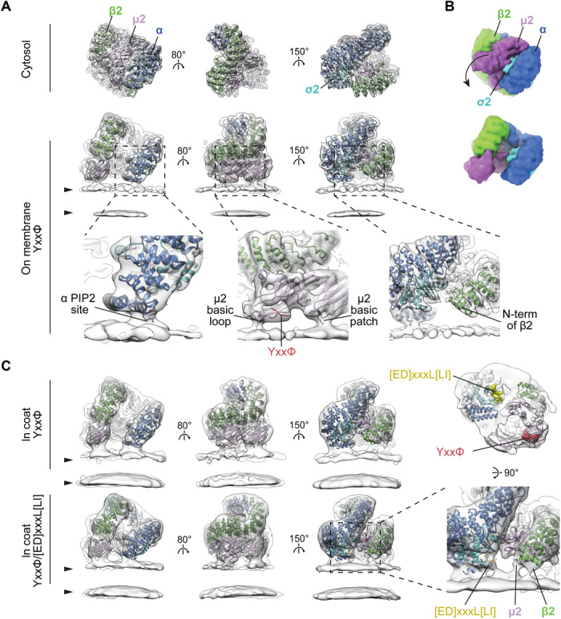

# AP2–PIP₂：膜环境中的分子互作、构象调控与多尺度研究设计

*AP2–PIP2 Interactions: Membrane Context, Conformational Regulation, and Multiscale Research Design*

从 AP2–PIP₂ 的具体膜环境出发，讨论怎样选择结合、构象、动力学和细胞功能实验。

[HTML阅读版](ap2-pip2-multiscale-research-case-study.html) · [动态成像专题](dynamic-imaging-and-time-resolved-structure.md) · [主题说明](README.md)

<a id="start"></a>

## 同样是 AP2 上膜，为什么后续表现会不同？

假设一个 AP2 突变体在膜上的荧光变弱了。接下来做什么？可以继续测结合，也可以去看构象、驻留时间或内吞。要选得有把握，得先弄清楚：膜上的分子少了，还是每个分子到膜上以后的行为变了？

AP2–PIP₂ 适合用来讨论这件事。AP2 的膜接触、货物识别和 clathrin 招募彼此牵连。一次膜结合实验能给课题一个起点；把它与构象和时间上的变化对上，才逐渐知道蛋白在这里做了什么。

我们想弄清楚的事

改变 PIP₂、货物或 FCHO 后，AP2 是更容易到达膜、更容易打开，还是停留得更久？这些变化又怎样影响 clathrin 装配？

前人已经建立了膜脂质、货物识别与 AP2 变构之间的联系，也解析了 closed、primed 和 open 等状态。做自己的课题时，可以从一个更具体的现象切入：例如在 PIP₂ 和货物都未饱和的膜上，某个位点突变仍保留膜结合，却降低了 clathrin 招募。这个差别就值得追下去。[[3]](#R03 "Höning et al. 2005 · Molecular Cell")[[4]](#R04 "Jackson et al. 2010 · Cell")[[5]](#R05 "Kelly et al. 2014 · Science")[[9]](#R09 "Partlow et al. 2022 · Nature Structural & Molecular Biology")

- [想看前人怎样选实验 从第 3 章读起，再看第 6 章怎样安排比较。](#papers)
- [正在准备课题 先看第 4、5、11 章，找适合自己材料的起点。](#route)
- [已有结果，解释还没接上 到第 9 章选一个相近情境，再回看相关方法。](#diagnose)

<a id="model"></a>

## 膜、货物和 AP2 构象是怎样联系起来的

AP2 由 α、β2、μ2、σ2 四个亚基组成。实验里常用的 AP2 core 去掉了大亚基的柔性 hinge/appendage 区域，适合拆解核心构象和货物识别；研究 clathrin 招募时，则要恢复相应功能区域。这里的 PIP₂ 指 PI(4,5)P₂，AP2 从胞质侧接触它的亲水头基。可溶的 IP₆、短链 PIP₂ 和嵌在膜里的 PIP₂，各有适合回答的问题。[[2]](#R02 "Collins et al. 2002 · Cell")[[5]](#R05 "Kelly et al. 2014 · Science")[[8]](#R08 "Kovtun et al. 2020 · Science Advances")

### 多一个膜接触，为什么会影响整个复合物？

在 closed 构象中，C-μ2 收在核心内部，货物口袋受到遮挡。AP2 打开以后，C-μ2 重新排列，货物和多个膜接触区域便能以更合适的方向共同参与结合。因此，一个头基接触可以影响整个复合物：不同构象利用膜和货物的能力不同。[[2]](#R02 "Collins et al. 2002 · Cell")[[4]](#R04 "Jackson et al. 2010 · Cell")[[8]](#R08 "Kovtun et al. 2020 · Science Advances")

第一次接触把 AP2 留在膜附近，其他位点就更有机会遇到脂质或货物。这是多价结合的一面。另一面是构象本身的取舍：各个状态能获得多少接触，又要付出多少几何和构象代价。这两方面会一起影响膜上状态的分布。

时间也在其中。AP2 短暂打开后若很快离开，货物和 clathrin 未必来得及接上；某个条件也可能让平均构象变化不大，却延长了这段相遇的时间。所以，驻留值得和构象一起测。

识别 ↔ 构象 ↔ 驻留 → 装配 → 功能

图中的关系用来安排实验。clathrin、磷酸化和膜物性还可能反过来影响前面的步骤。

| 分别看什么 | 用什么测量 | 还要一起看什么 |
| --- | --- | --- |
| **膜结合量 B** 有多少完整 AP2 与膜相关 | 浮选、共沉降；校准后的膜上荧光 | 同样的膜结合量，可以来自更快的到达，也可以来自更慢的离开，时间序列能把它们分开。 |
| **膜结合群体中的构象** p(state \| bound) | 经验证的多位点构象报告；膜上结构分类 | 膜上分子的比例变了，溶液与膜混合群体的平均信号也会变；最好单独估计膜结合群体中的状态。 |
| **驻留分布 S(t)** 到达之后能留多久 | 单分子追踪、洗脱；报告截断与漂白校正 | 除了平均寿命，还要看长寿命事件，以及脱离后再次结合的情况。 |
| **装配效率** 单位膜上 AP2 对应多少 clathrin、形成何种结构 | 双通道重构、负染/冷冻电镜、形态统计 | 同时保留 AP2 总量、clathrin/AP2 比值和膜形态，才能分清招募、装配与后续出芽。 |
| **细胞内化与通量** 有多少货物进入细胞、何时进入 | 摄取时间序列，结合表面受体池和单事件测量 | 表面受体池、循环回膜和细胞状态也会影响摄取，最好与内化时间序列一起记录。 |

**把“激活”说得具体一点**

组会上如果只说“加 PIP₂ 后 AP2 激活了”，后续实验还不好定。可以说得具体一点：“膜结合增加了；在膜结合量相近的条件下，开放态报告也有变化。接下来想看，每单位膜上 AP2 能否招募更多 clathrin。”这样就有了一个可以继续检验的问题。

<details>
<summary>closed、primed 和 open，该怎样放在一起理解</summary>

Partlow 研究中的 muniscin-engaged primed，与经典的 cargo-engaged open 有不同排列。Zaccai 则在高 PIP₂/PS 的重构膜上，无货物也观察到开放构象。读这两套结果时，值得把构建体、负电环境和辅助因子放在一起比较，看看哪些条件让不同状态容易被捕获。[[9]](#R09 "Partlow et al. 2022 · Nature Structural & Molecular Biology")[[10]](#R10 "Zaccai et al. 2022 · Science Advances")

结构间的插值动画能帮助看懂位移和旋转。若想知道分子实际怎样转换、转换有多快，还要接上时间分辨的测量；配体诱导打开和配体稳定已有开放态，也需要这类信息来区分。

</details>

<a id="papers"></a>

## 顺着论文看：一个实验之后，为什么接着做另一个

这些论文可以连着读：看作者遇到了什么问题，选了哪种实验，结果又让下一步变得怎样具体。对准备课题更有用的，往往就是这段衔接。

1999 · Journal of Cell Biology [[1]](#R01 "Gaidarov & Keen 1999 · Journal of Cell Biology")

### 先确认突变体还保持原来的结构

Gaidarov 和 Keen 把 α 亚基的磷酸肌醇结合区域与包被小窝定位联系起来。他们做了区域和点突变，也检查了 CD、蛋白酶敏感性及 clathrin 结合。定位实验告诉我们这个区域在细胞里有用；后面几项检查，则帮助判断突变后拿来比较的蛋白是否仍保持原来的结构和功能。

如果从这里安排自己的实验，我会先做少量、容易解释的电荷扰动。样品组装和稳定性接近 WT 后，再往下看膜结合。尤其值得保留的是那些还会结合膜、却改变了后续行为的突变体，它们更方便把几个步骤拆开。

2002 · Cell；2005 · Molecular Cell [[2]](#R02 "Collins et al. 2002 · Cell")[[3]](#R03 "Höning et al. 2005 · Molecular Cell")

### 有了头基结构，为什么还要把 AP2 放回膜上？

Collins 的 AP2 core–IP₆ 结构给出了潜在头基识别区域，也显示货物位点被遮挡。到 Höning 的工作，问题被放进了定义脂质和货物的膜体系：PIP₂ 怎样影响 AP2 识别货物，两种输入一起出现时又怎样？

这两种体系各解决一部分问题。可溶 IP₆ 方便研究口袋和结构；膜上则多了脂质的侧向密度、货物的锚定和接触方向。把这些条件加回来，才能看出一个结构模型在膜界面上的表现。

因此，若关心的是某个口袋如何识别磷酸化头基，可以从可溶配体入手；若关心多价膜结合，定义双层更切题。比较两套结果时，把各自的构建体、膜组成和拟合模型一起带上，K<sub>D</sub> 才有可解释的含义。

2010 · Cell [[4]](#R04 "Jackson et al. 2010 · Cell")

### 孤立 μ2 能结合货物，完整 AP2 为何受到限制？

Jackson 把 C-μ2 的大幅重排、货物口袋暴露和多个膜结合表面的重新排列放到同一个框架里。完整复合物内部的排列，决定了一个结构域本来具备的结合能力何时能用上。

遇到“孤立结构域结合很好，完整 AP2 却不同”的结果，我会先保留这段差异，沿着自抑制往下查：在完整 core 中测状态，再扰动相关接口，观察货物识别是否随之改变。结构域和完整复合物之间的差别，本身就能提供研究线索。

2014 · Science [[5]](#R05 "Kelly et al. 2014 · Science")

### 研究 clathrin 装配，需要怎样的 AP2 构建体？

Kelly 在 AP2 构建体中加入 β2 hinge，把 clathrin-binding motif 的自抑制、膜依赖释放和 coated buds 的形成接了起来。问题走到 clathrin 招募时，构建体也跟着扩展了。

这项选择很具体：core 适合研究核心开合，而下游测试需要 clathrin 结合区域。决定构建体边界时，可以从希望恢复的功能倒推，而不必一开始就追求所有区域都在。

实验上可先用 core 拆构象，再把关键条件带入具备相应 hinge/appendage 功能的构建体。测 clathrin 时，同时保留膜上 AP2 总量和 clathrin/AP2 比值：前者告诉我们招来了多少，后者帮助判断每单位 AP2 的装配表现。

2016 · Developmental Cell；2017 · Journal of Cell Biology [[6]](#R06 "Ma et al. 2016 · Developmental Cell")[[7]](#R07 "Kadlecova et al. 2017 · Journal of Cell Biology")

### 摄取下降，究竟卡在内吞的哪一步？

Ma 讨论了 FCHO/Eps15 与 AP2 的早期组织；Kadlecova 用定量活细胞分析拆开小窝的成核、稳定和成熟，看到不同 PIP₂/货物结合位点对这些阶段的影响并不相同。同一个摄取下降的终点，往前追可能对应几种不同的失败过程。

这会改变成像的重点。先把事件和追踪窗口定义好，再看起始率、寿命分布及成熟比例。那些刚出现就消失的短事件尤其值得留下：如果突变主要影响早期稳定，过滤掉它们就会漏掉最直接的表型。

2020 · Science Advances [[8]](#R08 "Kovtun et al. 2020 · Science Advances")

### 换一种货物，AP2 接触膜的方式也会变化

Kovtun 用膜重构和 cryo-ET 看 AP2 的膜上排列。在 YxxΦ 条件下能看到 α、μ2 区域的膜接触，β2 N 端则未见接触；加入酸性双亮氨酸货物后，β2 相关接触和整体几何也发生了变化。

这类结果适合用来决定下一轮换什么条件。一个正电表面是否接触膜，和当时的构象、货物呈递有关。若某个位点在一套条件下不显眼，可以根据结构换一种货物，再看接触和功能是否一起变化。



Kovtun et al., *Science Advances* (2020), Fig. 2。CC BY 4.0，原图未改动。[原文图注](https://pmc.ncbi.nlm.nih.gov/articles/PMC7375805/#F2)。A 对比溶液和膜上的排列，C 对比两种货物条件下的接触几何。图中主要分辨的是膜附近的密度与空间关系。

2022 · Nature Structural & Molecular Biology；Science Advances [[9]](#R09 "Partlow et al. 2022 · Nature Structural & Molecular Biology")[[10]](#R10 "Zaccai et al. 2022 · Science Advances")

### primed 与 open 之间，还发生了什么？

Partlow 识别出 muniscin 相关的 primed 状态，又用膜上的构象特异性交联来检验它。Zaccai 则结合 FCHO 的早期空间组织、AP2 结合和膜依赖竞争，讨论 AP2 怎样沉积到膜上，以及 FCHO 怎样被释放。

这时值得关心的是，能抓住货物的状态与进入成熟包被的状态怎样衔接，启动因子又在什么时候离开。静态结构提供了候选排列，状态报告和组分交换实验则能继续追这段过程。

比较可溶 APA 和带膜结合部分的 FCHO 时，我会同时看 AP2 的膜密度和构象。膜锚定把调节因子放在了不同的位置，也改变了接触机会。两篇文章的构建体、mimetic 和膜条件，正适合拿来逐项对照。

<details>
<summary>借用交联报告前，值得仔细看的一张图</summary>

Partlow 的 primed 交联对包含 μ2-V306C，作者讨论它可能自带激活作用。Fig. 5c 中，加入 SGIP 后的 primed 报告增量也没有达到显著。因此，使用这组报告时，要把 V306C 的作用和氧化反应效率一起考虑。三组 Cys pair 测的是各自构建体中的邻近捕获；要估计天然 WT 的状态比例，还需要校准。[对照 Fig. 5 与正文](https://pmc.ncbi.nlm.nih.gov/articles/PMC10116491/#F5)。

</details>

2025 · Communications Biology；2026 · Science Advances [[13]](#R13 "Maestro et al. 2025 · Communications Biology")[[14]](#R14 "Sloan et al. 2026 · Science Advances")

### 膜还会影响驻留和四聚体装配

Maestro 把 AP2 的模型膜吸附动力学与界面物性一起研究；Sloan 的 CCDC32 工作则显示，溶液中的装配抑制会在含 PIP₂ 的膜条件下改变。这让我们在解释“膜结合变少”时，多了两个具体问题：蛋白留得有多久，完整四聚体又有多少。

研究 CCDC32 或亚基稳定性时，四亚基比例和复合物完整性就值得优先测。若手里已经是稳定的纯化 WT 四聚体，可以继续聚焦结合与状态。界面物理也一样：先在所测单层或双层中弄清吸附和组织，再考虑怎样与细胞膜的行为相接。

<a id="entry"></a>

## 第一组实验，跟着手里的现象选

课题可以从细胞表型、纯化蛋白的结合差异，或者一个结构预测开始。手里的材料不同，第一步要解决的问题也不同。资源充足时，反而更需要选一个能解释当前现象的起点。

| 当前起点 | 我会先做什么，为什么 | 什么情况下换路线 |
| --- | --- | --- |
| 细胞里 AP2 斑点或转铁蛋白摄取下降 | 先看亚基表达与组装、表面受体池，再区分急性变化和长期适应，找出受影响的内吞阶段。 | 蛋白量先降，就先解释对象减少；蛋白量正常而早期事件受损，再带着阶段表型去做重构。 |
| 纯化突变体在脂质体上结合下降 | 把无膜蛋白背景、脂质回收、尺寸和复合物质量查清，再比较膜脂与货物条件。 | 结合恢复后构象仍不同，可追耦合；差异只出现在某种固定表面，就先查表面条件。 |
| 结构或计算给出了一个新接触 | 把接触转成完整 AP2 在膜上应有的表现，再选尽量保留其他功能的扰动。 | 测量有效而预测关系没有出现，就调整这个接触在当前条件下的解释，再决定是否继续。 |

**先让预实验回答一个具体问题**

假如准备从 SLB 开始，第一轮可以先看 WT 在非饱和条件下，对 PIP₂ 和膜锚定货物有没有可重复、可逆的响应。响应范围合适，再放入突变体；范围太窄，就先调整蛋白或脂质密度。这比一开始铺开很多位点更容易判断结果。

<details>
<summary>从零开始时，结合量和构象报告为何值得放在一起</summary>

结合量和一个独立构象报告，能先分开“到膜上的数量变了”和“膜上的状态变了”。这两个量接得上，后续选驻留、结构还是装配实验就会清楚得多。

如果细胞表型已经很明确，却同时伴随蛋白表达下降，先查亚基量和组装会更直接。第一步跟着最影响解释的那个疑问走。

</details>

<a id="environment"></a>

## 选膜模型时，先看这一步需要保留什么环境

PIP₂ 在膜里有朝向、侧向密度和流动性，AP2 还同时遇到 PS、离子和货物。选择体系时，可以先问：现在最想保留哪一种关系？口袋识别需要的环境，和观察驻留或膜形变需要的环境，往往不同。

| 体系 | 适合追的问题 | 选它时需要考虑什么 |
| --- | --- | --- |
| IP₆ / 可溶头基 / 短链脂质 | 口袋识别、可溶复合物构建、局部结构或谱学 | 利于控制可溶配体和结构。IP₆、短链脂质与 heparin 各有模拟用途；研究二维组织时，再转入完整膜。 |
| 定义组成的脂质体 | 膜偏好、货物协同、曲率和包被重构 | 双层且配方容易调整。把尺寸、层数、外叶可接近面积和脂肽方向记清楚；换配方后也要看制备是否一致。 |
| 平面 SLB / 包覆微球的 SLB | 膜密度、扩散、单分子驻留、局部组织 | 便于成像。玻璃支持会影响活动空间，平面与微球 SLB 还提供不同曲率，比较时把这些几何差别算进去。 |
| GUV / 膜管 / 可控张力膜 | 膜形变、曲率偏好、张力依赖 | 适合区分曲率感知与形变产生。制备、脂质对称性和张力校准会增加工作量，问题涉及这些量时再加入。 |
| Langmuir 单层与界面物理 | 吸附、侧向压力、界面黏弹响应 | 便于控制侧向压力和测界面响应。气–水单层与细胞脂双层的边界条件不同，密度/高度拟合也要检查可识别性。 |
| 活细胞 / 接近内源水平的 rescue | 所提机制在目标细胞环境中的贡献 | 保留伙伴、骨架与主动过程。用重构帮助拆直接作用，再在细胞中检验这项作用的贡献。 |

### 配方和制膜时，几件值得记清楚的事

先把 PIP₂ 的量说清楚。配方摩尔分数、外叶可接近密度和局部富集各有含义；wt% 换成 mol% 需要按分子量计算，总脂质量也要结合可接近面积来看。比较曲率时，脂质体半径和外叶面积都要记录。

再看负电荷背景。PC/PS 背景、PIP₂ 梯度和合适的其他磷酸肌醇对照，可以帮助区分一般静电吸引与头基识别。PS 可用于补偿名义电荷，同时记住 PIP₂ 的有效电荷还受 pH、二价离子和局部环境影响。

货物怎样露在膜外，也会改变结果。YxxΦ 与酸性双亮氨酸分别比较，记录脂肽密度、锚定和连接臂；再放入同样锚定、但 motif 失活的肽。游离货物肽适合做竞争，膜锚定货物则更适合研究二维协同。

加入组分后，顺手确认膜的制备和回收是否一致。如果要解释扩散或聚簇，再测膜流动性与脂质分布。PIP₂ 探针、荧光脂质和二价离子也会参与这个环境，低标记量和探针浓度依赖值得一起检查。

<details>
<summary>什么时候再去改变盐、二价离子和胆固醇</summary>

当假说涉及静电屏蔽、头基组织或膜物性时，再单独改变盐、Mg²⁺、Ca²⁺、温度或胆固醇。先保持其他变量一致，下一轮就容易知道哪个变化影响了结合或耦合。

盐敏感性可以提示静电作用参与；要定位接触，还得结合位点信息。胆固醇则可能同时影响有序度、脂质可接近性和组分分布，选一个与这些变化相配的测量会更有帮助。

</details>

<a id="coupling"></a>

## 货物让 AP2 上膜更多，还是让膜上的 AP2 有所不同？

货物加进去以后，膜上的 AP2 更多了。接下来值得问的是：如果把膜结合量放到相近范围，构象和 clathrin 招募还会不会不同？这项比较能帮助判断，货物的作用有多少来自分子数量，有多少发生在上膜之后。

可以先选 WT 和一个质量检查合格的位点扰动，做 PIP₂ × cargo 的 2×2 比较。找到非饱和、能看出差别的范围后，再展开 PIP₂ 或货物密度梯度。FCHO 留到这组基线清楚以后加入，会更容易解释。

| 条件 | 主要用途 | 同步记录 |
| --- | --- | --- |
| 无 PIP₂、无 cargo | 确定背景及非特异关联 | 膜相关 AP2 总量与四亚基完整性；经校准的状态报告。进入成像阶段再加到达/驻留分布，进入功能重构再加 clathrin/AP2 比值与形态。 |
| 有 PIP₂、无 cargo | 确定膜输入自身能做到什么 | 膜相关 AP2 总量与四亚基完整性；经校准的状态报告。进入成像阶段再加到达/驻留分布，进入功能重构再加 clathrin/AP2 比值与形态。 |
| 无 PIP₂、有 cargo | 检验本体系货物单独的作用与呈递 | 膜相关 AP2 总量与四亚基完整性；经校准的状态报告。进入成像阶段再加到达/驻留分布，进入功能重构再加 clathrin/AP2 比值与形态。 |
| 有 PIP₂、有 cargo | 检验两输入的联合效应 | 膜相关 AP2 总量与四亚基完整性；经校准的状态报告。进入成像阶段再加到达/驻留分布，进入功能重构再加 clathrin/AP2 比值与形态。 |

无 PIP₂ 组仍可保留定义好的 PS 背景，有货物组再配 motif 失活对照。四个条件先用来找响应发生在哪里。若某组膜结合分子太少，膜上状态比例就记为不可估计；联合组信号更高时，再看这部分增量是否仍超出结合量变化的解释。

### 几种解释，会给出怎样不同的结果？

| 可能发生的过程 | 应该看见什么 | 接下来怎样分辨 |
| --- | --- | --- |
| **更多分子上膜** | B 增加；膜结合群体中的构象与单位 AP2 装配能力可不变 | 把 B 与状态分开测，再到重叠膜密度范围比较。若变化主要跟着 B 走，就先解释招募数量。 |
| **膜上构象偏移** | 在可比较的膜结合条件下，状态报告仍随输入改变 | 换一个独立状态报告，并检查混合群体与报告化学；研究转换先后时，再加时间分辨信息。 |
| **驻留过程改变** | 构象变化不明显，但离开/长寿命尾部改变，并伴随装配机会变化 | 同时看轨迹与 clathrin 到达，检查长寿命尾部。稀少状态是否可见，还取决于时间分辨率。 |
| **空间组织或伙伴交换改变** | 平均 B 接近，但局部密度、FCHO 释放或 clathrin/AP2 改变 | 补上空间分布和组分交换测量，并检查标签多聚、非特异聚集这些会形成相似外观的因素。 |

**找到膜结合量重叠的范围，再往下比较**

补高突变体的溶液浓度，虽然能追回平均膜结合量，也会改变碰撞、溶液状态和局部簇。比较时可多取几个浓度，找出 WT 与突变体重叠的膜结合范围，并一起测局部分布和驻留。下游差异若在这个范围里持续存在，就有理由继续查上膜之后的过程。

<details>
<summary>怎样给协同作用一个清楚的定量定义</summary>

定量时先约定响应尺度，再在同批样品中估计 PIP₂×cargo 的交互项，保留原始值和不确定性。加法和比值尺度回答的问题不同，检测底限与饱和也会改变交互的外观。

热力学耦合需要平衡、可比较标准态和明确的状态/配体定义。对于定义一致的平衡常数比，可用 ΔΔG = −RT ln(耦合因子)。不同膜配方、表面密度或模型给出的 K<sub>D,app</sub>，先在各自条件下解释；多价 avidity、表面重结合和非平衡装配，也各自保留为需要描述的过程。

</details>

<a id="reporters"></a>

## 怎样选突变，才能看出各个位点的作用

位点很多时，我会先选一个同时有结构线索和功能现象的区域，做单点或小组合，再根据结果扩展。大量电荷一起去掉，容易得到膜结合明显下降的结果；少量扰动则更有机会保留一部分功能，看清 α、μ2 和 β2 在不同条件下各做什么。

| 候选扰动 | 为什么可能有信息 | 选位与样品验证 |
| --- | --- | --- |
| α N 端多碱性区域；如文献使用的 K55–K57 簇 | 有早期功能研究，可作为膜识别相关参照 | 先核对物种、isoform 和构建体，用它作为区域功能的参照；逐残基接触再结合结构细化。[[1]](#R01 "Gaidarov & Keen 1999 · Journal of Cell Biology") |
| μ2 basic loop / patch | 有膜上空间接触依据，可比较结合与构象耦合 | 2020 图注中的 loop 为 K167/Y168/R169/R170，patch 标出 K350/K367/R368。按原序列逐项核对；Y168 是 Tyr，R368 是 Arg。更大的候选集合再查各自来源。[[8]](#R08 "Kovtun et al. 2020 · Science Advances") |
| β2 N 端相关区域 | 细胞功能与不同货物下的膜几何可形成互补证据 | 把细胞功能与不同货物下的膜几何放在一起看，观察扰动是否还改变了构象接口。[[7]](#R07 "Kadlecova et al. 2017 · Journal of Cell Biology")[[8]](#R08 "Kovtun et al. 2020 · Science Advances") |
| μ2 T156、FCHO 接口或 clathrin-binding 区域 | 适合检验调控输入、状态或下游连接 | 先明确想检验的调节关系。T156E/D 与真实磷酸化分别解释；大缺失则同时检查其他接口和功能。 |

### 先想看见什么变化，再选构象报告

如果只想先看 AP2 是否离开紧闭排列，有结构依据的有限蛋白酶敏感性或交联就可以起步。配上完整性和功能参照，比较反应可及性，便能判断信号变化更接近构象变化还是局部失稳。

区分 primed 和经典 open，需要标签对在这两个状态下有不同的预期。选位时先比较几何：某一对距离在两种膜上排列里若变化很小，就换一对更能分辨的。Partlow 的三组 Cys pair 提供了设计思路，使用时仍要分别校准。[[9]](#R09 "Partlow et al. 2022 · Nature Structural & Molecular Biology")

等问题进入转换速度或路径，再考虑时间分辨 FRET / smFRET。根据结构选染料位置，检查标记完整性和膜结合功能，再看时间分辨率能否覆盖目标变化。这里的 smFRET 是后续可考虑的设计，标签组合需要用自己的构建体来建立。

<details>
<summary>借用 Partlow 的 Cys pair，怎样开始验证</summary>

Partlow 设计的三组为 closed：μ2-Y403C/β2-Y328C；primed：μ2-V306C/σ2-H96C；open：μ2-D245C/β2-T290C。沿用前核对物种、序列和构建体。无氧化剂、单 Cys 或合适背景、还原/非还原以及时间/剂量对照，可以帮助确认产物身份和反应行为。[[9]](#R09 "Partlow et al. 2022 · Nature Structural & Molecular Biology")

各对 Cys 的氧化条件和反应效率不同，产率要在各自校准后比较。保留未标记 WT、功能参照和另一种状态测量，尤其留意 V306C 可能带来的激活效应。这样才能知道信号里有多少来自我们想观察的状态，有多少来自报告设计。

</details>


<details>
<summary>rescue 之后，怎样追到具体步骤</summary>

WT rescue 恢复而位点突变 rescue 失败，可以先把这个区域和细胞功能接起来。再把同一扰动带回完整性正常的膜重构，寻找具体的结合或状态缺陷。若激活型背景能补回功能，则继续看它补回的是膜招募，还是原来受损的那一步。

</details>

**什么时候结构和局部谱学最能帮上忙**

一旦找到“结合还在，状态或下游却变了”的样品，HDX-MS、NMR 或更高分辨率结构就有了明确用途：找局部界面与远端稳定性哪里不同。要进一步讨论原子接触时，再把密度质量、分辨率和功能扰动合起来判断。

<a id="quantify"></a>

## 结合量、状态比例和驻留时间，分开来看

开放态比例是在全部 AP2 中算，还是只在膜上的分子中算？clathrin 按膜面积、AP2 数量，还是小窝数归一？这些分母决定了两组数据能比较到哪一步，最好在分析前就写下来。

### SPR/BLI：曲线里混进了哪些过程

固定脂质组成、表面负载和构建体后，先看浓度响应与洗脱曲线。多价膜结合常把表面扩散、多个接触、再结合和状态变化混在一起。可用流速或表面负载变化检查传质与重结合，再看残差和浓度依赖，决定是否适合提取 k<sub>on</sub>/k<sub>off</sub>。模型暂时接不上时，原始响应和条件依赖仍然有用。

Höning 的脂质体 SPR 和 Maestro 的单层界面测量，环境与模型各不相同。后者从界面动力学推断驻留，从中子反射的密度/厚度剖面讨论结构。这些信息可以与单分子轨迹或高分辨率结构相互参照，比较时保留各自的测量层次。[[3]](#R03 "Höning et al. 2005 · Molecular Cell")[[13]](#R13 "Maestro et al. 2025 · Communications Biology")

### 单分子驻留：怎样判断分子何时离开

分析驻留前，先约定起止、最短可见时长、轨迹连接和分析区域。成像开始前已存在的事件单独标记；拍摄结束仍在的分子作右删失处理。相邻分子合并、短暂离开后重结合和出焦，也用不同分析设置试一下，看看结论是否稳定。

**先估计漂白的影响**

在解离与漂白相互独立、都近似指数过程，且其他丢失可以忽略时：`k<sub>obs</sub> = k<sub>off</sub> + k<sub>bleach</sub>`。

降低照明强度后再比较寿命，有助于看出漂白的影响。若存在异质群体、出焦、轨迹阈值或重结合，就把这些过程纳入分析。

先看完整生存曲线、置信区间和长寿命尾部，再决定是否用多组分模型。平均寿命相同的样品，也可能给装配留下不同的时间窗口；拟合出两个指数后，则继续用独立状态信息判断它们对应什么。

### 膜上状态比例：哪些分子被留在了视野里

膜上结构和长轨迹更容易留下稳定、可分类的分子。若某条件让 closed 分子更快离开，剩下群体中的 open 比例就可能上升。因此，能联合测量时，把到达、状态和离开一起看；至少在图上写明分母是总体还是膜结合群体 p(state | bound)。

### 重复与统计：保留样品的层级

同一张膜上的很多轨迹，共享蛋白和膜的制备条件。统计时保留蛋白批次、脂质体批次、成像日、细胞和事件的层级，再选分层模型、分层 bootstrap 或先汇总后比较。样本量从预实验方差、目标差异和测量精度来估。

<details>
<summary>这些条件，最好跟着原始数据一起保存</summary>

记录构建体序列与边界、物种/isoform、标签位置、四亚基比例、磷酸化状态和蛋白/脂质批次；膜的 mol%、总量、脂肽锚定与密度、尺寸/层数、可接近面积、缓冲液/离子/温度；表面负载、观察时间、照明和追踪参数；以及归一化分母、排除规则、原始数据与拟合残差。

两批结果不一致时，通常就得回到这些记录，找出具体是哪项条件换了。

</details>

<a id="diagnose"></a>

## 遇到这些结果，下一步可以怎么做

用几种假想结果练习安排下一步。选一个接近自己情况的现象，先看哪些检查最值得做，再想可能的结果会把课题带向哪里。

<details>
<summary>A · 膜结合和构象报告一起下降</summary>

先看样品是否完整、膜回收是否一致，再检查构象报告里是否混入更多游离分子。接着在 WT 与突变体的膜结合量重叠范围内比较状态，同时留意局部密度和报告活性。

若状态差异随 B 恢复而消失，招募减少就足以解释这一组结果；若 B 相近时差异还在，则继续追状态调节。若一直找不到可比较范围，就先把两种解释都留下，换一种条件或测量方式再分。

</details>


<details>
<summary>B · 膜结合量相近，状态或装配却不同</summary>

平均 B 相近时，先看局部簇分布、hinge/appendage 是否齐全，以及突变是否直接影响了报告位置。再补一个独立状态报告，与膜上 clathrin/AP2 一起比较，需要时测组分交换。

若多种条件下都保留结合，而状态和装配持续受损，这个分离就值得继续做。若状态接近 WT、clathrin/AP2 却下降，则把重点移到下游接口可及性或伙伴竞争。

</details>


<details>
<summary>C · 构象差不多，驻留和成熟率不同</summary>

先检查时间分辨率、稀少短暂状态、漂白、出焦和轨迹连接。随后测 clathrin 相对 AP2 到达的等待时间，看留下来的事件是否更容易进入装配。

若状态相近时，延长驻留能部分恢复装配，可以继续检验“有效相遇时间”的解释。增加货物或膜密度还会同时增强多价接触，因此恢复实验里要把这几项一起测。

</details>


<details>
<summary>D · 可溶 FCHO linker 加进去没有效果</summary>

先确认 linker 稳定、能结合 AP2，再看原条件是否已让 AP2 接近饱和开放。比较可溶 APA、带膜结合部分的构建体和 AP2 接口参照时，同时记录 AP2 密度和状态。

只有膜锚定形式有效，说明定位、几何或多价组织值得往下查。若可溶 APA 在体外改变状态却救不了细胞，则回头看它在细胞中的呈递位置和作用时间。[[6]](#R06 "Ma et al. 2016 · Developmental Cell")[[9]](#R09 "Partlow et al. 2022 · Nature Structural & Molecular Biology")[[10]](#R10 "Zaccai et al. 2022 · Science Advances")

</details>


<details>
<summary>E · 体外差异明显，细胞摄取却接近正常</summary>

检查 rescue 的表达量、细胞中的货物/PIP₂ 是否接近饱和，以及摄取终点是否足够敏感。再把表达调回接近内源，比较早期事件、货物条件和亚基组装。

差异若只在低密度或特定货物下出现，就把作用放在这个环境里讨论。更合适的细胞测量仍接近正常，就先记下这套细胞条件下没有观察到功能缺陷。体外发现可以保留；若要用补偿解释，再去找具体参与的伙伴或通路。

</details>


<details>
<summary>F · 细胞表型伴随多个 AP2 亚基一起减少</summary>

先测总量、降解、四亚基比例和复合物完整性，再区分急性状态变化与长期装配/稳态变化。涉及 AAGAB/CCDC32 时，装配文献能帮助安排这一轮检查。

完整 AP2 的可用量若先下降，低膜信号就有了一个数量上的解释。之后再讨论每个复合物的结合能力。Sloan 2026 提供了 CCDC32 与膜环境调节装配的具体先例。[[14]](#R14 "Sloan et al. 2026 · Science Advances")

</details>

<a id="bridge"></a>

## 把分子层面的发现带到包被和细胞里

### 从 core 转到能招募 clathrin 的构建体

在 core 中找到结合、状态或驻留的差异后，可以把同一扰动带入具备所需 β2 功能区域的构建体。先复核原来的现象，再测 clathrin 招募和装配。这样就知道，增加功能区域后，原来观察到的关系是否还在。Kelly 的工作提供了一个具体先例。[[5]](#R05 "Kelly et al. 2014 · Science")

clathrin 总量、clathrin/AP2 比值和膜形态放在一起，能区分“招来了多少”和“装成了什么”。电镜取随机视野，约定形态分类和分母；带 neck 的 bud 先记为仍与母膜相连的出芽。若要追到游离、封闭并装载货物的囊泡，再加入相应的切断和封闭测量。

### 进入细胞后，选与重构结果对应的测量

进入细胞后，可在一个明确背景里，用接近内源水平的 WT 和突变体做 rescue。检查亚基量、组装和定位，再选择与重构结果对应的阶段：到达受损就看起始率，驻留不足就看早期消失与成熟，货物识别不同就换有依据的 cargo 条件。

转铁蛋白摄取适合做时间序列，同时分开表面结合与内化，记录受体表面池、细胞活性和回收。TIRF 中斑点消失时，则结合事件标记、轴向信息或内化测量，判断它是解聚、离开倏逝场，还是完成了后续过程；漂白也放进分析。

### 急性调节 PIP₂ 后，怎样拆出 AP2 的作用

急性招募磷酸酶能减少长期适应，适合观察脂质变化后的早期响应。配上催化失活、招募本身、脂质监测和恢复条件，留意生成的脂质及其他 PIP₂ 依赖过程。再借 AP2 特异扰动和重构，逐步拆出 AP2 的贡献。探针表达尽量低，并检查它是否缓冲了脂质。

<details>
<summary>什么时候把张力、肌动蛋白或膜纳米域加进来</summary>

如果重构能解释结合和状态，却解释不了细胞中的后续变化，或表型明显依赖基底面、张力和货物负载，就值得加入膜力学或骨架。可以先问：膜结合量相近时，机械负荷是否改变装配到内化的成功率？再选相应操控与形态/动力学测量。

共定位、聚簇或慢扩散出现后，先把结合、拥挤、交联和膜支持这些解释放在一起比较。若结果指向脂质纳米域或相分离，再增加能区分它们的测量。这样，新的组织模型就有了具体要解释的现象。

</details>

**带着同一个问题往下走**

做多尺度连接时，可以始终带着同一个扰动走：先弄清它改变哪项状态或驻留关系，再看每单位 AP2 的装配，最后看目标细胞中的对应阶段。前后几段接得上，课题的解释也会逐渐清楚。

<a id="route"></a>

## 如果现在开始，这个课题可以这样安排

假设我们想研究：AP2 的某个区域，怎样影响上膜之后的状态、驻留和 clathrin 装配。下面这套课题草案可以从定义膜体系开始，做到哪一步，再根据那一轮结果决定。

A

### 先让结合量和构象能一起测

先用 WT core、定义脂质体或 SLB，做 PIP₂×YxxΦ 基线和 motif 对照，接上一个有结构依据、经过功能校准的状态报告。

这一轮主要是找到非饱和、有响应、可重复的条件范围，让膜结合量和状态能放在一起解释。

当膜回收、AP2 完整性、背景和报告行为都清楚，不同批次也能复现响应方向，就可以加入位点扰动。若响应范围很窄，先调体系；样品不稳定，就先解决构建体和组装。

B

### 追一组能把功能分开的结果

加入一个小范围位点扰动或 FCHO 条件，在重叠的膜结合范围比较状态。差异涉及时间或局部组织时，再测驻留和膜密度分布。

这轮最值得细看的，是膜结合与下游变化不成比例的条件。若所有变化都跟着膜结合量走，也已经回答了一个问题：当前条件下，招募数量能解释多少。

选出能跨条件或批次重复的分离，用另一个报告继续确认，并检查聚集、报告化学和构建体质量。测量有效却没有差异时，可以缩小假说范围，或根据现象换一个环境再试。

C

### 看这组差异怎样影响装配和细胞

把关键扰动放入具备 β2 下游功能的构建体，测 clathrin/AP2 和膜形态。随后在目标细胞里，以接近内源的 rescue 和相应阶段测量来检验。

此时结构研究也有了更具体的用途：解释已经定位的接口，或辨认一个新的候选状态。如果前面的结果就需要结构来分清，也可以提前做。

分子、膜和细胞结果吻合，就可以把它们组织成这套条件下的机制解释。若只在重构成立，或细胞结果相反，就回到伙伴、负载与系统反馈，看看缺少了哪种环境。

### 第一轮组会，先带这几样东西来讨论

1. 眼前最想解释的关系，以及它为什么值得继续做。
2. 把膜结合量与状态或驻留分开的图，附上原始值和批次。
3. 一个仍说得通的替代解释，以及分开它们需要的观察。
4. 这一轮之后，是继续、调条件，还是换一个解释。

<details>
<summary>怎样从论文配方开始预实验</summary>

确定构建体、细胞背景和平台后，再从最接近的原始 methods/SI 提取起始配方。用预实验摸清浓度范围、方差和时间分辨率，后续工作量就比较容易估计。

</details>

<a id="transfer"></a>

## 换一个体系，哪些经验还能用

AP1–Arf1 和 epsin–PIP₂ 值得与 AP2 放在一起读。前者让我们看招募与激活怎样分工，后者把脂质结合接到了膜形变。回到 AP2 自身，NECAP 和 CCDC32 又展示了伙伴、修饰和装配环境怎样改变同一个复合物的行为。

| 案例 | 论文里发生了什么 | 做相近课题时怎么借鉴 |
| --- | --- | --- |
| **AP1–Arf1** Ren 2013 · Cell [[15]](#R15 "Ren et al. 2013 · Cell") | 结构与生化支持 Arf1-GTP 通过不同接口参与 AP1 的招募与开放，提示两种功能可被区分。 | 伙伴兼有招募和调节作用时，可分别扰动接口，再看定位与状态。迁移到新体系前，重新确认细胞器膜脂和 GTPase 的核苷酸条件。 |
| **Epsin–PIP₂** Ford 2002 · Nature [[16]](#R16 "Ford et al. 2002 · Nature") | PIP₂ 结合、ENTH 的两亲性螺旋形成及膜曲率改变被联系起来，疏水残基扰动检验膜弯曲作用。 | 研究膜形变时，把膜结合与形变一起测，尝试分开曲率感知和主动产生。epsin 的插入机制与 AP2 的复合物重排各有结构依据。 |
| **AP2–NECAP / T156** Wrobel、Partlow 2019 [[11]](#R11 "Wrobel et al. 2019 · Developmental Cell")[[12]](#R12 "Partlow et al. 2019 · eLife") | 不同研究分别将磷酸化联系到 NECAP 招募/阶段组织，以及 NECAP 依赖的 AP2 失活模型。 | 同一修饰放到不同伙伴和阶段里，作用可能不同。可以并列比较这两套体系，查清伙伴出现和状态变化的先后。 |
| **AP2–CCDC32–膜** Sloan 2026 · Science Advances [[14]](#R14 "Sloan et al. 2026 · Science Advances") | 重构中观察到溶液装配抑制和含 PIP₂ 膜条件下的装配稳定，提出环境调节装配模型。 | 多个亚基减少或半复合物积累时，先查完整 AP2 的数量。至于细胞里的最终装配位置和时序，则继续用细胞中的直接观察来回答。 |

**先想清楚，脂质在新体系里做什么**

换一个脂质–蛋白体系时，我会先问脂质在其中做什么：标记膜身份、提供接触、稳定某种构象，还是影响驻留、装配和形变？若对象变成可溶性小分子或跨膜通道，再去考虑配体耗竭、膜内分配或电流这些测量。方法就能跟着对象走。

<a id="toolbox"></a>

## 遇到具体问题，再来选方法

挑方法时，可以从眼前最缺哪项信息入手。下面把各方法的用途和起步时要处理的条件放在一起，便于需要时查。

接着读：[从显微视频到构象快照](dynamic-imaging-and-time-resolved-structure.html)。时间序列、SIM重构、高速AFM与时间分辨电镜怎样用于动态研究。

<details>
<summary>脂质体共沉降与浮选：看蛋白是否跟着膜走</summary>

先筛膜组成、货物或突变时，共沉降很方便。蛋白自聚集也会进沉淀，可加浮选作为另一种分离方式；两者都要保留无膜蛋白背景和脂质回收。

把上清、沉淀或各分层一起定量，样品少时可先做终点比较。等问题涉及到达和离开的速度，再接时间测量。

</details>


<details>
<summary>SPR / BLI：把结合和洗脱过程展开来看</summary>

SPR 有定义脂质体表面的 AP2 先例；FCHO–AP2 的蛋白相互作用也用过 BLI。选择哪一套，先看能否建立稳定、可比较的表面。[[3]](#R03 "Höning et al. 2005 · Molecular Cell")[[10]](#R10 "Zaccai et al. 2022 · Science Advances")

用参考表面、负载和传质检查来判断曲线包含哪些过程。若只想筛膜偏好，先比较响应就够；需要提取快慢过程时，再确认时间分辨率和拟合模型。

</details>


<details>
<summary>ITC / MST：从性质清楚的可溶样品起步</summary>

ITC 看热信号，在合适模型下给热力学参数；MST 看荧光分子在温度梯度中的响应。前者要考虑样品量、稀释和膜重排热，后者留意散射、吸附、荧光变化及聚集。

可溶配体、结构域或伙伴通常更容易起步。转入脂质体时，先测空白、混合和颗粒行为，再决定这套数据适合怎样的结合模型。

</details>


<details>
<summary>定点突变：从一小组容易解释的扰动开始</summary>

结构或序列给出候选区域后，先做单点或小组合，按结果决定是否扩展。K→A、K→Q、K→E 改变的化学性质不同，选哪种应当有具体理由。

SEC、四亚基比例、稳定性和保留功能一起看。SEC 接近正常后，局部构象仍值得继续查；那部分差别也可能就是课题要解释的作用。

</details>


<details>
<summary>HDX-MS：找出哪些区域的保护发生了变化</summary>

已有结合或状态差异时，HDX-MS 可以比较界面附近与远端肽段。交换减少可能涉及遮蔽、氢键或局部稳定化，把这些解释和位置一起看。

准备好摄取时间序列、肽覆盖图和回交换处理。若两组结合量差很多，先估计游离/结合群体混合带来的变化，再解释保护差异。

</details>


<details>
<summary>NMR：在合适的结构域里看局部环境</summary>

化学位移、峰强和动力学信息能帮助定位配体或伙伴引起的变化。完整 AP2 core 约 200 kDa，做常规溶液谱比小结构域困难得多。

可以从已验证可溶、折叠且保留目标行为的结构域或片段开始，再视问题考虑大复合物方案。位移变化同时结合直接接触和变构来解释；回到完整 AP2 时，还要考虑口袋是否可及。

</details>


<details>
<summary>FRET / smFRET：让标签距离对应到你关心的状态</summary>

群体 FRET 适合先看距离相关信号有没有变化；smFRET 则能进一步看异质性和转换。E ≈ 1/[1+(r/R₀)⁶] 的距离解释要结合光谱、染料取向等条件。

先检查 donor-only/acceptor-only、串色、直接激发、染料运动、漂白与功能，再把信号对到结构参照上。有了这一步，轨迹里的不同峰才更容易命名。

</details>


<details>
<summary>Cys 交联 / 有限蛋白酶：借结构设计一个状态报告</summary>

若预期状态有明显的邻近或可及性差异，可以从这两种方法起步，AP2 已有具体先例。[[9]](#R09 "Partlow et al. 2022 · Nature Structural & Molecular Biology")

确认产物身份，做时间、剂量和功能比较。稀少而短暂的状态也可能累积交联产物，因此先把产率当作捕获信号，校准后再讨论状态比例。

</details>


<details>
<summary>SAXS、单颗粒 cryo-EM、cryo-ET：按想看的环境和尺度选</summary>

SAXS 给溶液整体形状和构象集合的约束；单颗粒 cryo-EM 适合分析可用颗粒的结构状态；cryo-ET 保留膜上的空间组织。AP2 的溶液与膜上研究正好展示了这些方法怎样互补。[[4]](#R04 "Jackson et al. 2010 · Cell")[[8]](#R08 "Kovtun et al. 2020 · Science Advances")[[9]](#R09 "Partlow et al. 2022 · Nature Structural & Molecular Biology")[[10]](#R10 "Zaccai et al. 2022 · Science Advances")

研究局部接触，就看样品和密度能否达到所需分辨率；研究膜上排列，则保留膜环境。解释 SAXS 反演或颗粒分类时，同时留意多解、制样和分析筛选带来的影响。

</details>


<details>
<summary>SLB–TIRF：看分子怎样到达、停留和扩散</summary>

先确认膜连续、流动性和背景，再分清单分子与多分子事件。需要稀疏标记时，改变标记分数，同时保持总蛋白浓度一致。

终点结合解释不清时，时间和空间信息往往能帮忙。也要检查支持表面、膜缺陷、标签多聚和不可逆吸附。FRAP 可以先看流动性，单分子扩散再用相应轨迹分析。

</details>


<details>
<summary>TIRF / TIRF-SIM：追膜附近事件的时间和位置</summary>

TIRF 适合近基底膜事件，SIM 能在合适条件下提高空间分辨率。FCHO/AP2 的早期组织提供了具体案例。[[7]](#R07 "Kadlecova et al. 2017 · Journal of Cell Biology")[[10]](#R10 "Zaccai et al. 2022 · Science Advances")

普通 TIRF 若已能分开目标阶段，先把事件分析做好；空间上还分不开时再升级。双通道注意配准、同步、点扩散函数和表达量，直接结合则接上分子层面的证据。

</details>


<details>
<summary>AFM / 中子反射 / Langmuir / 界面流变：把膜的响应也测出来</summary>

这些方法分别看形貌与力学、法向密度剖面、表面压力和界面黏弹性。Maestro 的 AP2 工作把它们用于吸附和膜组织问题。[[13]](#R13 "Maestro et al. 2025 · Communications Biology")

现象涉及这些物理量时，可以合作引入。AFM 留意探针和支持条件，反射拟合检查可识别性；单层里的网络行为，再通过合适的双层或细胞实验去衔接。

</details>


<details>
<summary>摄取 / 流式 / rescue：看细胞中的后果</summary>

接近内源的 rescue 配合摄取与流式，可以看细胞内化和群体差异。用时间序列分开表面池与内化，并记录细胞活性和受体表达。

重构提示哪一步受影响，细胞里就优先追哪一阶段。终点同时考虑回收和受体量；要解释直接结合、构象或装配，再接回对应的分子测量。

</details>


<details>
<summary>结构预测、静电分析与模拟：帮忙选位和形成预测</summary>

这些方法适合比较状态几何、选择标签和扰动位点，也能帮助提出脂质、盐或曲率依赖的预测。

把蛋白状态、脂质参数、质子化、离子和采样范围写清楚，再把预测带回完整对象检验。预测接触、天然亲和力、占据率和动力学各需要相应证据。

</details>

<a id="notebook"></a>

## 把自己的问题和下一步记下来

把自己体系里的条件和疑问填在下面，方便下一次讨论时接着想。笔记会保存在当前浏览器，也可以导出 Markdown 留档。

我的 AP2–PIP₂ 研究卡

```text
研究对象和环境：物种、isoform、构建体、膜模型、货物、辅助因子。

我现在手里的现象：测到了什么，怎样归一，哪些条件已经确认？

我最想解释的一步：哪个变化怎样影响了后续过程？

还有哪些解释说得通：数量、构象、驻留、空间组织、四聚体装配，或其他。

下一项实验：为什么选它？结果不同，我会怎样接着做？

如果没有差异：是检测能力不够，条件不合适，还是需要调整原来的解释？

做到什么程度，值得进入下一个尺度？

还需要回去细读的论文方法、补充材料和具体问题：
```

<a id="references"></a>

## 带着自己的问题，再回去读这些论文

想先理清整体机制，可以顺着 Jackson、Kelly、Kovtun 读，再看 Partlow 和 Zaccai 怎样处理状态与启动因子。从细胞表型出发，Kadlecova 的阶段分析更容易上手；关心亚基稳态和装配，再读 Sloan。

每篇后面附了阅读范围，方便继续往下查。具体实验配方、构建体序列和分析参数，值得结合自己的材料细读原始方法与补充材料。

1. <a id="R01"></a>**Gaidarov & Keen · 1999 · *Journal of Cell Biology***

   Phosphoinositide–AP-2 interactions required for targeting to plasma membrane clathrin-coated pits

   [原始来源](https://pmc.ncbi.nlm.nih.gov/articles/PMC2156139/) · [DOI: 10.1083/jcb.146.4.755](https://doi.org/10.1083/jcb.146.4.755)

   阅读：突变、完整性检查与细胞定位相关正文。
2. <a id="R02"></a>**Collins et al. · 2002 · *Cell***

   Molecular architecture and functional model of the endocytic AP2 complex

   [原始来源](https://pubmed.ncbi.nlm.nih.gov/12086608/) · [DOI: 10.1016/S0092-8674(02)00735-3](https://doi.org/10.1016/S0092-8674(02)00735-3)

   阅读：摘要、书目信息；主文与补充材料未完整取得。
3. <a id="R03"></a>**Höning et al. · 2005 · *Molecular Cell***

   Phosphatidylinositol-(4,5)-bisphosphate regulates sorting signal recognition by the clathrin-associated adaptor complex AP2

   [原始来源](https://pubmed.ncbi.nlm.nih.gov/15916959/) · [DOI: 10.1016/j.molcel.2005.04.019](https://doi.org/10.1016/j.molcel.2005.04.019)

   阅读：摘要、出版社公开的膜重构与SPR结果段。
4. <a id="R04"></a>**Jackson et al. · 2010 · *Cell***

   A large-scale conformational change couples membrane recruitment to cargo binding in the AP2 clathrin adaptor complex

   [原始来源](https://pmc.ncbi.nlm.nih.gov/articles/PMC3655264/) · [DOI: 10.1016/j.cell.2010.05.006](https://doi.org/10.1016/j.cell.2010.05.006)

   阅读：结构重排、膜结合与货物相关正文及方法。
5. <a id="R05"></a>**Kelly et al. · 2014 · *Science***

   AP2 controls clathrin polymerization with a membrane-activated switch

   [原始来源](https://pmc.ncbi.nlm.nih.gov/articles/PMC4333214/) · [DOI: 10.1126/science.1254836](https://doi.org/10.1126/science.1254836)

   阅读：构建体及Fig. 2至4相关正文、图注。
6. <a id="R06"></a>**Ma et al. · 2016 · *Developmental Cell***

   Transient Fcho1/2·Eps15/R·AP-2 nanoclusters prime the AP-2 clathrin adaptor for cargo binding

   [原始来源](https://pmc.ncbi.nlm.nih.gov/articles/PMC4921775/) · [DOI: 10.1016/j.devcel.2016.05.003](https://doi.org/10.1016/j.devcel.2016.05.003)

   阅读：摘要与公开结果概述。
7. <a id="R07"></a>**Kadlecova et al. · 2017 · *Journal of Cell Biology***

   Regulation of clathrin-mediated endocytosis by hierarchical allosteric activation of AP2

   [原始来源](https://pmc.ncbi.nlm.nih.gov/articles/PMC5223608/) · [DOI: 10.1083/jcb.201608071](https://doi.org/10.1083/jcb.201608071)

   阅读：摘要、讨论及细胞阶段分析相关文字。
8. <a id="R08"></a>**Kovtun et al. · 2020 · *Science Advances***

   Architecture of the AP2/clathrin coat on the membranes of clathrin-coated vesicles

   [原始来源](https://pmc.ncbi.nlm.nih.gov/articles/PMC7375805/) · [DOI: 10.1126/sciadv.aba8381](https://doi.org/10.1126/sciadv.aba8381)

   阅读：膜重构正文、图注；查看了Fig. 2原图。图像许可为CC BY 4.0。
9. <a id="R09"></a>**Partlow et al. · 2022 · *Nature Structural & Molecular Biology***

   Structural basis of an endocytic checkpoint that primes the AP2 clathrin adaptor for cargo internalization

   [原始来源](https://pmc.ncbi.nlm.nih.gov/articles/PMC10116491/) · [DOI: 10.1038/s41594-022-00749-z](https://doi.org/10.1038/s41594-022-00749-z)

   阅读：primed、货物释放和SLB交联正文；查看了Fig. 5原图。
10. <a id="R10"></a>**Zaccai et al. · 2022 · *Science Advances***

    FCHO controls AP2’s initiating role in endocytosis through a PtdIns(4,5)P₂-dependent switch

    [原始来源](https://pmc.ncbi.nlm.nih.gov/articles/PMC9054013/) · [DOI: 10.1126/sciadv.abn2018](https://doi.org/10.1126/sciadv.abn2018)

    阅读：FCHO时空组织、膜竞争、构建体与讨论相关正文及图注。
11. <a id="R11"></a>**Wrobel et al. · 2019 · *Developmental Cell***

    Temporal ordering in endocytic clathrin-coated vesicle formation via AP2 phosphorylation

    [原始来源](https://pmc.ncbi.nlm.nih.gov/articles/PMC6706699/) · [DOI: 10.1016/j.devcel.2019.07.017](https://doi.org/10.1016/j.devcel.2019.07.017) · [2020作者更正](https://pmc.ncbi.nlm.nih.gov/articles/PMC7063567/)

    阅读：书目信息、公开摘要及结果片段。2020年的更正补列了作者。
12. <a id="R12"></a>**Partlow et al. · 2019 · *eLife***

    A structural mechanism for phosphorylation-dependent inactivation of the AP2 complex

    [原始来源](https://elifesciences.org/articles/50003) · [DOI: 10.7554/eLife.50003](https://doi.org/10.7554/eLife.50003)

    阅读：摘要、公开结果概述及图注。
13. <a id="R13"></a>**Maestro et al. · 2025 · *Communications Biology***

    Combined thermodynamic and time-resolved structural analysis of interactions between AP2 and biomimetic plasma membranes provides insights into clathrin-mediated endocytosis

    [原始来源](https://www.nature.com/articles/s42003-025-08597-5) · [DOI: 10.1038/s42003-025-08597-5](https://doi.org/10.1038/s42003-025-08597-5)

    阅读：摘要、结果、讨论与相关方法文字。
14. <a id="R14"></a>**Sloan et al. · 2026 · *Science Advances***

    CCDC32 collaborates with the membrane to assemble the AP-2 clathrin adaptor complex

    [原始来源](https://pmc.ncbi.nlm.nih.gov/articles/PMC13267310/) · [DOI: 10.1126/sciadv.aeb2377](https://doi.org/10.1126/sciadv.aeb2377)

    阅读：摘要及装配、膜结合相关正文和图注。
15. <a id="R15"></a>**Ren et al. · 2013 · *Cell***

    Structural basis for recruitment and activation of the AP-1 clathrin adaptor complex by Arf1

    [原始来源](https://pmc.ncbi.nlm.nih.gov/articles/PMC3913725/) · [DOI: 10.1016/j.cell.2012.12.042](https://doi.org/10.1016/j.cell.2012.12.042)

    阅读：摘要，以及讨论中区分招募与激活的段落。
16. <a id="R16"></a>**Ford et al. · 2002 · *Nature***

    Curvature of clathrin-coated pits driven by epsin

    [原始来源](https://www.nature.com/articles/nature01020) · [DOI: 10.1038/nature01020](https://doi.org/10.1038/nature01020)

    阅读：摘要和公开图注。

<details>
<summary>阅读范围，以及动手前还要查什么</summary>

这里的讨论来自各篇列出的相关段落和图注，其中 Kovtun Fig. 2、Partlow Fig. 5 查看了原图；其余图表、原始数据和补充材料尚未逐项复评。局部阅读适合帮助选下一步，具体参数和定量比较还应回到对应方法。

第9章用假想情境练习判读，第11章是一套尚未执行的课题草案。选定具体扰动和环境后，再检索相关研究，确认已有工作做到哪里。文献检索日期为2026-11-20，覆盖的是这组问题相关的工作。

</details>
