

# 细胞膜运输：膜融合、胞吞胞吐与受体介导胞吞

从脂质双层的拓扑变化出发，追踪囊泡如何形成、移动、融合、切割和分选；重点解释受体介导胞吞过程中，质膜、胞质溶胶、脂质、离子、细胞骨架与内体腔环境如何在空间和时间上协同改变。

**核心问题 1 · 膜拓扑**：两张膜怎样形成连续结构？一张连续膜又怎样切割成囊泡？

**核心问题 2 · 局部环境**：脂质、蛋白、Ca²⁺、ATP/GTP、pH、张力和骨架如何变化？

**核心问题 3 · 货物命运**：受体如何被选中，内吞后为什么有的回收、有的降解？

论文图增强版：本页为适合 GitHub 阅读的 Markdown。所有论文图随本目录保存；HTML 版另提供目录搜索和原图放大。原图保持完整图版，中文说明区分原始研究图与综述模型。

## 学习目标、术语边界与阅读方式

先明确本资料讨论什么，不把不同层级的过程混为一谈。

本资料围绕一条连续的机制主线展开：一般膜融合与胞吐 → 胞吞的反向膜形变 → 受体介导、尤其是网格蛋白介导的胞吞（CME）→ 内体成熟与货物分选。

**重要的术语区分**：“受体介导胞吞（RME）”按货物如何被选择来定义；“网格蛋白介导胞吞（CME）”按膜运输机器如何组织来定义。两者高度重叠，但不是同义词。许多经典 RME 由 CME 执行；也有受体进入非网格蛋白介导的内吞途径。

本版用经过图注和来源核查的论文图替换主要简易示意，并补上实验对象、面板读法和推断边界。只保留一幅膜方向辅助图。论文中的机制模型、测量校准、结构快照和动态实验各有用途；图像真实来源于论文，并不自动意味着某一机制已被直接看见。

#### Known · 已有坚实证据

膜双层拓扑、SNARE 介导融合、AP2/网格蛋白装配、Dynamin 参与部分 CME 裂变、内体分选。

#### Conditional · 依条件变化

肌动蛋白的必要性、内吞位点寿命、融合孔是否扩张、受体回收或降解比例。

#### Open · 仍在研究

膜裂变的精确物理路径、融合孔 flickering 的结构机制、膜张力与蛋白网络的定量耦合。

## 论文图阅读地图

按机制定位原图，再看实验究竟测量了什么。

17 幅论文图 · 13 幅原始研究图 · 4 幅综述模型图 · 1 幅方向辅助图 · 全部图片随资料保存

建议先看融合、胞吐与 CME 总览，再沿 AP2 → 包被曲率 → actin → Dynamin → 脱包被 → 内体分选阅读。原始研究图也可能含模型面板；中文说明会明确哪些是测量，哪些是解释。

#### 论文图索引

| 图号 | 主题 | 证据形式 | 出处 |
| --- | --- | --- | --- |
| [P01](#paper-fusion-model) | [膜融合的近端单层、半融合与融合孔](#paper-fusion-model) | 综述机制模型 | Frontiers in Molecular Neuroscience · 2017 · Figure 1 |
| [P02](#paper-fusion-schwenen-3) | [双通道单囊泡融合：把显微图像与脂质荧光轨迹对应起来](#paper-fusion-schwenen-3) | 原始研究：体外重构、双通道共聚焦时间序列 | Scientific Reports · 2015 · Figure 3 |
| [P03](#paper-exo-liu-6) | [活细胞胞吐：双标记荧光突增与超分辨融合孔环状结构](#paper-exo-liu-6) | 原始研究：INS-1 活细胞、TIRF 与 Hessian-SIM | Nature Communications · 2021 · Figure 6 |
| [P04](#paper-coat-em) | [电镜中的平坦、穹顶与圆形包被](#paper-coat-em) | 原始研究 · dSTORM / 铂复型 TEM | Nature Communications · 2018 · Figure 1 |
| [P05](#paper-cme-map) | [CME 的分子机器与阶段全景](#paper-cme-map) | 综述机制模型 | Frontiers in Aging Neuroscience · 2024 · Figure 1 |
| [P06](#paper-cargo-map) | [跨膜货物如何与胞质侧接头连接](#paper-cargo-map) | 综述机制模型 | Frontiers in Molecular Biosciences · 2017 · Figure 1 |
| [P07](#paper-cme-fcho-1) | [内吞位点的脂质与货物环境：FCHo2 使受体附近的 PIP₂ 信号重新聚集](#paper-cme-fcho-1) | 原始研究：去顶细胞膜片重构、Airyscan/共聚焦成像与细胞过表达对照 | eLife · 2022 · Figure 1 |
| [P08](#paper-coat-dynamics) | [装配与弯曲存在不同的时间关系](#paper-coat-dynamics) | 原始研究 · 活细胞偏振 TIRF | Nature Communications · 2018 · Figure 3 |
| [P09](#paper-actin-storm) | [内吞位点的网格蛋白与 actin 三维组织](#paper-actin-storm) | 原始研究 · 双色三维 STORM | Molecular Biology of the Cell · 2022 · Figure 1 |
| [P10](#paper-cme-dynamin-4) | [Dynamin–amphiphysin 的真实膜裂变：高速 AFM 时间序列](#paper-cme-dynamin-4) | 原始研究：体外脂质膜管、dynamin–amphiphysin 重构与高速 AFM | eLife · 2018 · Figure 4 |
| [P11](#paper-cme-uncoat-4s1) | [壳消失、膜囊泡保留：酶促脱包被的负染电镜证据](#paper-cme-uncoat-4s1) | 原始研究：小鼠脑来源包被囊泡、体外脱包被与负染电子显微镜 | eLife · 2018 · Figure 4—figure supplement 1 |
| [P12](#paper-endo-podinovskaia-1) | [Rab5→Rab7 转换：在同一个扩大内体上追踪膜身份变化](#paper-endo-podinovskaia-1) | 原始研究：HeLa 活细胞双通道时间序列 | eLife · 2021 · Figure 1 |
| [P13](#paper-escrt-wenzel-3) | [EGFR 进入腔内囊泡：电镜、三维断层与 ESCRT 招募动力学](#paper-escrt-wenzel-3) | 原始研究：HeLa 金标 EGFR 电镜、电子断层与活细胞成像 | Nature Communications · 2018 · Figure 3 |
| [P14](#paper-mt-flores-1) | [微管与动力蛋白支持内体运动：用扰动条件检验真实运输轨迹](#paper-mt-flores-1) | 原始研究：HeLaM 活细胞 GFP-Rab5 内体成像与自动粒子追踪 | PLOS ONE · 2011 · Figure 1 |
| [P15](#paper-tfr-rossatti-1) | [TfR 回收可被细胞状态迅速调节：抗体预标记与流式定量](#paper-tfr-rossatti-1) | 原始研究：预标记/表面封闭/流式细胞术定量回收 | BMC Biology · 2022 · Figure 1 |
| [P16](#paper-ldlr-map) | [LDLR 回收与 LDL 降解的分流](#paper-ldlr-map) | 综述机制模型 | Frontiers in Cell and Developmental Biology · 2022 · Figure 1 |
| [P17](#paper-coat-calibration) | [先校准弯曲读出，再解释动态曲线](#paper-coat-calibration) | 原始研究 · 偏振 TIRF / TEM / AFM | Nature Communications · 2018 · Figure 2 |

## 膜拓扑：先把“内侧、外侧、腔内”说清楚

胞吞胞吐最容易混乱的地方不是蛋白名称，而是空间方向。

动物细胞质膜是一张脂质双分子层。它有两个单层（leaflets）：非胞质侧单层朝向细胞外；胞质侧单层朝向胞质溶胶。膜内嵌有跨膜蛋白，膜表面还结合外周膜蛋白。糖萼位于细胞外侧。动物细胞没有植物细胞那样的细胞壁。

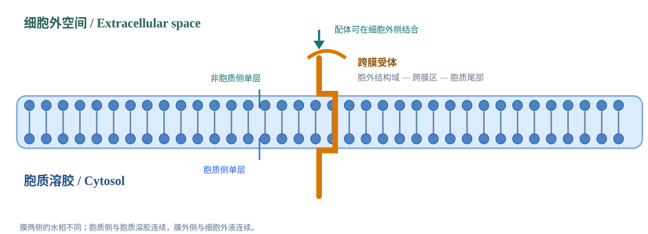

辅助图 T1. 质膜横截面概念图。实际膜由多种脂质、胆固醇、跨膜/外周蛋白和糖基化组分构成；两侧单层具有不对称组成。

**拓扑守恒原则**：胞吞、胞吐改变膜的连接方式，但在通常的囊泡运输中，膜的朝向保持：胞质侧仍朝胞质；非胞质侧仍朝囊泡腔或细胞外。胞吞囊泡腔来自细胞外空间；分泌囊泡腔与细胞外空间在融合后连通。

### 三个必须区分的“内部”

- **胞质（cytoplasm）**：胞质溶胶加上细胞器、细胞骨架等内容。
- **胞质溶胶（cytosol）**：膜性细胞器之外的连续水相，位于质膜胞质侧。
- **囊泡腔 / 内体腔（lumen）**：被膜包围的非胞质空间，不等于胞质溶胶。

## 膜融合：两张独立脂质双层如何变成一张连续膜？

膜融合是拓扑变化与能量障碍跨越，不是“蛋白识别后两层膜粘在一起”。

以分泌囊泡与质膜融合为例。两张膜相互靠近时，囊泡外侧（胞质侧）面对质膜的胞质侧。融合过程需要克服膜间水化排斥、脂质头基重排和膜弯曲能等障碍。SNARE 复合物的组装及其辅助因子提供了重要自由能来源，但最终路径受到脂质组成、膜张力、Ca²⁺ 和其他调控因子影响。

#### 图 P01 · 膜融合的近端单层、半融合与融合孔

*综述机制模型*

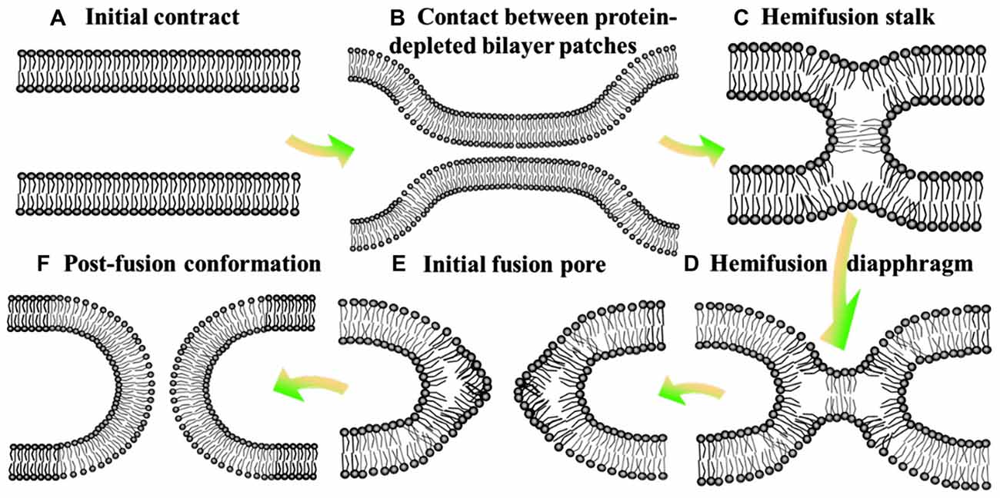

**读图：** 按 A→F 看接触、去蛋白脂质区、融合茎、半融合盘、初始融合孔和融合后形态。C、D 的连接关系可用于辨别近端与远端单层。

**这张图帮助建立什么：** 脂质混合与腔内容物连通是不同层次的事件。

**读图边界：** 这是经典路径的模型图；不能据图断言所有细胞融合均经历可检测的半融合盘。

来源：Zhiwei Yang et al. · *Frontiers in Molecular Neuroscience* (2017) · 原文 Figure 1。Membrane Fusion Involved in Neurotransmission: Glimpse from Electron Microscope and Molecular Simulation。 [DOI: 10.3389/fnmol.2017.00168](https://doi.org/10.3389/fnmol.2017.00168) · [论文全文与图注](https://www.frontiersin.org/journals/molecular-neuroscience/articles/10.3389/fnmol.2017.00168/full) · [CC BY 4.0](https://creativecommons.org/licenses/by/4.0/)。完整原图，未改绘。

#### 图 P02 · 双通道单囊泡融合：把显微图像与脂质荧光轨迹对应起来

*原始研究：体外重构、双通道共聚焦时间序列*

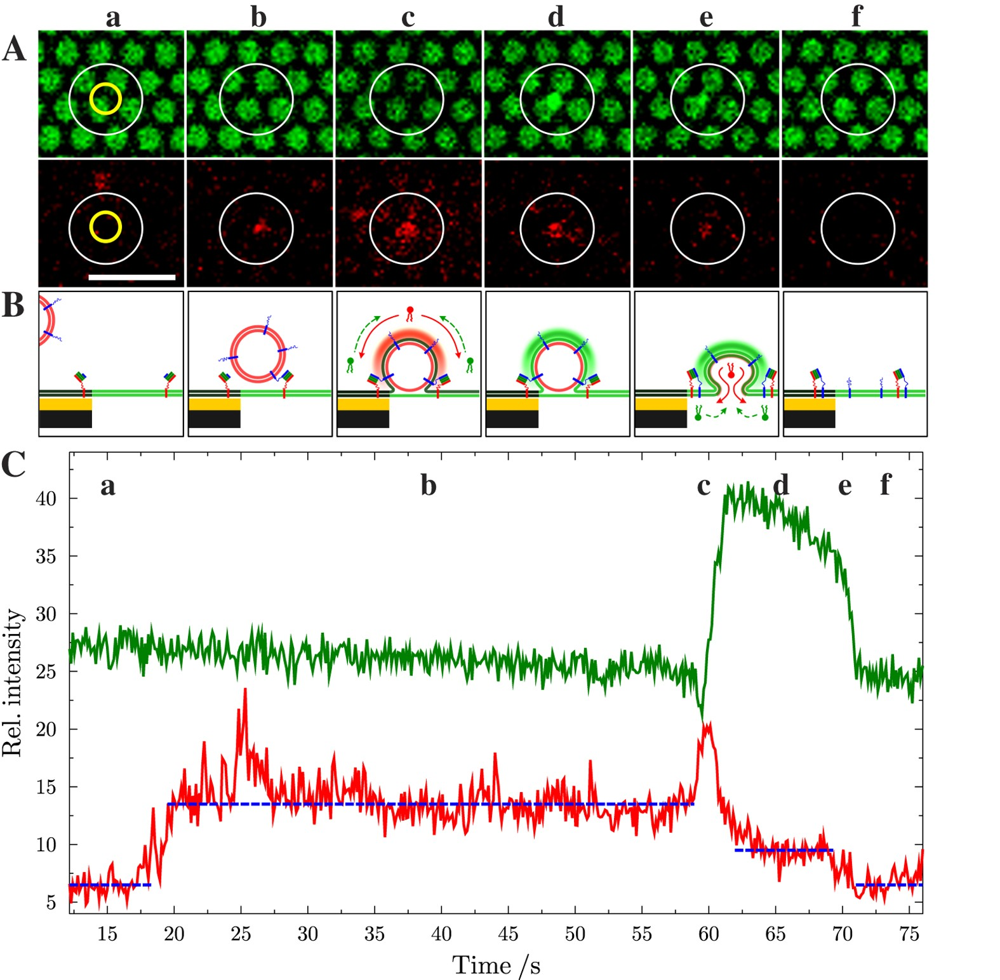

**读图：** A：上排绿色为孔跨膜中的 Oregon Green DHPE，下排红色为含 synaptobrevin 2 囊泡中的 Texas Red DHPE；a–f 对应同一事件的不同时间点，比例尺 5 μm。B 是作者据荧光变化提出的状态模型，并非直接看到的纳米结构。C 将绿色/红色信号随时间变化与 A 的图像配对，区分停靠、脂质混合相关中间状态与最终信号消散。

**这张图帮助建立什么：** 相对于单张图像，双通道时间序列能把“已靠近膜”和“发生脂质交换”分开，帮助理解融合研究如何构建证据链。

**读图边界：** 这是 SNARE 蛋白重构的人工膜体系；脂质荧光、FRET 与扩散共同影响读出。本图不是水溶性内容物释放的直接测量，也不是纳米级半融合结构的直接成像。

来源：Lando L. G. Schwenen, Raphael Hubrich, Dragomir Milovanovic et al. · *Scientific Reports* (2015) · 原文 Figure 3。Resolving single membrane fusion events on planar pore-spanning membranes。 [DOI: 10.1038/srep12006](https://doi.org/10.1038/srep12006) · [论文全文与图注](https://www.nature.com/articles/srep12006) · [CC BY 4.0](https://creativecommons.org/licenses/by/4.0/)。完整原图，未改绘。

**从模型走向读出：**：先用论文模型识别单层与水相，再用真实双通道时间序列区分停靠、脂质混合及荧光消散。单个读出能支持到哪里，见每图的说明。

### 2.1 四个单层（leaflets）是理解融合的关键

两张双层膜相遇时，共有四个单层。最初相互接近的是两张膜彼此相邻的“近端单层”（proximal leaflets）；远离界面的则是“远端单层”（distal leaflets）。经典半融合状态中，近端单层已连通并发生脂质混合，而远端单层仍未形成完整连通。此时囊泡腔与细胞外空间尚未通过水相通道连通。

### 2.2 融合孔形成意味着什么？

融合孔是连通两个非胞质水相的通道；孔边缘的脂质与蛋白组成、初始孔结构及后续扩张方式依体系而异，需结合结构与功能证据判断。囊泡腔与细胞外空间连通，水溶性货物可以从囊泡腔释放。它不是胞质流入囊泡的洞，因为胞质位于膜的胞质侧，而融合孔连通的是两侧的非胞质水相。

### 2.3 SNARE 提供什么？

以神经分泌为例，囊泡 SNARE（如 VAMP/synaptobrevin）与质膜 SNARE（如 Syntaxin-1、SNAP-25）组装成跨膜 SNARE 复合物。SNARE motif 的逐步“拉链化”把两张膜拉近，配合 Munc18、Munc13、Synaptotagmin 等调控因子，帮助跨越膜间能量障碍。融合后，SNARE 位于同一张膜上形成 cis-SNARE 复合物，α-SNAP 协助 NSF 利用 ATP 使其拆解、重置，以供下一轮使用。

**机制边界：SNARE 不是一把分子剪刀**：它们的核心作用是膜靠近与促进融合能垒跨越；膜本身的脂质重排才构成双层拓扑转变。融合孔开启、扩张、收缩和闭合的精细机制仍在研究中。

### 2.4 脂质组成为什么重要？

| 脂质 / 组分 | 典型特征 | 与膜形态 / 融合的关系 |
| --- | --- | --- |
| PC（磷脂酰胆碱） | 常见结构磷脂，头基相对较大 | 提供膜双层主体；具体作用依脂肪链而变 |
| PE（磷脂酰乙醇胺） | 头基较小，常表现出锥形倾向 | 可影响自发曲率与融合中间态形成 |
| PS（磷脂酰丝氨酸） | 带负电，常富集在胞质侧 | 参与胞质侧蛋白结合和膜电荷环境 |
| PI / PIP₂ / PI(3)P | 可被激酶、磷酸酶快速转换的信号脂质 | 为不同膜区室提供分子身份与蛋白募集位点 |
| 胆固醇 | 调节脂质有序性和膜力学性质 | 影响膜厚度、流动性、弯曲和蛋白功能环境 |

脂质不对称性也很重要：典型质膜的胞质侧相对富集 PS、PE 和磷脂酰肌醇类，外侧相对富集 PC、鞘磷脂和糖脂。实际分布随细胞类型、膜区室和生理状态变化，不能把简化组成表当作每个膜区域的固定配方。

## 胞吐：融合后膜、胞质和细胞骨架分别发生什么？

从囊泡到质膜的融合不是物质“穿膜”，而是两个非胞质腔面连通。

### 3.1 融合时胞质会不会流进囊泡？

不会。融合孔连接囊泡腔和细胞外液；胞质始终位于膜的胞质侧。融合后，囊泡膜整合进质膜，原囊泡腔变成与细胞外连通的空间。若完全塌陷，囊泡膜面积并入质膜；若是 kiss-and-run，融合孔短暂开放后关闭，囊泡可保持相对独立并重新回收。

#### 图 P03 · 活细胞胞吐：双标记荧光突增与超分辨融合孔环状结构

*原始研究：INS-1 活细胞、TIRF 与 Hessian-SIM*

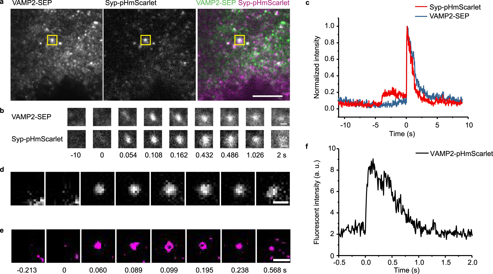

**读图：** a–c：INS-1 细胞中 VAMP2-SEP（绿色）与 Syp-pHmScarlet（品红）双标记同一融合事件，显微时间序列与强度曲线显示同步突增；a 比例尺 5 μm，b 比例尺 0.5 μm。d–f：VAMP2-pHmScarlet 标记的另一事件，宽场 TIRF 与 Hessian-SIM 对照；e 的超分辨时间序列可分辨瞬时环状信号，f 为相应强度变化。

**这张图帮助建立什么：** 融合孔开放使酸性囊泡腔与胞外环境连通，pH 敏感标记因去淬灭变亮；分辨率提高后，同一类胞吐事件可以从“亮点”进一步辨认为具有空间结构的融合中间状态。

**读图边界：** 环状结构是经 SIM 重建后可分辨的较大孔形态，不能据此看见所有初始纳米孔。荧光随后衰减还会受膜蛋白扩散、重新酸化和成像条件影响，不能单独判定完全塌陷或 kiss-and-run；INS-1 的观察也不能无条件推广到所有分泌细胞。

来源：Anyuan Liu, Xiaoshuai Huang, Wenting He et al. · *Nature Communications* (2021) · 原文 Figure 6。pHmScarlet is a pH-sensitive red fluorescent protein to monitor exocytosis docking and fusion steps。 [DOI: 10.1038/s41467-021-21666-7](https://doi.org/10.1038/s41467-021-21666-7) · [论文全文与图注](https://www.nature.com/articles/s41467-021-21666-7) · [CC BY 4.0](https://creativecommons.org/licenses/by/4.0/)。完整原图，未改绘。

### 3.2 融合后的膜成分如何变化？

- 囊泡膜脂质进入质膜，随后在膜平面内侧向扩散；但扩散不意味着瞬间均匀化。
- 囊泡膜蛋白（如 VAMP）进入质膜，可能受膜微区、细胞骨架、蛋白相互作用及后续内吞限制。
- 质膜面积短暂增加；之后可经内吞、膜储库展开/收缩或其他膜运输机制调整。
- 不同脂质的跨膜分布可能由 flippase、floppase 或 scramblase 改变，但这并非每次融合必然出现。

### 3.3 分泌蛋白从合成到胞外：内膜系统如何串联？

以经典可分泌蛋白为例：具有信号肽的新生多肽在翻译过程中被导向粗面内质网并进入内质网腔；蛋白质在内质网中折叠、形成二硫键并接受初步修饰；随后通过 COPII 相关出芽载体离开内质网，经 ER-Golgi intermediate compartment 等路线到达高尔基体；在高尔基体不同区域进一步加工，最后由反面高尔基网络（TGN）分选至质膜、分泌颗粒或其他目的地。囊泡到达质膜后，才进入前述停靠、SNARE 组装和膜融合步骤。

粗面内质网 合成 / 折叠 → COPII 载体 ER 输出 → 高尔基体 加工 / 修饰 → TGN 分选 确定目的地 → 分泌囊泡 运送 / 融合

这条路线也体现了膜拓扑守恒：内质网腔、高尔基体腔和运输囊泡腔在膜拓扑上彼此对应；分泌囊泡与质膜融合后，囊泡腔与细胞外空间连通。可溶性分泌蛋白无需穿越每一张脂质双层。跨膜蛋白则在整个过程中保持其胞质侧与非胞质侧朝向。

### 3.4 胞质侧局部环境变化

#### Ca²⁺ 微域

在神经分泌等调控性胞吐中，电压门控 Ca²⁺ 通道开启可产生局部 Ca²⁺ nanodomain；Synaptotagmin 感知 Ca²⁺ 并促进融合。不是所有胞吐都以相同 Ca²⁺ 机制触发。

#### ATP / GTP 循环

NSF 利用 ATP 拆解 cis-SNARE；Rab GTPase 在 GTP/GDP 状态之间循环，参与膜区室识别和运输调控。ATP/GTP 消耗不等于胞质整体能量浓度显著下降。

#### 膜脂信号

PIP₂ 等脂质可在胞质侧招募膜结合蛋白、肌动蛋白调控因子和内吞机器；融合后的局部脂质组成会影响后续内吞和膜重塑。

#### 皮层骨架

质膜下 F-actin 可构成运输障碍，也可帮助局部定位、融合后结构稳定和膜回收。局部重塑的程度取决于细胞类型和生理状态。

**别把胞吐理解为“囊泡膜全都摊平”**：Full-collapse fusion 与 kiss-and-run 等模式并存；融合孔也可能经历开放、扩张、收缩或重新闭合。融合孔动态的细节仍是研究前沿。[B1,B2]

## 胞吞：从连续质膜到独立囊泡

胞吞不是胞吐的简单倒放；它需要膜弯曲、货物分选、颈部形成和膜裂变。

### 4.1 为什么胞吞需要一个“选货”系统？

细胞膜上有大量不同受体、通道和黏附分子。若完全随机吞入，细胞就无法控制哪些受体内化、哪些继续留在表面。受体胞质尾部的分选基序和接头蛋白提供了货物选择性；包被网络则把这些货物集中到一个可弯曲、可裂变的膜区域。

#### 图 P04 · 电镜中的平坦、穹顶与圆形包被

*原始研究 · dSTORM / 铂复型 TEM*

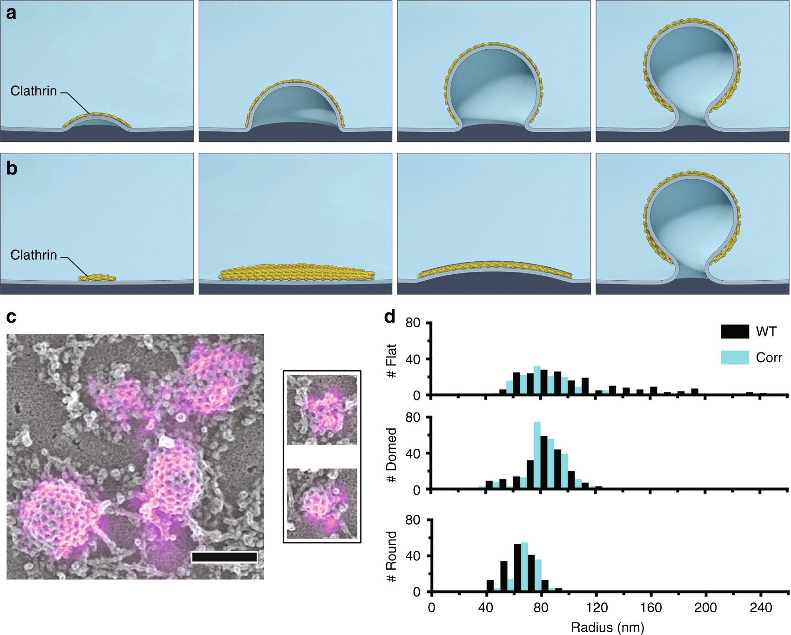

**读图：** c：去顶 SK-MEL-2 细胞的相关 dSTORM/TEM 图像，比例尺 200 nm；a、b 为两种弯曲模型。

**这张图帮助建立什么：** 包被具有多样形态。

**读图边界：** 不同结构的快照不是同一囊泡的连续帧。

来源：Brandon L. Scott et al. · *Nature Communications* (2018) · 原文 Figure 1。Membrane bending occurs at all stages of clathrin-coat assembly and defines endocytic dynamics。 [DOI: 10.1038/s41467-018-02818-8](https://doi.org/10.1038/s41467-018-02818-8) · [论文全文与图注](https://www.nature.com/articles/s41467-018-02818-8) · [CC BY 4.0](https://creativecommons.org/licenses/by/4.0/)。完整原图，未改绘。

### 4.2 胞吞和胞吐的差别

| 比较维度 | 胞吐 | 胞吞 |
| --- | --- | --- |
| 拓扑变化 | 两个膜区室融合，腔与腔连通 | 连续质膜出芽，形成独立囊泡 |
| 典型机器 | Rab、系留因子、SNARE、Synaptotagmin 等 | 货物接头、AP2、Clathrin、Dynamin、辅助蛋白 |
| 膜曲率 | 融合茎、半融合和融合孔的局部曲率 | 膜从平面向内弯曲形成囊泡颈部 |
| 能量 / 调控 | SNARE 组装自由能、Ca²⁺ 等调控、ATP 介导复位 | GTPase、ATP 依赖脱包被、膜张力与骨架力 |
| 结果 | 货物释放，囊泡膜可并入质膜 | 货物进入细胞，膜被内化并送往内体 |

## 受体介导胞吞：完整的动态机制主线

以受体—配体复合物经 AP2 / 网格蛋白进入早期内体为主线。

受体介导胞吞的功能逻辑可分为：胞外识别 → 胞质侧分选信号读取 → 内吞位点组装 → 膜弯曲 → 裂变 → 脱包被 → 内体融合和成熟 → 回收或降解。每一阶段的分子组装都伴随局部膜化学、蛋白分布、几何形状和机械状态改变。

#### 图 P05 · CME 的分子机器与阶段全景

*综述机制模型*

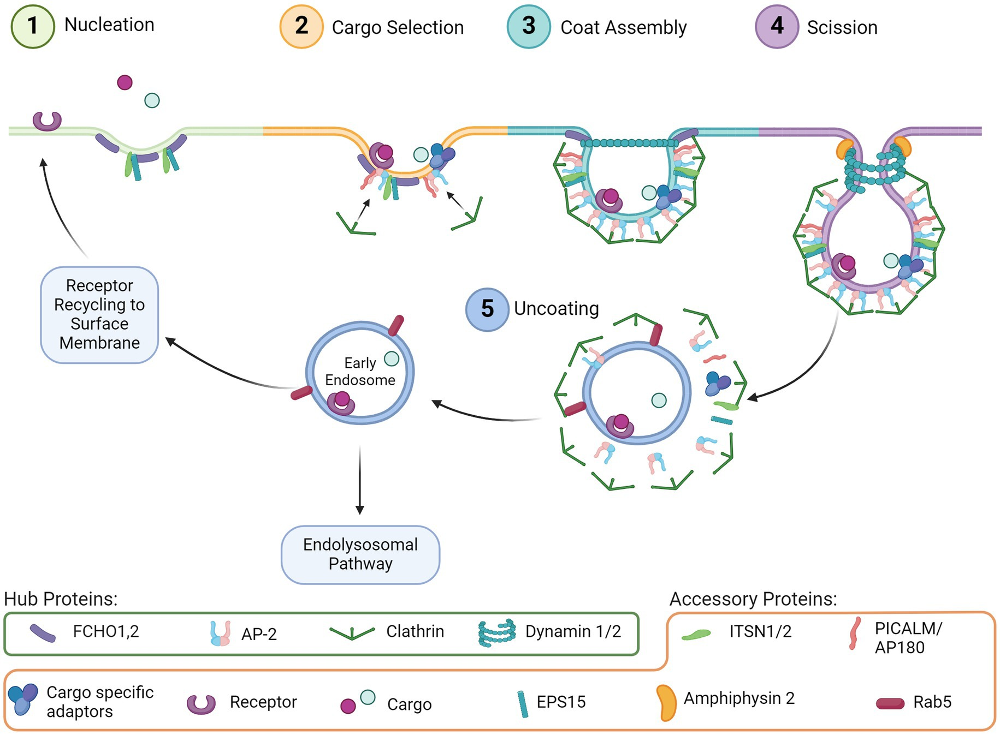

**读图：** 沿编号 1–5 依次定位位点启动、货物选择、包被装配、裂变和脱包被；对照下方图例辨认 AP2、网格蛋白与 Dynamin。

**这张图帮助建立什么：** 分选、弯曲与裂变由胞质侧的多蛋白网络协作完成。

**读图边界：** 阶段编号是阅读框架；真实位点中过程会重叠，脱包被囊泡也不等于已经成熟的早期内体。

来源：Sierra Jaye, Ursula S. Sandau, Julie A. Saugstad · *Frontiers in Aging Neuroscience* (2024) · 原文 Figure 1。Clathrin mediated endocytosis in Alzheimer’s disease: cell type specific involvement in amyloid beta pathology。 [DOI: 10.3389/fnagi.2024.1378576](https://doi.org/10.3389/fnagi.2024.1378576) · [论文全文与图注](https://www.frontiersin.org/journals/aging-neuroscience/articles/10.3389/fnagi.2024.1378576/full) · [CC BY 4.0](https://creativecommons.org/licenses/by/4.0/)。完整原图，未改绘。

### 5.1 受体识别：胞外结合怎样转变成胞内分选指令？

典型跨膜受体由胞外结构域、跨膜区和胞质尾部构成。配体与胞外结构域结合后，受体可能发生构象变化、二聚化或聚集；但受体激活与受体内吞不是同一件事，也不是所有受体都要求先激活再内吞。

#### 图 P06 · 跨膜货物如何与胞质侧接头连接

*综述机制模型*

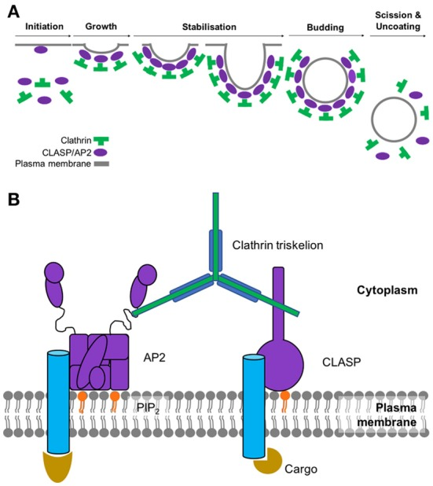

**读图：** A 为装配过程概览；B 将膜外货物、跨膜受体、AP2/CLASP、PIP₂ 与网格蛋白放在同一空间关系中。重点辨认膜的两侧。

**这张图帮助建立什么：** 内吞机器主要读取胞质尾部信号，并借助膜脂与接头形成多价连接。

**读图边界：** 图示为功能关系；不表示每种货物都直接结合 AP2，也未给出精确结构或相互作用强度。

来源：SM Smith, M Baker, M Halebian, CJ Smith · *Frontiers in Molecular Biosciences* (2017) · 原文 Figure 1。Weak Molecular Interactions in Clathrin-Mediated Endocytosis。 [DOI: 10.3389/fmolb.2017.00072](https://doi.org/10.3389/fmolb.2017.00072) · [论文全文与图注](https://www.frontiersin.org/journals/molecular-biosciences/articles/10.3389/fmolb.2017.00072/full) · [CC BY 4.0](https://creativecommons.org/licenses/by/4.0/)。完整原图，未改绘。

受体尾部可含 YXXΦ、双亮氨酸（dileucine）或 NPXY 等分选信号。不同信号需要不同接头蛋白解释，不应假设所有 motif 都由 AP2 直接以同一种方式识别。例如 LDLR 的 NPXY motif 可通过 ARH 或 Dab2 等衔接蛋白连接 AP2；转铁蛋白受体具有可支持内吞的 YTRF 信号。货物种类、细胞类型和接头蛋白表达会影响具体路线。

**关键思想：跨膜信息转换**：胞外配体结合并不自动“把受体拉进细胞”。胞质尾部的分选信号必须与相应的接头蛋白/内吞机器建立连接，才能高效进入特定内吞位点。

### 5.2 内吞位点启动：PIP₂、FCHO、Eps15 与 AP2 的局部组装

质膜胞质侧的 PI(4,5)P₂（通常简称 PIP₂）是重要的膜身份脂质。它的带负电头基可与 AP2、FCHO、epsin 等具有脂质结合能力的蛋白相互作用。内吞位点不是任意膜点随机聚集蛋白，而是通过膜脂信号、货物信号和蛋白—蛋白弱相互作用逐渐组织。

#### 图 P07 · 内吞位点的脂质与货物环境：FCHo2 使受体附近的 PIP₂ 信号重新聚集

*原始研究：去顶细胞膜片重构、Airyscan/共聚焦成像与细胞过表达对照*

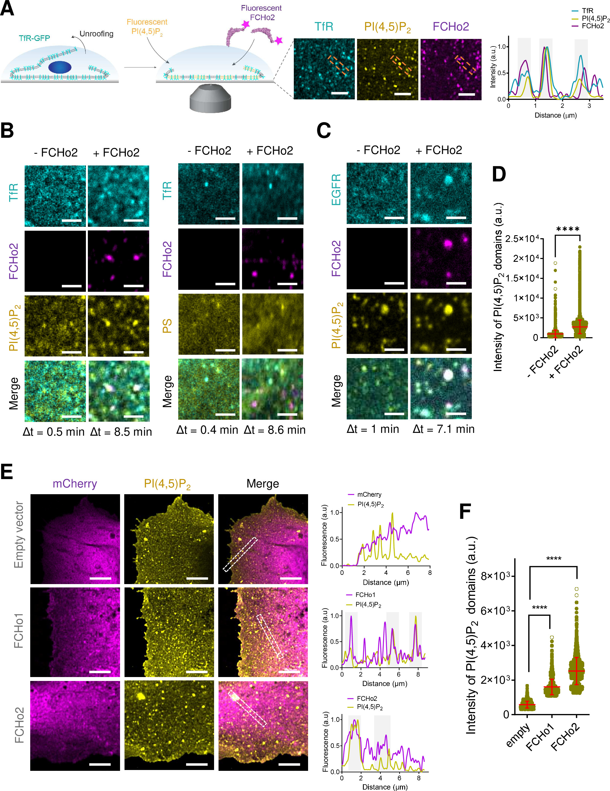

**读图：** A：实验设置与膜片上的三通道图像，TfR 为青色、PI(4,5)P₂ 为黄色、FCHo2 为品红。B–D：比较加入 FCHo2 前后，TfR/EGFR 附近的 PIP₂ 信号及其强度分布；PS 是脂质对照，A–C 标尺 2 μm。E–F：HT1080 细胞表达 mCherry、mCherry-FCHo1 或 mCherry-FCHo2 后，内源 PIP₂ 染色与分布统计，E 标尺 4 μm。

**这张图帮助建立什么：** 内吞启动的局部膜环境具有组织作用：FCHo2 招募与 PIP₂ 在货物受体附近的重新分布相联系。膜脂质和蛋白并非分别在一张均匀背景膜上工作。

**读图边界：** 膜片实验经过细胞去顶，E–F 采用过表达。图中没有直接测量 AP2 构象、完整囊泡裂变或受体内化通量，不能把共定位当作所有环节均已完成。

来源：Fatima El Alaoui, Ignacio Casuso, David Sanchez-Fuentes et al. · *eLife* (2022) · 原文 Figure 1。Structural organization and dynamics of FCHo2 docking on membranes。 [DOI: 10.7554/eLife.73156](https://doi.org/10.7554/eLife.73156) · [论文全文与图注](https://elifesciences.org/articles/73156) · [CC BY 4.0](https://creativecommons.org/licenses/by/4.0/)。完整原图，未改绘。

AP2 是异源四聚体接头复合物。胞质中的 AP2 可处于相对闭合构象；在 PIP₂、货物尾部信号和内吞辅助蛋白共同作用下，AP2 发生构象变化，暴露与货物、Clathrin 及其他蛋白相互作用的位点。这个过程不是单向的简单招募，而是多个弱相互作用和构象变化共同形成的协同装配。

**局部胞质组分的变化**：AP2、FCHO、Eps15、epsin 等原本可以在胞质中扩散的蛋白，被富集到质膜某个微小区域。这种“募集”会让内吞位点在胞质侧形成一个局部高浓度的分子机器。

### 5.3 网格蛋白组装与膜曲率形成

Clathrin 重链和轻链组成 triskelion（三脚架）样结构；多个三脚架组装成多边形网格。Clathrin 位于膜的胞质侧，通常通过 AP2 和其他接头蛋白连接到膜与货物。网格的几何结构与辅助蛋白、膜脂质一起，帮助建立或稳定曲率。

#### 图 P08 · 装配与弯曲存在不同的时间关系

*原始研究 · 活细胞偏振 TIRF*

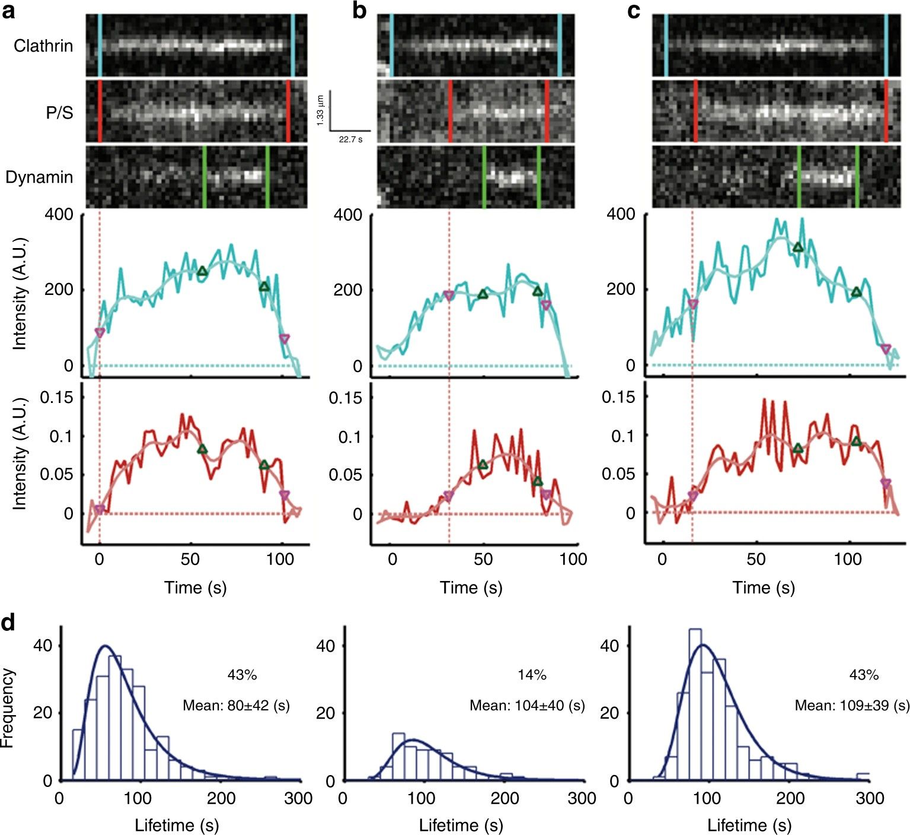

**读图：** a–c：比较网格蛋白信号与弯曲读出 P/S 的起点、平台和重叠；d 为寿命分布。

**这张图帮助建立什么：** 装配和弯曲可同步，也可先后发生。

**读图边界：** 这些类别来自特定细胞与读出，不能当作全部细胞的固定比例。

来源：Brandon L. Scott et al. · *Nature Communications* (2018) · 原文 Figure 3。Membrane bending occurs at all stages of clathrin-coat assembly and defines endocytic dynamics。 [DOI: 10.1038/s41467-018-02818-8](https://doi.org/10.1038/s41467-018-02818-8) · [论文全文与图注](https://www.nature.com/articles/s41467-018-02818-8) · [CC BY 4.0](https://creativecommons.org/licenses/by/4.0/)。完整原图，未改绘。

Epsin 的 ENTH 结构域可结合 PIP₂，并通过两亲性螺旋插入胞质侧单层，改变局部脂质排列与曲率。BAR-domain 蛋白可感知或稳定特定曲率。Clathrin 网格本身与 adaptor/辅助蛋白共同组织膜面几何。膜弯曲能、膜张力和膜蛋白拥挤都会影响内陷能否持续。

Ebend = ½ κ ∫ (2H − C0)² dA

Helfrich 型弯曲能简式：κ 为弯曲刚度，H 为平均曲率，C₀ 为自发曲率，dA 为表面积元。该式是物理直觉工具，真实膜还有张力、压力、蛋白结合、脂质混合熵和边界能等贡献。

P/S 是曲率的代理读出，其独立校准见方法章节。 [查看图 P17：先校准弯曲读出，再解释动态曲线](#paper-coat-calibration)。

### 5.4 肌动蛋白与周边机械环境：为什么同样的内吞位点有时需要 actin，有时不需要？

F-actin（丝状肌动蛋白）在质膜内侧形成皮层网络。其作用具有双重性：既提供支撑、限制膜移动，也能通过聚合产生推力并通过肌球蛋白相关机制产生收缩力。Arp2/3 促进分支肌动蛋白网络形成；N-WASP、WAVE 等上游调控因子可影响其活化。具体哪个因子主导，取决于细胞类型与内吞事件。

#### 图 P09 · 内吞位点的网格蛋白与 actin 三维组织

*原始研究 · 双色三维 STORM*

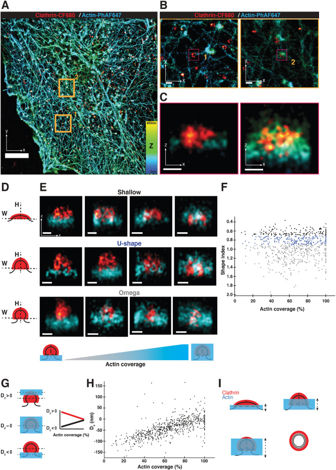

**读图：** A–C：网格蛋白（红）与 actin（青）的空间分布；E：浅窝、U 形及 Ω 形包被的 x–z 投影；F、H 将包被几何与 actin 覆盖或高度对应。

**这张图帮助建立什么：** 相似包被形态可对应不同程度的 actin 包裹；几何与骨架负载不能简单等同。

**读图边界：** 固定细胞的空间排列不直接给出时间次序、力值或每个窝的张力；张力适应还需同文后续干预实验支持。

来源：Charlotte Kaplan, Sam J. Kenny et al. · *Molecular Biology of the Cell* (2022) · 原文 Figure 1。Load adaptation by endocytic actin networks。 [DOI: 10.1091/mbc.E21-11-0589](https://doi.org/10.1091/mbc.E21-11-0589) · [论文全文与图注](https://pmc.ncbi.nlm.nih.gov/articles/PMC9265150/) · [CC BY-NC-SA 4.0](https://creativecommons.org/licenses/by-nc-sa/4.0/)。完整原图，未改绘。

#### 低张力 / 易变形膜

Clathrin 包被与辅助因子在某些细胞表面可支持内陷与成熟，actin 聚合不是每一个位点的绝对必要条件。

#### 高张力 / 高皮层约束

膜弯曲能垒升高，actin 聚合可提供额外内向力，帮助完成内陷或内吞。这种依赖性受到细胞极性、渗透压、拉伸和局部结构影响。

**机制边界**：不能说“每次胞吞都由肌动蛋白把囊泡推入细胞”。更准确是：actin 是可调节的机械执行模块；在特定张力和细胞背景下非常重要，在另一些条件下贡献较小。[B4,B5]

### 5.5 Dynamin 与膜裂变：狭窄的囊泡颈部如何断开？

Dynamin 是大型 GTPase，能在内吞颈部组装成螺旋/环状寡聚结构。GTP 结合和水解与其构象变化、寡聚体重排和膜裂变相关。Amphiphysin、Endophilin、Syndapin、Intersectin 等蛋白可帮助组织颈部区域。不能把 Dynamin 想成简单剪刀：膜颈部的几何、脂质排列和其他辅助因子也决定裂变。

#### 图 P10 · Dynamin–amphiphysin 的真实膜裂变：高速 AFM 时间序列

*原始研究：体外脂质膜管、dynamin–amphiphysin 重构与高速 AFM*

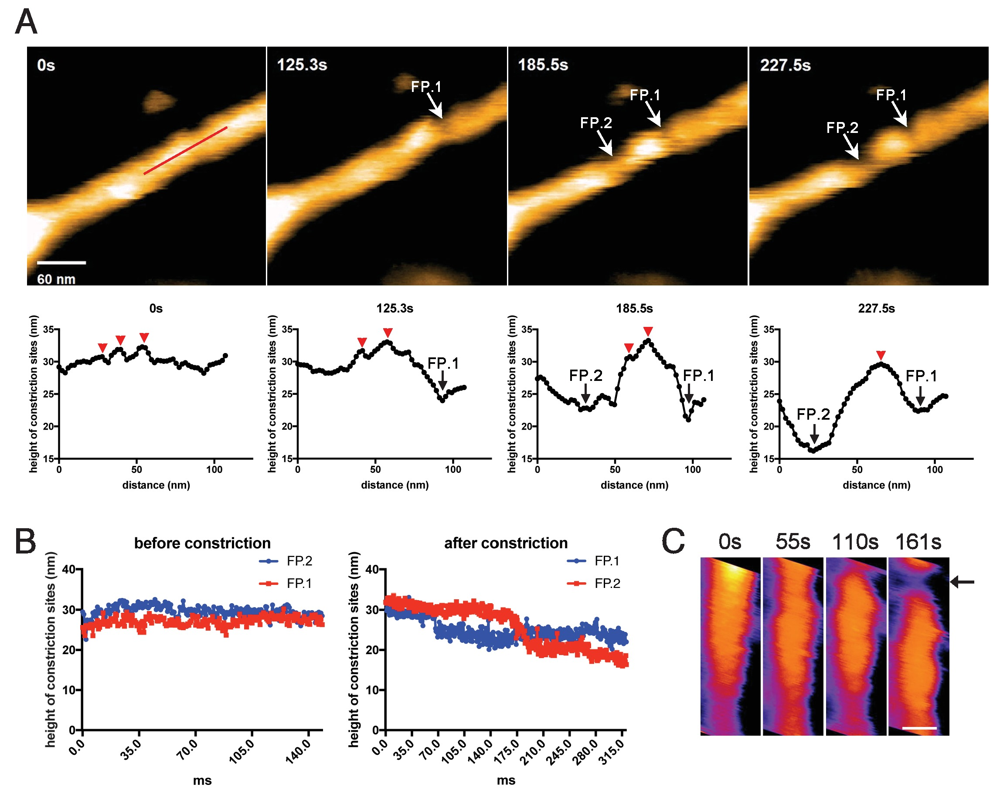

**读图：** A：同一膜管的高速 AFM 时间序列与沿红线测量的高度剖面；FP.1/FP.2 标出蛋白簇两侧的裂变位置，红箭头标出蛋白簇。B：相应位置收缩前后的高度变化。C：另一序列显示蛋白簇侧方出现收缩，标尺 40 nm。暖色为 AFM 伪彩高度信号，并非荧光共定位。

**这张图帮助建立什么：** 在这个重构体系中，裂变发生于 dynamin–amphiphysin 蛋白簇边缘的裸露膜区域；它把“颈部蛋白装配”和“最终断开的位置”分开，修正了仅靠一圈剪刀切断膜的卡通印象。

**读图边界：** 观察对象是固体支持上的体外膜管，不是活细胞 CME 囊泡。AFM 高度轮廓不能直接分辨脂质单层拓扑，也不单独决定 GTP 水解与每一步裂变的精确耦联。原图 B 的横轴标为 ms，而对应时间序列及图注使用 s；本资料不据该轴作速率计算。

来源：Tetsuya Takeda, Toshiya Kozai, Huiran Yang et al. · *eLife* (2018) · 原文 Figure 4。Dynamic clustering of dynamin-amphiphysin helices regulates membrane constriction and fission coupled with GTP hydrolysis。 [DOI: 10.7554/eLife.30246](https://doi.org/10.7554/eLife.30246) · [论文全文与图注](https://elifesciences.org/articles/30246) · [CC BY 4.0](https://creativecommons.org/licenses/by/4.0/)。完整原图，未改绘。

裂变后，细胞质膜的剩余边界重新连续；内陷部分成为独立囊泡。囊泡腔内仍是由胞外液包围的货物，外表面仍朝向胞质溶胶。

### 5.6 脱包被：Clathrin 与接头蛋白去哪了？

新形成的网格蛋白包被囊泡需要脱包被，才能有效进入后续内体运输。Auxilin/J-domain 蛋白可招募 Hsc70；Hsc70 通过 ATP 依赖的分子伴侣循环帮助解聚 Clathrin lattice。Synaptojanin 等磷脂酰肌醇磷酸酶使 PIP₂ 去磷酸化，削弱部分接头蛋白与膜的结合，有助于脱包被。

#### 图 P11 · 壳消失、膜囊泡保留：酶促脱包被的负染电镜证据

*原始研究：小鼠脑来源包被囊泡、体外脱包被与负染电子显微镜*

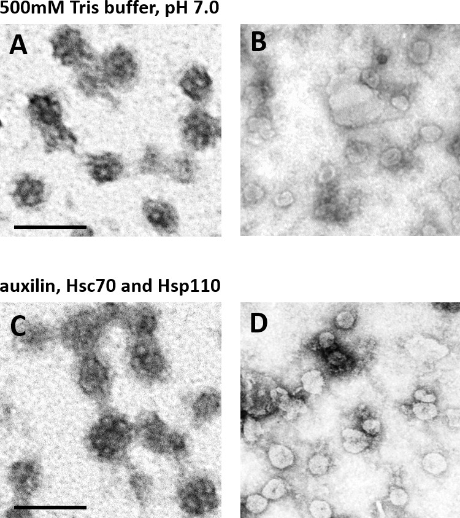

**读图：** A–B：包被囊泡在中性 500 mM Tris 缓冲液处理前后。C–D：另一组包被囊泡在 auxilin、Hsc70 与 Hsp110 酶促处理前后；处理后可看到缺少外层笼状包被的膜囊泡。标尺 100 nm，A/B 与 C/D 均是群体样品前后比较，不是同一个囊泡的连续追踪。

**这张图帮助建立什么：** 脱包被移除的是膜外胞质侧的蛋白壳，膜囊泡本身保留。酶促处理与缓冲液处理都能产生形态变化；这比流程箭头更具体地展示了“去壳而不拆膜”的含义。

**读图边界：** 酶促条件同时含 auxilin、Hsc70 与 Hsp110，本图不能单独归因于某一个组分。负染静态图不提供 ATP 水解动力学、所有接头蛋白释放顺序或活细胞内精确时程。

来源：Zohreh Farsi, Sindhuja Gowrisankaran, Matija Krunic et al. · *eLife* (2018) · 原文 Figure 4—figure supplement 1。Clathrin coat controls synaptic vesicle acidification by blocking vacuolar ATPase activity。 [DOI: 10.7554/eLife.32569](https://doi.org/10.7554/eLife.32569) · [论文全文与图注](https://elifesciences.org/articles/32569) · [CC BY 4.0](https://creativecommons.org/licenses/by/4.0/)。完整原图，未改绘。

包被囊泡 Clathrin + adaptor → Auxilin 招募 Hsc70 ATP 周期 → Clathrin lattice 解聚 接头蛋白释放 → 未包被运输载体 准备内体融合

**胞质组分的动态变化**：包被形成时，胞质蛋白被募集至质膜；包被解聚时，这些蛋白重新回到胞质池，可被重复利用。它们并不是随囊泡货物一起进入囊泡腔。

### 5.7 早期内体：膜身份、离子环境和腔内 pH 如何改变？

早期内体是内吞货物的主要分选站之一，常富集 Rab5、EEA1 和 PI(3)P。Rab5-GTP 可促进 VPS34 等效应因子募集，VPS34 产生 PI(3)P；EEA1 等 FYVE-domain 蛋白识别 PI(3)P，并与 Rab5 协同参与系留和融合。之后内体可经历 Rab5 到 Rab7 的身份转换，逐渐成熟为晚期内体。

#### 图 P12 · Rab5→Rab7 转换：在同一个扩大内体上追踪膜身份变化

*原始研究：HeLa 活细胞双通道时间序列*

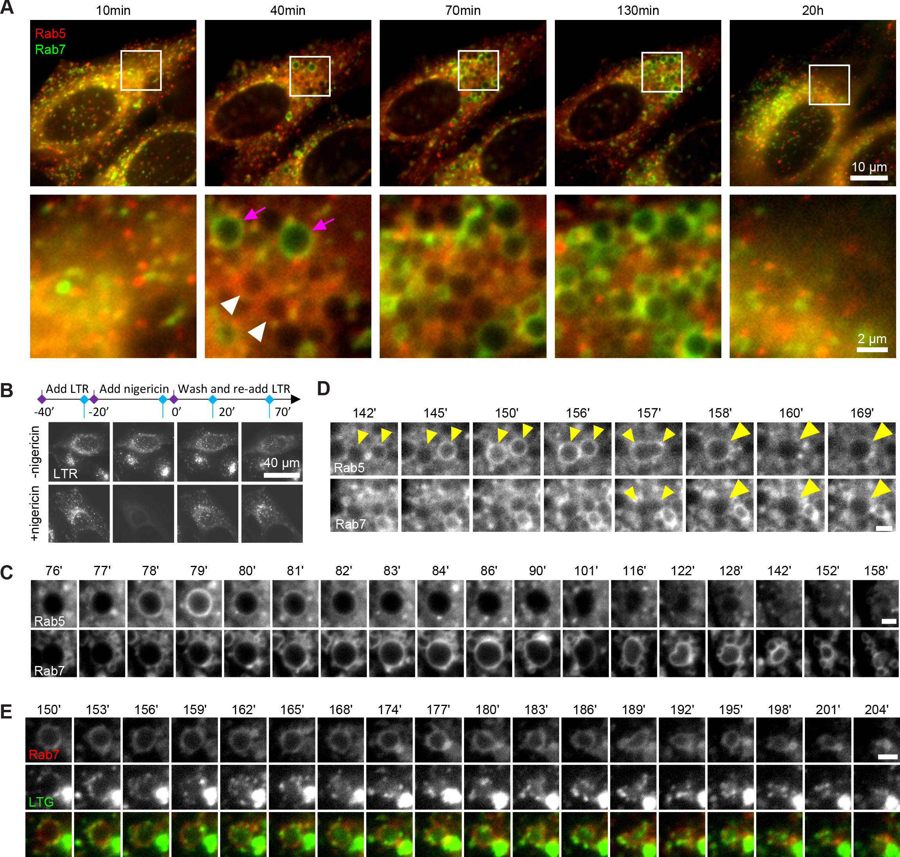

**读图：** A：mApple-Rab5 为红色、GFP-Rab7 为绿色，显示处理后扩大内体的形态恢复。C：逐帧追踪同一个内体，Rab5 先募集后消失，同时出现 Rab7；D 展示两个 Rab5 阳性内体融合后的标记变化。E 同时观察 Rab7 与 LysoTracker 信号。C–E 比例尺 2 μm，时间相对于 nigericin 洗脱计算。

**这张图帮助建立什么：** 内体成熟中的 Rab 转换是膜表面蛋白身份的更替；它不是 Rab5 分子本身化学转变成 Rab7。时间序列比不同细胞中两张静态共定位图更能支持转换过程。

**读图边界：** 细胞先接受 10 μM nigericin 20 min 再洗脱，内体被人为扩大，不能把图中的分钟数视为未处理细胞的普遍时间表。LysoTracker 富集是酸性区室读出，并非经过校准的绝对 pH；本图也不能单独给出 Rab 转换的全部因果机制。

来源：Maria Podinovskaia, Cristina Prescianotto-Baschong, Dominik P. Buser, Anne Spang · *eLife* (2021) · 原文 Figure 1。A novel live-cell imaging assay reveals regulation of endosome maturation。 [DOI: 10.7554/eLife.70982](https://doi.org/10.7554/eLife.70982) · [论文全文与图注](https://elifesciences.org/articles/70982) · [CC BY 4.0](https://creativecommons.org/licenses/by/4.0/)。完整原图，未改绘。

内体膜上的 V-ATPase 消耗 ATP，将 H⁺ 泵入腔内，建立酸性环境。典型早期内体常见 pH 约 6.0–6.5，但具体值受细胞类型、测量方法和成熟状态影响。随后更成熟的内体/溶酶体通常更酸。酸化可以使某些配体与受体解离，也会影响酶活性、货物结构和分选。

**注意空间位置**：酸化发生在囊泡/内体的腔内，而不是整个胞质溶胶。质子泵位于内体膜，ATP 结合/水解侧朝向胞质，H⁺ 被转运到腔内；离子通道与 counter-ion 通量帮助维持电荷平衡。

### 5.8 分选：回收、降解与信号调控

#### 回收：Rab4 / Rab11 等

受体可经快速回收或循环内体较慢回收回到质膜。部分膜蛋白与脂质由管状域、分选因子和骨架共同组织运输。

#### 降解：泛素 / ESCRT

泛素化膜蛋白可被 ESCRT 识别并分选进内体腔内囊泡（ILV），形成多泡体（MVB），随后进入溶酶体相关降解通路。

ESCRT 系统并非简单地把膜蛋白“从膜上拿下来”，而是把膜的一部分向内体腔侧出芽，形成腔内小囊泡。这样，原先朝向胞质的受体胞质结构域被封装在 ILV 内，减少其继续接触胞质信号蛋白的机会；随后相关膜蛋白和货物可在溶酶体中降解。

#### 图 P13 · EGFR 进入腔内囊泡：电镜、三维断层与 ESCRT 招募动力学

*原始研究：HeLa 金标 EGFR 电镜、电子断层与活细胞成像*

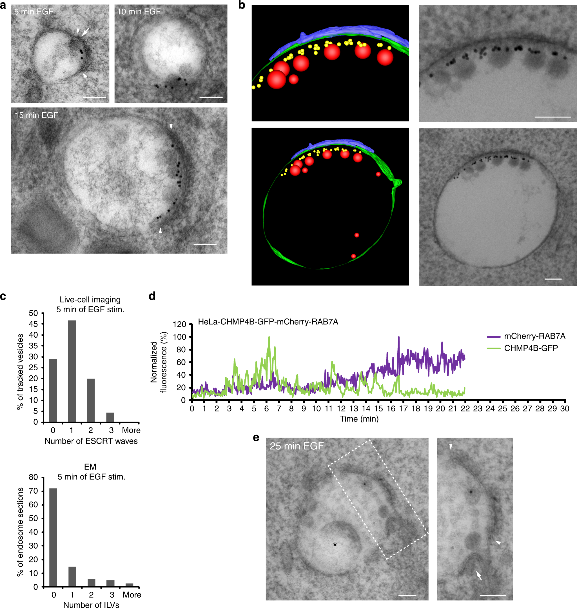

**读图：** a：EGF 刺激 5、10、15 min 后的电镜；10 nm 金颗粒标记内化 EGFR，可见出芽轮廓及逐渐增多的腔内囊泡。b：250 nm 厚切片的断层重建，红色为已脱离限制膜的 ILV，蓝色为邻近包被区。c 比较 ESCRT 招募波次与切片中的 ILV 数目分布。d：单个内体的 CHMP4B-GFP 与 mCherry-RAB7 动态。e：25 min 时的出芽与降解相关结构。电镜比例尺均为 100 nm。

**这张图帮助建立什么：** 受体降解分选具有明确膜拓扑：EGFR 从内体限制膜进入 ILV，胞质侧结构域随之与胞质信号因子隔离。d 还显示获得 RAB7 后 CHMP4B 招募仍可继续，不能把 ILV 形成和 Rab 转换画成严格互斥的两步。

**读图边界：** 电镜时间点来自不同样本；ESCRT 波次与 ILV 数目的关系由两类实验的统计对应支持，并非同时直接看到同一个招募波形成一个 ILV。单幅图不能证明所有内体或受体都遵循完全相同的动力学。

来源：Eva Maria Wenzel, Sebastian Wolfgang Schultz, Kay Oliver Schink et al. · *Nature Communications* (2018) · 原文 Figure 3。Concerted ESCRT and clathrin recruitment waves define the timing and morphology of intraluminal vesicle formation。 [DOI: 10.1038/s41467-018-05345-8](https://doi.org/10.1038/s41467-018-05345-8) · [论文全文与图注](https://www.nature.com/articles/s41467-018-05345-8) · [CC BY 4.0](https://creativecommons.org/licenses/by/4.0/)。完整原图，未改绘。

EGFR 是重要例子：EGF 激活 EGFR 后，受体可经 Cbl 等 E3 泛素连接酶发生泛素化，随后被内吞并进入内体。部分 EGFR 在内体阶段仍可传递信号；被分选进 ILV 后，其胞质信号结构域被隔离，最后受体进入溶酶体降解，有助于降低或终止信号。

## 微管、肌动蛋白与局部运输：不是一套轨道包办一切

将远距离运输、皮层末端运动、膜形变与内体定位分开看。

微管不是填满细胞空间的实体墙。典型微管是由 α/β-微管蛋白组成的中空管状聚合物，外径约 25 nm；它们以离散的细长结构分布在三维胞质中。囊泡通常在微管外表面由马达蛋白携带，而不是进入微管内腔。微管之间、细胞器之间存在可被局部扩散和其他运输机制利用的空间；同时，微管可聚合、解聚和重新组织。因此，细胞内部虽拥挤，却不是被固定管道完全填满。

#### 图 P14 · 微管与动力蛋白支持内体运动：用扰动条件检验真实运输轨迹

*原始研究：HeLaM 活细胞 GFP-Rab5 内体成像与自动粒子追踪*

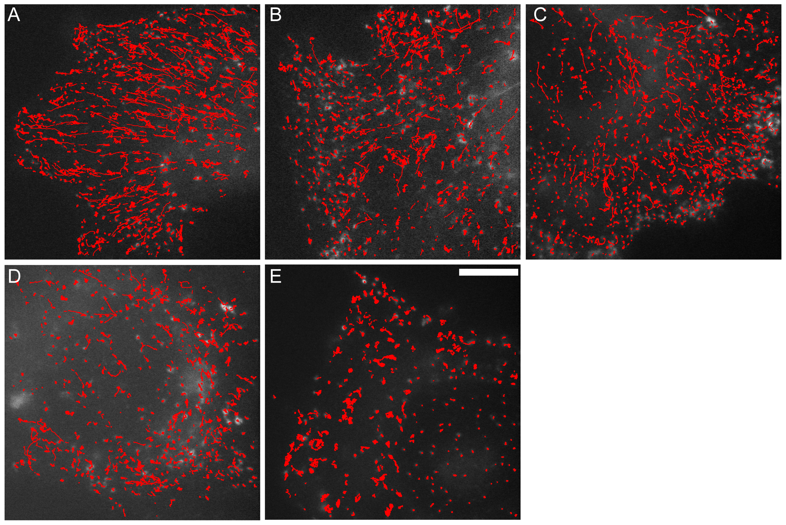

**读图：** 作者以 28 帧/秒记录 1000 帧，将自动追踪所得红色轨迹叠加在第一帧内体荧光图像上。A 为对照；B 为胞质动力蛋白重链 DHC1 耗竭；C 为过表达 dynactin 亚基 p50；D 为表达干扰 dynein–dynactin 相互作用的 CC1 片段；E 为 nocodazole 处理。比例尺 10 μm。红线是内体运动轨迹，绝不是微管染色。

**这张图帮助建立什么：** 对照中可见较长、近直线的内体移动；耗竭动力蛋白、干扰 dynactin 或解聚微管后，轨迹明显改变。它把运输机制从示意性的“囊泡沿轨道行走”推进到可干预检验的细胞内运动。

**读图边界：** 各面板展示不同细胞的代表性轨迹，不能只比较单图中红线总量来计算抑制率；定量结论需结合原文 Figure 2–5 和统计。本图不直接显示 kinesin/actin，也不证明每个局部内吞位点形成都需要微管。

来源：Neftali Flores-Rodriguez, Salman S. Rogers, David A. Kenwright, Thomas A. Waigh, Philip G. Woodman, Victoria J. Allan · *PLOS ONE* (2011) · 原文 Figure 1。Roles of Dynein and Dynactin in Early Endosome Dynamics Revealed Using Automated Tracking and Global Analysis。 [DOI: 10.1371/journal.pone.0024479](https://doi.org/10.1371/journal.pone.0024479) · [论文全文与图注](https://journals.plos.org/plosone/article?id=10.1371/journal.pone.0024479) · [CC BY（原文未注明版本）](https://journals.plos.org/plosone/article?id=10.1371/journal.pone.0024479)。完整原图，未改绘。

| 结构 / 马达 | 典型方向或位置 | 在胞吞胞吐中的常见角色 | 需要避免的过度概括 |
| --- | --- | --- | --- |
| 微管 | 由 MTOC 等区域向外延伸，具有正负端极性 | 运输囊泡、内体和细胞器；影响内体定位 | 不是每个内吞窝都要让微管局部解聚 |
| Kinesin | 多数朝微管正端 | 常参与向细胞外围运输 | 家族成员、货物连接方式与运动方向有例外 |
| Dynein | 通常朝微管负端 | 常参与向细胞中心运输 | 运输需要 dynactin、接头蛋白等调控 |
| F-actin | 富集于细胞皮层及多种局部结构 | 内吞力学、末端定位、局部膜运输 | 不意味着每个囊泡都沿 actin 运输 |
| Myosin | 沿 actin 运动或调节 actin 网络 | 局部囊泡移动、皮层张力和收缩 | 不同 myosin 类别功能差异很大 |

内吞位点发生时，微管通常不是形成膜窝的直接执行结构。其重要性往往在内吞载体脱包被、与内体融合后，体现在内体沿微管向细胞中心或外围的运输。肌动蛋白更贴近质膜皮层，因而常在内陷、局部机械力和末端定位中发挥作用。两套骨架又通过交联蛋白、微管正端捕获和信号网络互相调节。

## 三个真实受体案例：同一内吞系统，不同的生理目的

用 TfR、LDLR 和 EGFR 区分“回收货物”与“受体降解”的不同命运。

### 7.1 转铁蛋白受体 TfR1：循环利用受体，把铁释放出来

#### 图 P15 · TfR 回收可被细胞状态迅速调节：抗体预标记与流式定量

*原始研究：预标记/表面封闭/流式细胞术定量回收*

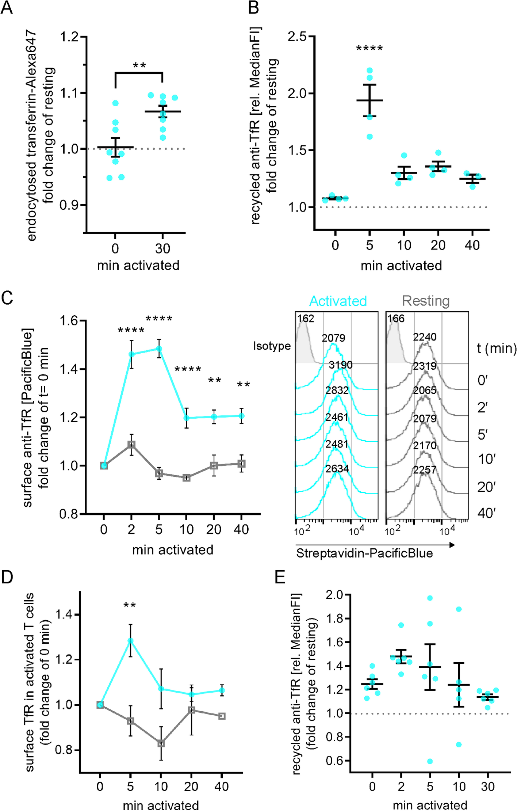

**读图：** A：Jurkat T 细胞的 Alexa647-transferrin 摄取。B：先用生物素化抗 TfR 标记受体池，再封闭当时位于表面的标记；刺激后用荧光链霉亲和素检测重新到达细胞表面的受体。C：独立检测表面 TfR 水平及代表性流式分布；D、E 在扩增原代人 T 细胞中分别检测表面受体与回收。

**这张图帮助建立什么：** “受体循环”可以用重新暴露到细胞表面的预标记受体直接定量；图中 T 细胞激活后回收与表面 TfR 短暂增加，说明回收速率受细胞状态调控。

**读图边界：** 数据来自 Jurkat 与扩增人 T 细胞及特定激活条件；回收受体的抗体标记信号不等同铁释放或铁输入量，本图也未直接测定内体 pH。不能将其时间与倍数作为所有细胞的 TfR 循环常数。

来源：Pascal Rossatti, Gregory M. I. Redpath, Luca Ziegler et al. · *BMC Biology* (2022) · 原文 Figure 1。Rapid increase in transferrin receptor recycling promotes adhesion during T cell activation。 [DOI: 10.1186/s12915-022-01386-0](https://doi.org/10.1186/s12915-022-01386-0) · [论文全文与图注](https://link.springer.com/article/10.1186/s12915-022-01386-0) · [CC BY 4.0](https://creativecommons.org/licenses/by/4.0/)。完整原图，未改绘。

典型流程：携铁转铁蛋白（holo-Tf）与 TfR1 结合 → CME 内吞 → 内体酸化（常约 pH 6.5）→ 铁释放并还原为 Fe²⁺ → DMT1 等转运体将铁转出内体腔 → apo-Tf 与 TfR1 在酸性环境中仍可结合 → 回收至质膜 → 中性胞外环境促进 apo-Tf 解离。TfR1 也可在没有 Tf 结合时持续内吞和循环。

### 7.2 LDL 受体：受体回收，脂蛋白颗粒进入溶酶体

#### 图 P16 · LDLR 回收与 LDL 降解的分流

*综述机制模型*

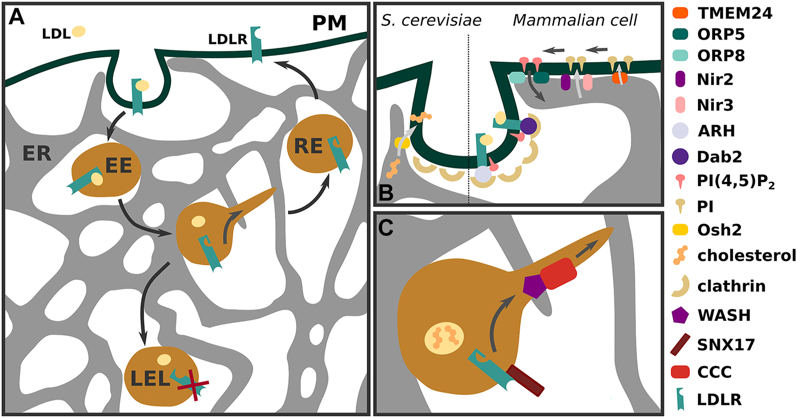

**读图：** A：LDL 与 LDLR 内吞后分流；B：质膜–内质网接触位点，区分酵母与哺乳动物；C：SNX17、WASH 与 CCC 等参与受体回收。

**这张图帮助建立什么：** 受体回收和配体降解可并行，膜接触位点又将运输与脂质稳态联系起来。

**读图边界：** B 混合呈现不同物种机制，不能把酵母甾醇机制直接套用于哺乳动物；这也不是单一实验的直接观察。

来源：Mohammad Majharul Islam, Iryna Hlushchenko, Simon G. Pfisterer · *Frontiers in Cell and Developmental Biology* (2022) · 原文 Figure 1。Low-Density Lipoprotein Internalization, Degradation and Receptor Recycling Along Membrane Contact Sites。 [DOI: 10.3389/fcell.2022.826379](https://doi.org/10.3389/fcell.2022.826379) · [论文全文与图注](https://www.frontiersin.org/journals/cell-and-developmental-biology/articles/10.3389/fcell.2022.826379/full) · [CC BY 4.0](https://creativecommons.org/licenses/by/4.0/)。完整原图，未改绘。

LDLR 胞质尾部的 NPXY 信号可被 ARH、Dab2 等接头识别，并接入网格蛋白内吞网络。LDL–LDLR 复合物内吞后，酸性环境促使 LDL 与受体解离。受体通常进入回收路径；LDL 则进入晚期内体/溶酶体，脂蛋白颗粒被降解并释放胆固醇。LDLR 的实际分流也受 PCSK9 等调节因素影响。

### 7.3 EGFR：内吞还负责调节信号持续时间

EGF 结合 EGFR 可促使受体二聚化、激酶活化和胞质尾部磷酸化；Cbl 等 E3 泛素连接酶可促进受体泛素化。EGFR 内吞后可在早期内体继续传递一段时间的信号。ESCRT 将部分泛素化受体分选进 ILV，令胞质尾部与胞质信号因子隔离，最终进入溶酶体降解。不同刺激强度、细胞类型和受体状态会改变回收与降解的比例。

EGFR 分选的金标电镜与功能证据见 [图 P13](#paper-escrt-wenzel-3)。区分“受体位于内体”与“已进入 ILV”是判断信号可及性的关键。

## 周边环境变化总表：把所有局部变量放进同一时间轴

回答“融合/胞吞发生时，周边到底改变了什么”。

| 环境层次 | 启动 / 识别 | 膜弯曲与裂变 | 脱包被 / 内体 | 回收或降解 |
| --- | --- | --- | --- | --- |
| 细胞外空间 | 配体扩散并结合受体；局部受体—配体富集 | 配体随膜内陷进入未来囊泡腔 | 囊泡腔保留胞外来源液体 | 货物被转运、释放或降解 |
| 膜脂质 | PIP₂ 等支持 AP2 / FCHO / epsin 募集 | 脂质重排、曲率变化；胆固醇/PE 等影响力学 | PIP₂ 去磷酸化参与脱包被；膜身份变化 | PI(3)P、PI(3,5)P₂ 等随内体成熟变化 |
| 膜蛋白 | 受体尾部 motif 与接头蛋白结合 | 货物集中在包被窝 | 受体进入内体膜；内吞机器释放 | 受体回收或泛素 / ESCRT 介导降解 |
| 胞质溶胶 | AP2、FCHO、Eps15 等募集 | Clathrin、Dynamin、辅助蛋白聚集；GTP 水解 | Auxilin / Hsc70、ATP 参与脱包被 | Rab GTPase 与效应因子调控运输、融合 |
| 离子与能量 | 胞吐场景可能有 Ca²⁺ 信号；受体信号改变 | Dynamin 使用 GTP；actin 动态使用 ATP | V-ATPase 消耗 ATP 泵 H⁺ 入腔 | 离子通道 / 反向离子流维持电荷平衡 |
| 细胞骨架 | 膜—骨架连接决定受体流动性和局部组织 | actin 可提供额外力或构成阻力；微管通常不直接构建内吞窝 | 囊泡脱包被后与内体运输相连 | 微管马达与 actin/myosin 参与内体移动、回收载体定位 |
| 囊泡 / 内体腔 | 尚未形成独立内吞囊泡 | 膜内陷腔仍与胞外连续 | 脱离后成为独立腔室；逐渐酸化 | 回收或进入晚期内体 / 溶酶体 |
| 膜几何与力学 | 膜张力、弯曲刚度与皮层约束设定初始条件 | 曲率升高、颈部变窄、膜裂变 | 小囊泡与内体融合，内体形态重塑 | 内体管状域、ILV、回收载体和膜面积再平衡 |

**一句话概括**：胞吞不是“把一小块膜机械地捏下来”；它是一个受体选择、膜脂化学、蛋白装配、膜弹性、局部力生成、GTP/ATP 周期和细胞器身份转换耦合的自组织过程。

## 如何观测这些动态过程？

不只有晶体学或冷冻电镜；不同问题需要不同的时间、空间和化学读出。

| 要回答的问题 | 合适的观察方法 | 能看到什么 | 主要限制 / 控制 |
| --- | --- | --- | --- |
| 内吞位点何时形成、持续多久？ | TIRF / spinning-disk live-cell imaging；标记 Clathrin、AP2、Dynamin | 单个内吞位点的出现、增长、消失和动力学异质性 | 过表达可能改变装配；标记需验证功能；TIRF 只采样靠近玻璃的薄层 |
| 受体是否进入内吞途径？ | 荧光配体脉冲追踪；抗体 feeding；酸洗去除表面结合配体 | 表面结合与真正内化的区分、内化速率 | 区分受体结合、内吞、再循环；注意非特异吸附和配体诱导信号 |
| 融合孔是否开放？ | pHluorin / pH-sensitive cargo；膜电容记录；单囊泡成像 | 囊泡腔暴露于外液时的 pH 变化或膜面积变化 | 报告系统可能有缓冲动力学；电容测量需要电生理背景 |
| 脂质组成是否改变？ | PIP₂ / PI(3)P 荧光生物传感器；脂质组学；膜分馏 | 活细胞局部富集变化或整体脂质组成 | 传感器表达量会缓冲目标脂质；脂质组学丢失空间信息 |
| 膜曲率 / 颈部如何变化？ | 快速冷冻、冷冻电镜 / 冷冻电子断层成像（cryo-ET）；高分辨活细胞成像 | 纳米尺度膜轮廓、包被和颈部形态 | 结构快照难以独自推断时间顺序；样本制备和取样时点至关重要 |
| actin 是否提供力？ | LifeAct / F-actin 探针、成像结合膜张力操控、温和药理扰动 | actin 聚合与内吞位点成熟的时间相关性 | LifeAct 会扰动 actin；药物副作用大，需遗传学和救援实验 |
| 内体是否酸化？ | 比率型 pH 探针、pH-sensitive dextran / cargo | 内体腔 pH 随时间变化 | 需要原位校准；注意探针装载路径和内体成熟状态 |
| 货物最终去哪了？ | Rab5/Rab7/Rab11 标记；共定位与脉冲追踪；定量流式 | 早期内体、晚期内体、回收内体和溶酶体路径 | 共定位不等同直接运输；需时间序列和功能干预支持 |

### 一个有信息量的实验设计示例

问题：提高膜张力是否会增强肌动蛋白对受体内吞的依赖？

#### 图 P17 · 先校准弯曲读出，再解释动态曲线

*原始研究 · 偏振 TIRF / TEM / AFM*

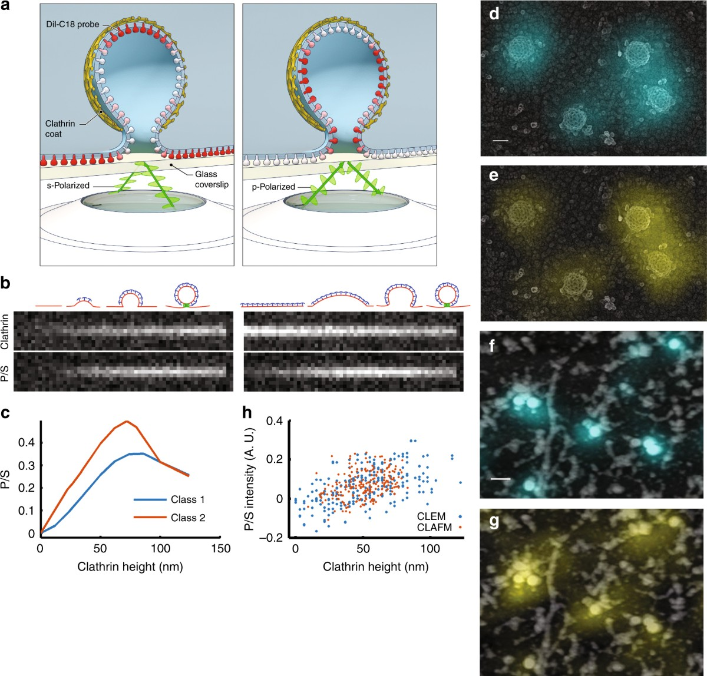

**读图：** a–c：偏振原理与模拟；d–h：相关电镜、AFM 与 P/S 信号的校准。

**这张图帮助建立什么：** 曲率代理读出需与独立形态测量对照。

**读图边界：** 本图主要验证方法；装配时序的直接证据见同文 Fig. 3。

来源：Brandon L. Scott et al. · *Nature Communications* (2018) · 原文 Figure 2。Membrane bending occurs at all stages of clathrin-coat assembly and defines endocytic dynamics。 [DOI: 10.1038/s41467-018-02818-8](https://doi.org/10.1038/s41467-018-02818-8) · [论文全文与图注](https://www.nature.com/articles/s41467-018-02818-8) · [CC BY 4.0](https://creativecommons.org/licenses/by/4.0/)。完整原图，未改绘。

条件操控 低 / 高张力 → 活细胞成像 AP2 + Clathrin + actin → 定量成熟率 pit 成功内化比例 → 因果验证 actin 干预 + rescue

- **自变量：**膜张力（渗透压、机械拉伸等操控，需确认细胞存活和形态）。
- **读出：**AP2/Clathrin 位点形成率、寿命、内陷完成率；actin 招募时序。
- **关键对照：**不改变张力的处理对照、actin 干预单独对照、细胞活性、表达量和膜标记控制。
- **因果检验：**若高张力下内吞受损，而恢复 actin 聚合能力可部分救援，才支持 actin 对高张力条件下内吞的机械贡献。

**证据链原则**：共定位只能说明空间邻近；时间相关只能提示关联；药理抑制可能有脱靶。较强机制结论通常需要动态成像、定量分析、独立干预和救援实验共同支持。

## 常见误解与需要保留的机制边界

把直观图景修正为更准确的细胞生物学模型。

#### 误解 1：受体一结合配体，就一定会被内吞。

不对。配体结合可能导致受体激活、聚集或构象变化，但是否内吞还取决于胞质尾部信号、接头蛋白、细胞类型和受体调控状态。TfR1 甚至可在没有配体结合时继续循环。

#### 误解 2：所有受体介导胞吞都由 Clathrin 完成。

不对。CME 是最经典、研究最充分的途径，但受体也可通过 caveolae 相关或其他非网格蛋白途径内化。需要根据具体受体和细胞类型判断。

#### 误解 3：Clathrin 本身像手一样把膜捏成囊泡。

过度简化。Clathrin lattice 提供几何支架；AP2、epsin、BAR-domain 蛋白、脂质自发曲率、膜张力和 actin 力共同影响膜形变。

#### 误解 4：每个胞吞位点都必须有显著 actin 聚合。

不对。Actin 依赖性受膜张力、细胞皮层和细胞类型影响。部分情况下包被装配本身足以完成内陷；高张力环境更常需要 actin 辅助。

#### 误解 5：微管需要为每个囊泡内陷腾出道路。

不对。微管不是每个内吞窝的局部机械执行者。它主要在细胞内部运输囊泡、内体及细胞器；质膜下方的局部机械调控通常更直接涉及 actin。

#### 误解 6：囊泡腔就是胞质的一部分。

不对。囊泡腔属于非胞质空间，拓扑上对应细胞外空间或其他细胞器腔。囊泡外表面才面对胞质溶胶。

#### 误解 7：内体酸化会让整个胞质变酸。

不对。V-ATPase 把 H⁺ 泵入内体腔，局部腔内酸化；胞质溶胶整体 pH 由缓冲和离子调控机制维持。

#### 误解 8：进入内体后，受体立刻停止信号。

不对。某些受体（如 EGFR）可以在内体阶段继续信号。进入 ILV 会隔离受体胞质结构域，随后溶酶体降解帮助终止信号。

#### 误解 9：胞吐加入的膜一定在原处立即被胞吞回收。

不对。膜回收在时间和空间上可以延迟、分散或进入不同膜运输路径。胞吐与胞吞共同维持膜稳态，但不是严格一对一抵消。

## 术语索引

按结构、分子机器、膜脂质和区室整理。

### 膜结构与物理变量

**Leaflet · 膜单层**：脂质双层中的一层；一张双层膜有胞质侧与非胞质侧两个 leaflets。

**Hemifusion · 半融合**：两张膜的近端单层已连接，远端单层仍保持分隔的中间状态。

**Fusion pore · 融合孔**：融合后连接两个非胞质腔面的亲水性通道。

**Membrane tension · 膜张力**：影响膜面积扩张、弯曲和内陷所需的力学代价。

**Membrane curvature · 膜曲率**：描述膜局部偏离平面的程度。

**Membrane asymmetry · 膜不对称性**：膜两侧单层的脂质组成不同。

### 胞吞与融合蛋白

**SNARE**：驱动/促进膜融合的蛋白家族，通过跨膜 SNARE 复合物将膜拉近。

**Rab GTPase**：膜运输小 GTPase，帮助定义区室身份、招募效应蛋白。

**AP2**：异源四聚体接头复合物，连接 PIP₂、货物信号与 Clathrin。

**Clathrin**：网格蛋白；在胞质侧形成多边形包被晶格。

**Dynamin**：大型 GTPase，参与部分内吞囊泡颈部膜裂变。

**Auxilin / Hsc70**：参与 ATP 依赖的 Clathrin 脱包被。

**ESCRT**：内体膜向腔内出芽与 ILV 形成的分选机器。

**Synaptotagmin**：部分调控性胞吐中感知 Ca²⁺ 的关键蛋白。

### 膜脂质与内体区室

**PIP₂ / PI(4,5)P₂**：常富集于质膜胞质侧，参与 AP2 等内吞蛋白募集。

**PI(3)P**：早期内体的重要身份脂质，可被 EEA1 等 FYVE-domain 蛋白识别。

**V-ATPase**：消耗 ATP 将质子泵入内体/溶酶体腔，建立酸性环境。

**EEA1**：Rab5 与 PI(3)P 相关的早期内体系留蛋白。

**ILV**：内体腔内囊泡，常通过 ESCRT 相关路径形成。

**MVB**：多泡体，含有多个 ILV 的内体结构。

**Rab4 / Rab11**：常与快速或较慢的受体/膜成分回收路线相关。

**Rab5 / Rab7**：分别是早期和晚期内体阶段的重要身份调控因子。

## 参考文献与延伸阅读

优先列出综述、机制研究和教材性资源；链接可打开原文或 PubMed Central 页面。

**图源与背景阅读分开编号**：下列 [P] 为本版实际采用的图源，点击图号可跳到图版；[B] 延续原资料的背景阅读编号。每幅图下均标明论文原图号、DOI、许可和读图边界。背景文献不是本次逐篇复核的清单。

1. [P01] **Zhiwei Yang et al.** Membrane Fusion Involved in Neurotransmission: Glimpse from Electron Microscope and Molecular Simulation. *Frontiers in Molecular Neuroscience*, 2017. 原文 Figure 1. [DOI](https://doi.org/10.3389/fnmol.2017.00168) · [跳到本页图版](#paper-fusion-model) · CC BY 4.0.
2. [P02] **Lando L. G. Schwenen, Raphael Hubrich, Dragomir Milovanovic et al.** Resolving single membrane fusion events on planar pore-spanning membranes. *Scientific Reports*, 2015. 原文 Figure 3. [DOI](https://doi.org/10.1038/srep12006) · [跳到本页图版](#paper-fusion-schwenen-3) · CC BY 4.0.
3. [P03] **Anyuan Liu, Xiaoshuai Huang, Wenting He et al.** pHmScarlet is a pH-sensitive red fluorescent protein to monitor exocytosis docking and fusion steps. *Nature Communications*, 2021. 原文 Figure 6. [DOI](https://doi.org/10.1038/s41467-021-21666-7) · [跳到本页图版](#paper-exo-liu-6) · CC BY 4.0.
4. [P04] **Brandon L. Scott et al.** Membrane bending occurs at all stages of clathrin-coat assembly and defines endocytic dynamics. *Nature Communications*, 2018. 原文 Figure 1. [DOI](https://doi.org/10.1038/s41467-018-02818-8) · [跳到本页图版](#paper-coat-em) · CC BY 4.0.
5. [P05] **Sierra Jaye, Ursula S. Sandau, Julie A. Saugstad** Clathrin mediated endocytosis in Alzheimer’s disease: cell type specific involvement in amyloid beta pathology. *Frontiers in Aging Neuroscience*, 2024. 原文 Figure 1. [DOI](https://doi.org/10.3389/fnagi.2024.1378576) · [跳到本页图版](#paper-cme-map) · CC BY 4.0.
6. [P06] **SM Smith, M Baker, M Halebian, CJ Smith** Weak Molecular Interactions in Clathrin-Mediated Endocytosis. *Frontiers in Molecular Biosciences*, 2017. 原文 Figure 1. [DOI](https://doi.org/10.3389/fmolb.2017.00072) · [跳到本页图版](#paper-cargo-map) · CC BY 4.0.
7. [P07] **Fatima El Alaoui, Ignacio Casuso, David Sanchez-Fuentes et al.** Structural organization and dynamics of FCHo2 docking on membranes. *eLife*, 2022. 原文 Figure 1. [DOI](https://doi.org/10.7554/eLife.73156) · [跳到本页图版](#paper-cme-fcho-1) · CC BY 4.0.
8. [P08] **Brandon L. Scott et al.** Membrane bending occurs at all stages of clathrin-coat assembly and defines endocytic dynamics. *Nature Communications*, 2018. 原文 Figure 3. [DOI](https://doi.org/10.1038/s41467-018-02818-8) · [跳到本页图版](#paper-coat-dynamics) · CC BY 4.0.
9. [P09] **Charlotte Kaplan, Sam J. Kenny et al.** Load adaptation by endocytic actin networks. *Molecular Biology of the Cell*, 2022. 原文 Figure 1. [DOI](https://doi.org/10.1091/mbc.E21-11-0589) · [跳到本页图版](#paper-actin-storm) · CC BY-NC-SA 4.0.
10. [P10] **Tetsuya Takeda, Toshiya Kozai, Huiran Yang et al.** Dynamic clustering of dynamin-amphiphysin helices regulates membrane constriction and fission coupled with GTP hydrolysis. *eLife*, 2018. 原文 Figure 4. [DOI](https://doi.org/10.7554/eLife.30246) · [跳到本页图版](#paper-cme-dynamin-4) · CC BY 4.0.
11. [P11] **Zohreh Farsi, Sindhuja Gowrisankaran, Matija Krunic et al.** Clathrin coat controls synaptic vesicle acidification by blocking vacuolar ATPase activity. *eLife*, 2018. 原文 Figure 4—figure supplement 1. [DOI](https://doi.org/10.7554/eLife.32569) · [跳到本页图版](#paper-cme-uncoat-4s1) · CC BY 4.0.
12. [P12] **Maria Podinovskaia, Cristina Prescianotto-Baschong, Dominik P. Buser, Anne Spang** A novel live-cell imaging assay reveals regulation of endosome maturation. *eLife*, 2021. 原文 Figure 1. [DOI](https://doi.org/10.7554/eLife.70982) · [跳到本页图版](#paper-endo-podinovskaia-1) · CC BY 4.0.
13. [P13] **Eva Maria Wenzel, Sebastian Wolfgang Schultz, Kay Oliver Schink et al.** Concerted ESCRT and clathrin recruitment waves define the timing and morphology of intraluminal vesicle formation. *Nature Communications*, 2018. 原文 Figure 3. [DOI](https://doi.org/10.1038/s41467-018-05345-8) · [跳到本页图版](#paper-escrt-wenzel-3) · CC BY 4.0.
14. [P14] **Neftali Flores-Rodriguez, Salman S. Rogers, David A. Kenwright, Thomas A. Waigh, Philip G. Woodman, Victoria J. Allan** Roles of Dynein and Dynactin in Early Endosome Dynamics Revealed Using Automated Tracking and Global Analysis. *PLOS ONE*, 2011. 原文 Figure 1. [DOI](https://doi.org/10.1371/journal.pone.0024479) · [跳到本页图版](#paper-mt-flores-1) · CC BY（原文未注明版本）.
15. [P15] **Pascal Rossatti, Gregory M. I. Redpath, Luca Ziegler et al.** Rapid increase in transferrin receptor recycling promotes adhesion during T cell activation. *BMC Biology*, 2022. 原文 Figure 1. [DOI](https://doi.org/10.1186/s12915-022-01386-0) · [跳到本页图版](#paper-tfr-rossatti-1) · CC BY 4.0.
16. [P16] **Mohammad Majharul Islam, Iryna Hlushchenko, Simon G. Pfisterer** Low-Density Lipoprotein Internalization, Degradation and Receptor Recycling Along Membrane Contact Sites. *Frontiers in Cell and Developmental Biology*, 2022. 原文 Figure 1. [DOI](https://doi.org/10.3389/fcell.2022.826379) · [跳到本页图版](#paper-ldlr-map) · CC BY 4.0.
17. [P17] **Brandon L. Scott et al.** Membrane bending occurs at all stages of clathrin-coat assembly and defines endocytic dynamics. *Nature Communications*, 2018. 原文 Figure 2. [DOI](https://doi.org/10.1038/s41467-018-02818-8) · [跳到本页图版](#paper-coat-calibration) · CC BY 4.0.

### 背景阅读 [B1]–[B16]

下列文献沿用原资料；本次重点核查实际选入的图版及相关机制表述。

1. [B1] **Jahn R, Cafiso DC, Tamm LK.** Mechanisms of SNARE proteins in membrane fusion. *Nature Reviews Molecular Cell Biology*. 2024;25:101–118. [DOI: 10.1038/s41580-023-00668-x](https://doi.org/10.1038/s41580-023-00668-x) · [PMC 全文](https://pmc.ncbi.nlm.nih.gov/articles/PMC11578640/). 用于 SNARE 拉链化、膜融合中间态、融合孔与 SNARE 循环。

2. [B2] **Wu LG, Chan CY.** Membrane transformations of fusion and budding. *Nature Communications*. 2024;15:21. [DOI: 10.1038/s41467-023-44539-7](https://doi.org/10.1038/s41467-023-44539-7). 用于膜融合、融合孔、膜出芽及 exo-endocytosis coupling 的动态视角。

3. [B3] **McMahon HT, Boucrot E.** Molecular mechanism and physiological functions of clathrin-mediated endocytosis. *Nature Reviews Molecular Cell Biology*. 2011;12:517–533. 另可参考结构与动力学综述：[Molecular Structure, Function, and Dynamics of Clathrin-Mediated Membrane Traffic](https://pmc.ncbi.nlm.nih.gov/articles/PMC3996469/).

4. [B4] **Boulant S, Kural C, Zeeh JC, Ubelmann F, Kirchhausen T.** Actin dynamics counteract membrane tension during clathrin-mediated endocytosis. *Nature Cell Biology*. 2011;13:1124–1131. [DOI](https://doi.org/10.1038/ncb2307) · [PMC 全文](https://pmc.ncbi.nlm.nih.gov/articles/PMC3167020/). 用于膜张力与 actin 依赖性的条件性。

5. [B5] **Saleem M et al.** Mechanoregulation of clathrin-mediated endocytosis. *Journal of Cell Science*. 2017;130:3631–3636. [DOI](https://doi.org/10.1242/jcs.205930) · [PMC 全文](https://pmc.ncbi.nlm.nih.gov/articles/PMC5702056/). 用于膜张力变化对 coat initiation、growth 和 internalization 的影响。

6. [B6] **Zaccai NR et al.** FCHO controls AP2’s initiating role in endocytosis through a PtdIns(4,5)P₂-dependent switch. *Science Advances*. 2022;8:eabn2018. [DOI: 10.1126/sciadv.abn2018](https://doi.org/10.1126/sciadv.abn2018). 用于 FCHO、AP2 构象及膜结合；修正原版期刊信息。

7. [B7] **Beyond Clathrin: Decoding the Mechanism of Ultrafast Endocytosis.** *Physiology*. 2025. [期刊页面](https://journals.physiology.org/doi/10.1152/physiol.00041.2024). 用于 CME 机器组成、阶段与非经典内吞路线的边界。

8. [B8] **Transferrin receptors.** 2025 review. [PMC 全文](https://pmc.ncbi.nlm.nih.gov/articles/PMC12045970/) · [DOI 页面](https://doi.org/10.1038/s12276-025-01436-x). 用于 TfR1 内吞、内体酸化、铁释放和受体回收。

9. [B9] **Molecular Biology of the Cell.** Endocytosis, NCBI Bookshelf. [NCBI Bookshelf](https://www.ncbi.nlm.nih.gov/books/NBK9831/). 教材性资源，解释早期内体酸化、LDL 与 LDLR 解离、受体回收和溶酶体降解。

10. [B10] **Endosome maturation.** *Traffic* / PMC review. [PMC 全文](https://pmc.ncbi.nlm.nih.gov/articles/PMC3181477/). 用于 Rab5→Rab7 转换、内体成熟、酸化与区室身份变化。

11. [B11] **Endosomal sorting complex required for transport proteins in cancer pathogenesis, vesicular transport, and non-endosomal functions.** Review discussing EGFR ubiquitination, ESCRT-mediated sorting into intraluminal vesicles, and lysosomal degradation. [PMC 全文](https://pmc.ncbi.nlm.nih.gov/articles/PMC11158640/). 用于 EGFR—ESCRT—MVB 路径。

12. [B12] **Endocytosis and the internalization of pathogenic organisms: focus on phosphoinositides.** [PMC 全文](https://pmc.ncbi.nlm.nih.gov/articles/PMC7233180/). 用于 PIP₂、PI3P 与内吞路径。

13. [B13] **Endocytic Pathways and Endosomal Trafficking: A Primer.** [PMC 全文](https://pmc.ncbi.nlm.nih.gov/articles/PMC4873410/). 用于内吞途径、膜脂信号和 Rab—磷脂协调。

14. [B14] **Pathways and Molecular Mechanisms Governing LDL Receptor Regulation.** *Circulation Research*. 2025;136:902–919. [DOI: 10.1161/CIRCRESAHA.124.323578](https://doi.org/10.1161/CIRCRESAHA.124.323578). 用于 LDLR—ARH—AP2、LDLR 回收以及调控因素。

15. [B15] **ESCRTing the RABs through conversion.** 2025 review. [PMC 全文](https://pmc.ncbi.nlm.nih.gov/articles/PMC12203935/). 用于内体成熟、Rab 转换、ILV 与 ESCRT 系统。

16. [B16] **Early Endosome Morphology in Health and Disease.** [PMC 全文](https://pmc.ncbi.nlm.nih.gov/articles/PMC6563932/). 用于早期内体形态、Rab5/Rab7、内体运输和分选。

**阅读顺序建议**：先读 [B1]、[B2] 建立膜融合的物理化学和拓扑模型；再读 [B3]、[B6]、[B4]、[B5] 理解 CME 的蛋白装配与力学；最后读 [B8]–[B14] 理解内体成熟、货物分选和真实受体案例。

**版本说明：**2026-11-20 论文图增强版，含 17 幅论文图与 1 幅方向辅助图。正文沿原资料结构完善，所有论文图均保留完整图版和图内标注，中文读图说明为本版整理。

**图源许可：**每幅图单列作者、原文图号、DOI 与许可证链接；Kaplan 等图采用 CC BY-NC-SA 4.0，其余所选图的许可见各图。各原图版权和许可独立适用。下载本主题完整目录后，图像和页面功能可离线使用；单独下载 HTML 不包含图片，访问外部论文需要联网。

**科学边界：**重点核查范围为所选图版的身份、图注、许可、相关实验读出与正文中的对应解释；本页不是对全部背景文献的系统综述。静态图像、共定位与代理读出需结合方法和干预证据使用。
