# 受体介导胞吞与内体分选：科研知识框架与研究基座 V2

## 00 · 从机制导读走向科研基座

这份资料的目标，是让你在遇到“受体内化减少”“内体变大”“药物改变了受体降解”时，能够重建发生了什么、识别目前还无法判定什么，并选择下一项真正增加信息的研究动作。主线限定为**受体介导胞吞—内体分选**；膜融合与胞吐提供理解拓扑、膜稳态和区室连通所需的背景。

**贯穿全文的研究主张：受体运输是受环境约束的多条状态转移和通量的耦合；一个分子的存在、一个区室的亮度或一张共定位图，通常不足以唯一确定其中哪一步改变。** 这是一种组织研究问题的分析框架，不是一篇论文已经证明的统一定律。

### 如何使用四个阅读层次

| 阅读层 | 你应能回答的问题 | 建议用法 |
|---|---|---|
| 机制正文 | 谁在膜哪一侧，在什么条件下改变了哪个状态？ | 先读 01–06，不熟悉的术语可回到原图 |
| 环境与尺度地图 | 哪些看似背景的条件会改变过程或读出？ | 设计实验前检查相关行，而非机械测量所有变量 |
| 实验决策手册 | 常规设备能先区分什么？何时需要合作升级？ | 从自己的现象进入，确定对象、分母和时间窗 |
| 完整案例与研究推演 | 为什么这些对照、构建体或技术能够推进判断？ | 先独立推断，再展开论证重建与迁移建议 |

正文中的 **[研究报告]** 表示来源实际给出的观察或解释；**[论证重建]** 表示根据公开论文分析证据为何有用；**[研究建议]** 表示可考虑的下一步，尚未在本资料中实施。作者没有明确说明的选择理由，不会被写成其私下真实想法；论文图序也不等于真实发现顺序。

### 对上一版的审计结论

上一版的强项是膜方向、流程导航、17 幅论文图及每图边界。它尚未充分解释**结构与功能如何连接、不同研究为何看似冲突、实验读出如何识别通量、环境干预怎样产生混杂**。本版据此重建正文。原图保留，并按具体问题重新使用。完整审计另见随附的《现版学习资料深度审计》。

**本版“深入”的判断标准**是能解释一个研究决定的必要性和代价，而不是蛋白名字的数量。每遇到细节，依次问：它改变了对象、作用条件、读出，还是可排除的解释？如果改变这些，就需要保留到具体实验层面。

## 01 · 先定义对象：什么才算一次内吞？

### 1.1 五种经常被当作同一件事的事件

1. **结合**：配体接触并占据受体；可以完全发生在表面。
2. **募集与聚集**：受体、接头或包被信号在局部增加；可以是短暂、失败或长期驻留的结构。
3. **内陷**：膜离开原平面，形成窝或颈部；囊泡腔仍可能与胞外连通。
4. **裂变与内化**：拓扑上形成与质膜分离的载体。
5. **进入后续区室并分选**：载体融合、内容物递送、受体回收、进入 ILV 或最终降解。

“胞内荧光斑点增加”可能对应其中几层，还受到光学截面、样品形状和探针性质影响。实际研究应先决定要证明哪种事件，再选择读出。**测量对象不是蛋白名，而是有操作定义的状态变化。**

### 1.2 路径、货物与区室是三种分类

RME 按选择货物的方式命名；CME 按包被机器命名；“早期内体”按区室身份和功能命名。因此“某受体进入 EEA1 阳性结构”不直接回答它通过哪条内化路线进入，也不确定接下来回收还是降解。EGFR 的剂量和表达量依赖性尤其能暴露这种混淆。[E13](https://doi.org/10.1038/emboj.2013.149)[E15](https://doi.org/10.1038/ncomms8999)

非网格蛋白途径不是一个统一的备用管道。caveolae、CLIC/GEEC、快速 endophilin 介导内吞、巨胞饮等，在细胞类型、触发、形态和分子依赖上各不相同。本版将它们作为检验“不能由 CME 解释的摄取”的候选，不展开为所有路线的百科，也不以单个标记或一种药物作通路裁决。

### 1.3 从连续流程转成可研究的状态网络

表面结合与装配 → 内陷/裂变/递送 → 分选与回收 ↺ 或 ILV/降解/反馈。

**论文图 P05：CME 的分子机器与阶段全景**。Frontiers in Aging Neuroscience (2024) · 原文 Figure 1 · [原始来源](https://doi.org/10.3389/fnagi.2024.1378576)。

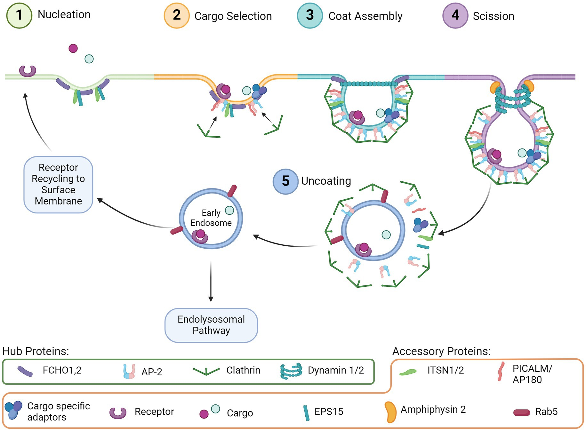

沿编号 1–5 依次定位位点启动、货物选择、包被装配、裂变和脱包被；对照下方图例辨认 AP2、网格蛋白与 Dynamin。

**读图边界：** 阶段编号是阅读框架；真实位点中过程会重叠，脱包被囊泡也不等于已经成熟的早期内体。

**许可：** [CC BY 4.0](https://creativecommons.org/licenses/by/4.0/)。完整图版，未改绘。

把“质膜→囊泡→内体→溶酶体”的箭头改写成问题：每条箭头的起始池是什么？事件是否可逆？是否有旁路？观察的是分子数、比例、占据量，还是单位时间穿过边界的通量？这种改写决定哪些数据能够回答问题。

例如，若表面受体减少，可能是内化加快，也可能是回收变慢、合成/递送减少，或表位不可及。只测表面终点不能区分这些机制。同理，内体中受体积累也可能来自入口增强、出口受阻或降解失败。

## 02 · 膜与局部力学：为什么一张膜会弯，也会不弯？

### 2.1 拓扑先于分子故事

质膜胞质侧始终面对胞质；非胞质侧在内化后面对囊泡腔。通常囊泡运输保持这种朝向。融合连通的是非胞质水相，裂变改变膜的连通关系；两者都不是可溶性货物直接穿过脂质疏水核心。

**辅助图 T1**：膜的胞质侧与非胞质侧。见 HTML 中的完整示意。

内体限制膜向腔内出芽形成 ILV 时，受体胞质尾部最终被封入 ILV 内侧。它在拓扑上的可及性改变，解释了为什么“仍在膜上”与“仍能接触胞质信号因子”不是同一件事。这个约束比单纯记忆 ESCRT 的名字更重要。

深入：融合与裂变为什么不能当成简单录像倒放？

脂质膜最终的连通变化在拓扑上有关，但实际可达路径受到不同蛋白装配、能量输入、颈部几何、脂质组成与张力条件限制。融合可以经历脂质混合而未形成内容物通道；包被膜已经形成深窝，也不意味着颈部已完成裂变。体外系统中的一个中间态不能自动成为所有细胞内事件的固定阶段。

**论文图 P01：膜融合的近端单层、半融合与融合孔**。Frontiers in Molecular Neuroscience (2017) · 原文 Figure 1 · [原始来源](https://doi.org/10.3389/fnmol.2017.00168)。

按 A→F 看接触、去蛋白脂质区、融合茎、半融合盘、初始融合孔和融合后形态。C、D 的连接关系可用于辨别近端与远端单层。

**读图边界：** 这是经典路径的模型图；不能据图断言所有细胞融合均经历可检测的半融合盘。

**许可：** [CC BY 4.0](https://creativecommons.org/licenses/by/4.0/)。完整图版，未改绘。

### 2.2 用最小力学模型辨认变量

教学用的膜自由能写法可以是：

F = ∫ [κ/2 · (2H − C₀)² + κ̄K] dA + σΔA + F黏附/骨架/蛋白

这里 κ 是弯曲刚度，H/K 描述曲率，C₀ 是有效自发曲率，σ 表示面积代价相关的张力。最后一项提醒我们，完整细胞还包含皮层附着、蛋白装配、拥挤和外侧环境。**这是建模语言，不是把活细胞代入几个常数就能直接算出内吞率的定律。** 细胞膜的面积储备、边界和骨架连接均可能随时间变化。

它带来的实际判断是：看见 actin 招募增加，不能只解释为细胞“想多内吞”；也可能是负载升高，需要更多力维持原有通量。看见包被更多，也不能直接解释为包被产生了更多有效内吞；某一步停滞同样会增加结构数量。

### 2.3 “膜张力”要问测的是哪一种

拉膜管常测得表观膜张力，其中可混合双层自身张力与膜—皮层连接效应。细胞整体拉伸、渗透膨胀、局部膜管和荧光力学探针并不必然报告同一物理量。膜脂变化还可能改变弯曲刚度或探针响应，使同一种读出变化有不同解释。

Shi 等在完整细胞与 bleb 的比较中报告不同的张力传播性质，提示不能无条件假设细胞任一位置的张力都瞬时一致。该结果限定于其细胞与测量条件，不排除其他体系中的远程机械响应。[SH18](https://doi.org/10.1016/j.cell.2018.09.054) 2026 年 hiPSC 研究又把微吸引、细胞群边界和局部内吞位点放在一起观察；它研究的是特定细胞与机械耦合环境，而不是推翻所有已有张力测量。[MY26](https://doi.org/10.1073/pnas.2532817123)

**[研究建议]** 若课题目标只是确定摄取是否改变，先做可靠的内化读出。若要声称“通过张力改变内吞”，才需要独立测量或约束力学变量，并检验细胞体积、皮层和接头分布等替代中介。不要为技术完整而先购置一套力学设备。

## 03 · 从受体到包被：选择不是一把锁配一把钥匙

### 3.1 先把胞外结合与胞质尾部识别分开

配体浓度、亲和力、价态和受体表面密度共同影响占据与聚集。胞质侧分选信号随后被不同接头读取：AP2 可识别特定 YxxΦ、酸性双亮氨酸等信号，ARH/Dab2 等可连接带 NPXY 信号的货物。泛素还可改变部分货物的内化或后续分选，但不能被当作所有 CME 货物的通用必需标签。

**论文图 P06：跨膜货物如何与胞质侧接头连接**。Frontiers in Molecular Biosciences (2017) · 原文 Figure 1 · [原始来源](https://doi.org/10.3389/fmolb.2017.00072)。

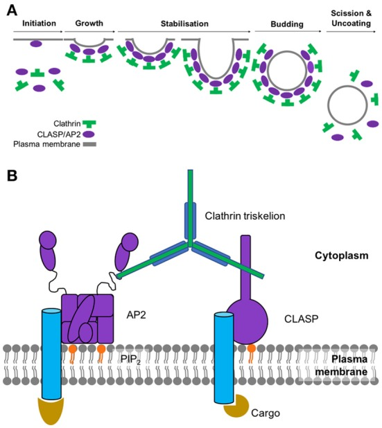

A 为装配过程概览；B 将膜外货物、跨膜受体、AP2/CLASP、PIP₂ 与网格蛋白放在同一空间关系中。重点辨认膜的两侧。

**读图边界：** 图示为功能关系；不表示每种货物都直接结合 AP2，也未给出精确结构或相互作用强度。

**许可：** [CC BY 4.0](https://creativecommons.org/licenses/by/4.0/)。完整图版，未改绘。

“结合量相同”不保证受体空间分布、停留时间或聚集状态相同。若比较配体或抗体，标记位置、标记比例、二价交联和游离染料都可能改变被研究对象。抗体 feeding 的优点是能追踪受体池；代价是抗体本身可能改变受体聚集、信号或回收。

### 3.2 AP2 的募集、激活和功能输出是三步

AP2 到膜上并不自动意味着可以有效招募网格蛋白。Kelly 等的 Science 工作把自抑制结构、解除抑制的突变与膜上重构连接起来：生理膜配体及货物有助于形成可用的招募状态，人工把复合物拴到膜上不是完全等价的操作。[K14](https://doi.org/10.1126/science.1254836) 这是一种“**位置正确但状态不一定正确**”的问题。

FCHO、Eps15、AP2 与 PIP₂ 形成的局部网络，需要兼顾分子接触、膜停留和装配稳定性。FCHo2/PIP₂ 重构图可帮助看见环境重新组织，但它没有直接测量每个细胞中 AP2 的激活构象。把两种证据放在一起，既能建立机制，也能避免让某一张图承担过多结论。

**论文图 P07：内吞位点的脂质与货物环境：FCHo2 使受体附近的 PIP₂ 信号重新聚集**。eLife (2022) · 原文 Figure 1 · [原始来源](https://doi.org/10.7554/eLife.73156)。

A：实验设置与膜片上的三通道图像，TfR 为青色、PI(4,5)P₂ 为黄色、FCHo2 为品红。B–D：比较加入 FCHo2 前后，TfR/EGFR 附近的 PIP₂ 信号及其强度分布；PS 是脂质对照，A–C 标尺 2 μm。E–F：HT1080 细胞表达 mCherry、mCherry-FCHo1 或 mCherry-FCHo2 后，内源 PIP₂ 染色与分布统计，E 标尺 4 μm。

**读图边界：** 膜片实验经过细胞去顶，E–F 采用过表达。图中没有直接测量 AP2 构象、完整囊泡裂变或受体内化通量，不能把共定位当作所有环节均已完成。

**许可：** [CC BY 4.0](https://creativecommons.org/licenses/by/4.0/)。完整图版，未改绘。

### 3.3 起始、稳定与成熟要分别统计

Cocucci 等为了观察最初少量分子，使用高灵敏时间序列，并用单 EGFP 强度校准连接亮度与分子数。他们还把初始到达与后续失败分开，因此 FCHO 相关表型不能仅用“位点数量少了”概括。[C12](https://doi.org/10.1016/j.cell.2012.05.047)

**[研究建议]** 比较一个候选启动因子时，至少明确“单位膜面积、单位时间的新事件数”“事件持续时间分布”和“成功成熟的比例”各代表什么。一个同时稳定早期结构和延迟离开的蛋白，可能让位点变多、变长，但净内化并不增加。低帧率与阈值还会丢掉短暂事件，使表面上成熟率升高。

### 3.4 什么时候才值得讨论凝聚或多价相互作用？

多位点、低亲和力和协同募集可以解释局部装配；它们并不自动证明形成液态凝聚体。若要提出相分离机制，应明确需要额外证明哪些相行为、浓度依赖与材料性质，以及这些性质怎样改变货物摄取。融合、FRAP 恢复或亮点形成，单独都不能替代这些论证。

## 04 · 包被弯曲、actin 与裂变：怎样读懂不同模型？

### 4.1 比较模型，先统一被测量的几何

“边长边弯”和“先较平再弯”可能指膜轮廓、包被表面或荧光强度的不同关系。Avinoam 等的 Science 研究用相关成像与电子断层讨论包被重塑，本轮仅将其作为摘要已核的历史定位。[A15](https://doi.org/10.1126/science.aaa9555) Scott 等进一步从活细胞测得不同时间关系，Bucher 等把几何模型、接头比例与力学条件连接起来。[S18](https://doi.org/10.1038/s41467-018-02818-8)[BU18](https://doi.org/10.1038/s41467-018-03533-0)

**论文图 P04：电镜中的平坦、穹顶与圆形包被**。Nature Communications (2018) · 原文 Figure 1 · [原始来源](https://doi.org/10.1038/s41467-018-02818-8)。

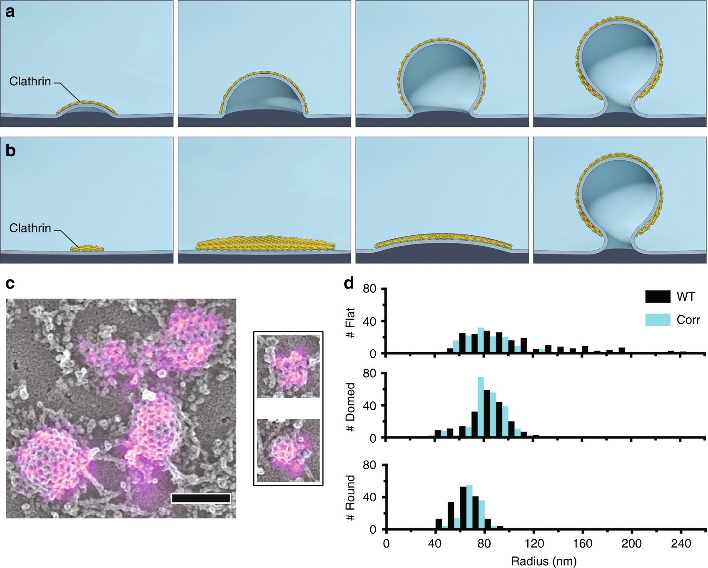

c：去顶 SK-MEL-2 细胞的相关 dSTORM/TEM 图像，比例尺 200 nm；a、b 为两种弯曲模型。

**读图边界：** 不同结构的快照不是同一囊泡的连续帧。

**许可：** [CC BY 4.0](https://creativecommons.org/licenses/by/4.0/)。完整图版，未改绘。

**论文图 P08：装配与弯曲存在不同的时间关系**。Nature Communications (2018) · 原文 Figure 3 · [原始来源](https://doi.org/10.1038/s41467-018-02818-8)。

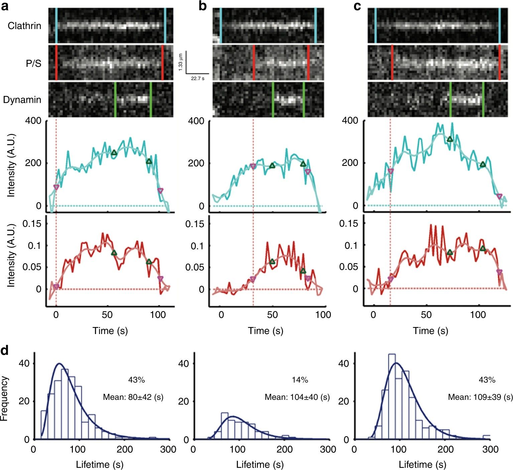

a–c：比较网格蛋白信号与弯曲读出 P/S 的起点、平台和重叠；d 为寿命分布。

**读图边界：** 这些类别来自特定细胞与读出，不能当作全部细胞的固定比例。

**许可：** [CC BY 4.0](https://creativecommons.org/licenses/by/4.0/)。完整图版，未改绘。

因此，不宜用一张平坦结构的电镜图宣告所有位点都先平后弯，也不能从强度增长直接推出面积增长。荧光强度还受标记比例、照明、轴向位置和交换影响。不同研究之间需要比较同一几何定义、同类细胞与相同筛选条件。

Sochacki 等在多细胞比较及去顶体系中研究包被自发弯曲。去顶后不添加新的能量源或胞质因子仍能出现弯曲，说明该体系保有促弯能力；它并不证明完整细胞从装配到裂变不需能量，也不排除先前装配已储存能量。[D21](https://doi.org/10.1016/j.devcel.2021.03.017)

### 4.2 actin 的“必要性”为什么会变化？

Boulant 等利用极化细胞不同膜面、低渗与机械拉伸比较 actin 依赖性。关键推进不是多测一种抑制剂，而是让“膜面差异”与“机械阻力差异”能够相互检验。[B11](https://doi.org/10.1038/ncb2307) V1 的 STORM 图则回答 actin 在包被周围怎样组织；固定细胞的网络形态不能单独给出力值。

**论文图 P09：内吞位点的网格蛋白与 actin 三维组织**。Molecular Biology of the Cell (2022) · 原文 Figure 1 · [原始来源](https://doi.org/10.1091/mbc.E21-11-0589)。

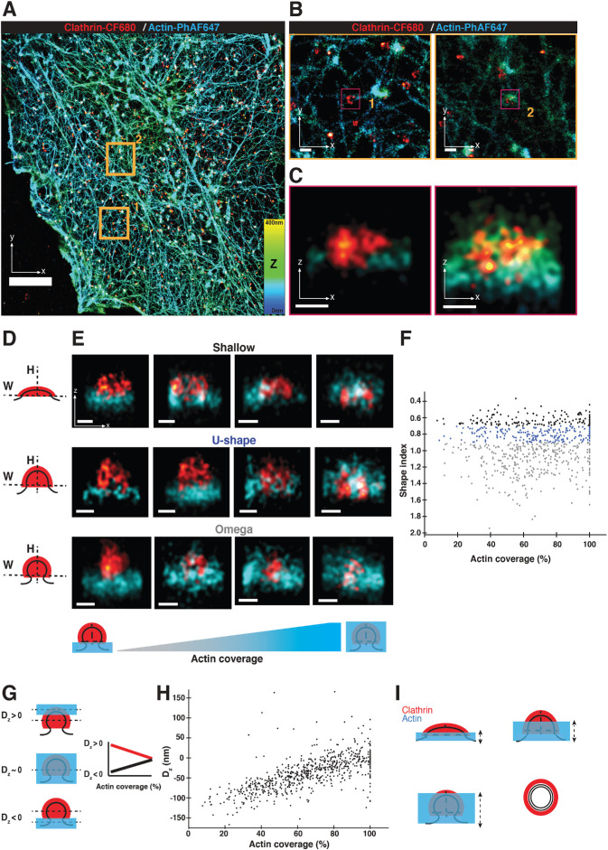

A–C：网格蛋白（红）与 actin（青）的空间分布；E：浅窝、U 形及 Ω 形包被的 x–z 投影；F、H 将包被几何与 actin 覆盖或高度对应。

**读图边界：** 固定细胞的空间排列不直接给出时间次序、力值或每个窝的张力；张力适应还需同文后续干预实验支持。

**许可：** [CC BY-NC-SA 4.0](https://creativecommons.org/licenses/by-nc-sa/4.0/)。完整图版，未改绘。

**[论证重建]** 如果 actin 的贡献是补偿负载，那么在较易变形条件下干预作用较小、较高负载时作用更大，是值得检验的预测。但低渗不仅改变张力，也改变体积、离子和细胞骨架状态；遗传或药理干预 actin 也会反过来改变皮层。应把这组双向作用纳入解释，不能把“处理名称”直接当作纯自变量。

### 4.3 2026 年的新读出，增加了什么，也依赖什么？

一项 Nature Communications 研究用转铁蛋白修饰金纳米棒跟踪旋转行为，提出晚期 CME 中不同机械运动与 actin 招募关联。它的新增价值是超出蛋白亮点强度，提供运动代理量；但读出仍通过纳米棒—受体—膜窝的耦合实现。[ME26](https://doi.org/10.1038/s41467-026-75876-y) 研究自己的边界与本版分析都要求保留：探针尺寸、负载、耦合稳定性和通路验证会影响从运动到膜形变的推断。

**[研究建议]** 如果常规成像已经能区分“结构形成”和“货物真实内化”，先把它们做好。只有当争议转为“晚期何种机械运动不同”，才值得寻求这类单粒子/力学合作。

### 4.4 裂变：位置、催化和拓扑完成分别需要证据

Dynamin 的装配、GTP 循环、膜管收缩和真正分离不是同一种观察。重构体系可隔离机制条件，活细胞则保留完整环境；两者回答的问题不同。以下高速 AFM 图显示特定重构膜管中的形态变化，不能直接替代活细胞受体内化率。

**论文图 P10：Dynamin–amphiphysin 的真实膜裂变：高速 AFM 时间序列**。eLife (2018) · 原文 Figure 4 · [原始来源](https://doi.org/10.7554/eLife.30246)。

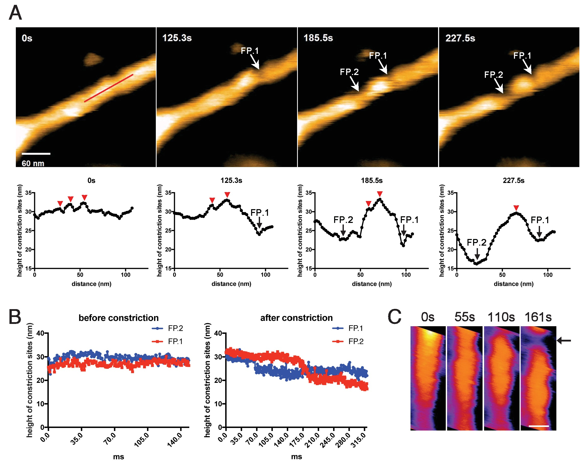

A：同一膜管的高速 AFM 时间序列与沿红线测量的高度剖面；FP.1/FP.2 标出蛋白簇两侧的裂变位置，红箭头标出蛋白簇。B：相应位置收缩前后的高度变化。C：另一序列显示蛋白簇侧方出现收缩，标尺 40 nm。暖色为 AFM 伪彩高度信号，并非荧光共定位。

**读图边界：** 观察对象是固体支持上的体外膜管，不是活细胞 CME 囊泡。AFM 高度轮廓不能直接分辨脂质单层拓扑，也不单独决定 GTP 水解与每一步裂变的精确耦联。原图 B 的横轴标为 ms，而对应时间序列及图注使用 s；本资料不据该轴作速率计算。

**许可：** [CC BY 4.0](https://creativecommons.org/licenses/by/4.0/)。完整图版，未改绘。

ESCRT-III/Vps4 研究提供另一个有用比较：通过正确方向的膜管、可定时释放的 ATP 与催化条件，检验逆向拓扑的切割能力。[ES18](https://doi.org/10.1126/science.aat1839) 这不意味着质膜 CME 裂变与 ILV 形成使用相同几何或同一执行机器。比较实验时，首先画清膜哪一侧能接触机器。

### 4.5 脱包被不是把囊泡拆散

Auxilin 类 J-domain 蛋白、Hsc70 循环及磷脂酰肌醇去磷酸化共同改变外层包被与接头的驻留。移除的是胞质侧蛋白壳；载体膜和腔内货物可以保留。若某处理导致包被囊泡增多，还要区分形成增多、脱包被变慢或后续融合障碍。

**论文图 P11：壳消失、膜囊泡保留：酶促脱包被的负染电镜证据**。eLife (2018) · 原文 Figure 4—figure supplement 1 · [原始来源](https://doi.org/10.7554/eLife.32569)。

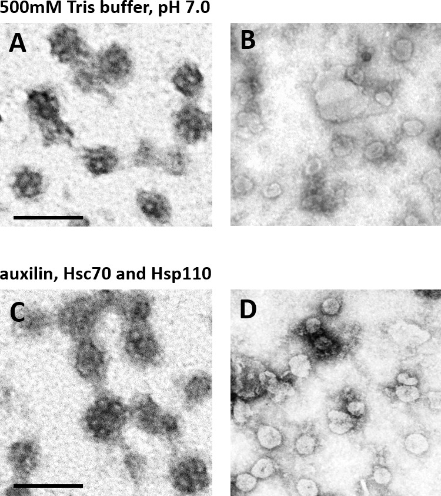

A–B：包被囊泡在中性 500 mM Tris 缓冲液处理前后。C–D：另一组包被囊泡在 auxilin、Hsc70 与 Hsp110 酶促处理前后；处理后可看到缺少外层笼状包被的膜囊泡。标尺 100 nm，A/B 与 C/D 均是群体样品前后比较，不是同一个囊泡的连续追踪。

**读图边界：** 酶促条件同时含 auxilin、Hsc70 与 Hsp110，本图不能单独归因于某一个组分。负染静态图不提供 ATP 水解动力学、所有接头蛋白释放顺序或活细胞内精确时程。

**许可：** [CC BY 4.0](https://creativecommons.org/licenses/by/4.0/)。完整图版，未改绘。

ATP/GTP 在这里不只是笼统“供能”：它们参与不同蛋白的状态循环、装配重排或复位。整细胞 ATP 下降会同时影响多环节，不能据此确定某个运输步骤就是唯一受影响节点。

## 05 · 内体：身份、化学环境和货物命运怎样共同变化？

### 5.1 内体是动态网络中的区室，不是固定标签的袋子

Rab5、PI3P 和 EEA1 有助于组织早期内体的系留、融合与分选环境；Rab7 参与较晚阶段的功能网络。但细胞器会融合、裂分并交换膜和蛋白，因此“同一个内体”需要操作定义。追踪对象可以是一个连续膜轮廓、一团货物，或某一膜域，它们在融合后不一定保持相同身份。

Rink 等提出 Rab 转换作为成熟机制，本轮对该经典工作的使用限于摘要与历史概念定位。[R05](https://doi.org/10.1016/j.cell.2005.06.043) 下面的现代活细胞图可以帮助学习单内体标记更替，但其 nigericin 扩大内体的条件必须随解释一起保留。

**论文图 P12：Rab5→Rab7 转换：在同一个扩大内体上追踪膜身份变化**。eLife (2021) · 原文 Figure 1 · [原始来源](https://doi.org/10.7554/eLife.70982)。

A：mApple-Rab5 为红色、GFP-Rab7 为绿色，显示处理后扩大内体的形态恢复。C：逐帧追踪同一个内体，Rab5 先募集后消失，同时出现 Rab7；D 展示两个 Rab5 阳性内体融合后的标记变化。E 同时观察 Rab7 与 LysoTracker 信号。C–E 比例尺 2 μm，时间相对于 nigericin 洗脱计算。

**读图边界：** 细胞先接受 10 μM nigericin 20 min 再洗脱，内体被人为扩大，不能把图中的分钟数视为未处理细胞的普遍时间表。LysoTracker 富集是酸性区室读出，并非经过校准的绝对 pH；本图也不能单独给出 Rab 转换的全部因果机制。

**许可：** [CC BY 4.0](https://creativecommons.org/licenses/by/4.0/)。完整图版，未改绘。

**[研究建议]** 分析 Rab5→Rab7 时，先检查分裂、融合、轨迹断裂与交换事件；再问信号变化是否可由 z 位移、曝光差异或分割阈值解释。一个扩大区室的标记持续时间，不应直接等同未处理细胞的普遍成熟时长。

分子接口：Rab、PI3P、EEA1 与 SNARE 分别解决什么问题？

Rab 是受核苷酸状态调控的小 GTP 酶。GEF 促进 GDP 释放和核苷酸交换；GAP 促进 GTP 水解。这里的“激活”是状态转换，不能由 Rab 总蛋白量或单一定位图代替。PI3P 是膜脂身份的一部分；EEA1 是读取膜脂与 Rab 条件的系留因子；SNARE 则参与后续膜融合机器。把它们都叫作“早期内体标记”，会丢掉真正需要研究的接口。

| 操作层 | 要实现的关系 | 为什么一个常见读出仍不够？ |
|---|---|---|
| 膜身份与募集 | 合适的膜脂和活化 Rab 使效应因子在正确位置工作 | EEA1 信号下降可能来自 PI3P、Rab 状态或蛋白量变化，不能直接叫“内体消失” |
| 远距离捕获 | 系留增加合适载体与靶膜相遇、保持接触的机会 | 两个斑点接近或共同移动，仍可能没有腔内容物连通 |
| 拉近与对接 | 从可捕获距离进入更接近的几何状态 | 载体团聚可能是捕获成功、后续受阻，而不是融合增强 |
| 膜融合与货物递送 | 膜连通和内容物交换真正发生 | 脂质混合、染料转移与水相内容物混合需要按具体体系区分 |

**[研究报告]** Murray 等的 Nature 研究重构 EEA1、PI3P 与 Rab5 系留体系，结合结构观察、光镊及构建体分析，报告 Rab5:GTP 可使 EEA1 从伸展变得柔顺，并提出熵塌缩将已捕获载体拉近的机制。[MU16](https://doi.org/10.1038/nature19326) 它连接了“选择对象”和“改变几何”，但不能被简化成 EEA1 单独足以完成全部融合。

**[研究建议]** 常规设备先确认货物从表面进入后是否到达合适区室，并同时记录 EEA1 蛋白量、定位与货物去向。若核心问题是“已经捕获却不能融合”，仅增加固定共定位图辨识力有限；应考虑经验证的内容物交换读出或重构合作。先选需要判定的事件，再选择技术。

为什么 Rab 身份能够切换？为什么当年选择线虫体腔细胞？

如果早期身份能够正反馈维持，成熟就不仅是“等时间过去”，还需要解除旧网络并建立后续网络。Poteryaev 等在 Cell 研究中分析 SAND-1/Mon1 与 RABX-5/Rabex5 的联系及其膜驻留，支持打断 Rab5 正反馈这一作用。[PO10](https://doi.org/10.1016/j.cell.2010.03.011) 这里不能把 Rab5 荧光变弱直接等同每个分子的 GTP 水解；定位和活性是不同变量。

**作者明确说明的体系选择理由**是：线虫体腔细胞的内体较大且摄取活跃，普通光学成像较易辨认限制膜与腔，已有标记和 BSA–Texas Red 示踪又便于在活体追踪。论文随后使用酵母研究过表达效应，也明确利用了其表达量较易控制的优势。这不是“哪个物种更高级”的选择，而是让待研究关系变得可观察、可操控。迁移到哺乳动物时，仍需重新确认尺寸、表达和动态范围，不能把线虫时长作为通用常数。

历史模型也需要更新：不能沿用早期论文中的推测，将 HOPS 一概称作 Rab7 的交换因子。后续生化工作直接检验了 Mon1–Ccz1 对酵母 Rab7 同源物 Ypt7 的 GEF 活性，并比较保留复合物形成/定位而损失交换活性的突变。[CA14](https://doi.org/10.1242/jcs.140921) 这再次说明，“能定位”与“能催化状态转换”可以分离；物种和复合物组成仍应随结论保留。

### 5.2 酸化不是只看 V-ATPase 的表达量

质子泵入腔内会建立化学梯度和膜电位；反离子通量、质子泄漏、缓冲容量、腔体积与膜运输共同决定 pH。对一个 H⁺ 的电化学代价可以写作：

ΔμH⁺ = RT ln([H⁺]腔/[H⁺]胞质) + F(ψ腔−ψ胞质)

这解释了为什么“泵更多”与“腔更酸”并非无条件的一一对应。Steinberg 等通过离子替换、区室通透控制和比率 pH 读出讨论反离子对酸化的贡献，说明不能只把阴离子内流视为唯一电荷补偿方式。[I10](https://doi.org/10.1083/jcb.200911083)

酸性染料的亮度会同时受装载、体积、区室数量、保留和 pH 影响。若目标是绝对 pH，需要合适动态范围、参考通道与原位校准；若只需判断货物进入酸性区室，可以采用较低要求，但结论的名称也应相应收窄。

### 5.3 腔内、胞质平均值与膜邻近微环境不是同一空间

“内体腔酸化不等于整个胞质变酸”仍是有用区分，但不能扩成“所有胞质侧位置都化学均一”。2026 年 Nature Cell Biology 报告了溶酶体外表面的酸性纳米层及其与运输调控的联系。[PH26](https://doi.org/10.1038/s41556-025-01855-y) **本轮仅取得公开摘要、图题及两份更正，未获得订阅全文和完整校准方法，因此将其作为近期报告与待深入材料，不作为已全面核验的完整案例，也不外推到全部早期内体。**

该文的出版更正涉及审稿信息；作者更正补充讨论及参考文献。更正本身不等于结果被否定，但核查版本是评估材料的必要步骤。研究上真正值得带走的问题是：当胞质可溶探针与膜锚定探针给出不同结果时，是空间梯度、探针化学、定位不纯还是校准方式造成？先区分这些，才谈新的调控机制。

### 5.4 分选发生在多个位置，早期内体本身也有异质性

Lakadamyali 等通过活细胞货物与内体运动追踪，研究不同货物进入不同早期内体群体的偏好。[L06](https://doi.org/10.1016/j.cell.2005.12.038) 它使“所有货物先到同一个共同分选站”的图景需要增加条件。这里的群体划分服务其细胞和读出，不是为全部细胞建立永远不变的两类内体。

膜上的货物信号、泛素修饰、膜域、分选因子、管状载体、actin 与微管运动共同影响出口。回收不是“只要没有降解标记就自动返回”：SNX27/retromer、SNX17/retriever 及其他路线识别与组织不同货物，不能因为都含 VPS 或 SNX 名称就视为同一机器。[M17](https://doi.org/10.1038/ncb3610)

### 5.5 ILV、ESCRT 与信号可及性

泛素化货物可以被 ESCRT 网络分选入 ILV。多泡体中的膜拓扑变化，会使受体胞质尾部与胞质效应蛋白的接触机会改变；最终水解还需要后续降解环境。进入 Rab7 阳性区室、进入 ILV 和蛋白被降解，是可分离的事件。

经典分工中，ESCRT-0 的 HRS/STAM 等帮助识别与集中泛素化货物；ESCRT-I/II 连接货物分选、膜形变和下游装配；ESCRT-III 与 VPS4 参与动态重排及膜切割。这是理解角色的简图，不表示所有场景都依赖每一级，也不表示整套复合物始终同步装配。Wenzel 等在其 HeLa 体系中比较了不同组分的重复募集波，提示不能把一张静态顺序图当成所有组分的共同寿命。[WE18](https://doi.org/10.1038/s41467-018-05345-8)

**论文图 P13：EGFR 进入腔内囊泡：电镜、三维断层与 ESCRT 招募动力学**。Nature Communications (2018) · 原文 Figure 3 · [原始来源](https://doi.org/10.1038/s41467-018-05345-8)。

a：EGF 刺激 5、10、15 min 后的电镜；10 nm 金颗粒标记内化 EGFR，可见出芽轮廓及逐渐增多的腔内囊泡。b：250 nm 厚切片的断层重建，红色为已脱离限制膜的 ILV，蓝色为邻近包被区。c 比较 ESCRT 招募波次与切片中的 ILV 数目分布。d：单个内体的 CHMP4B-GFP 与 mCherry-RAB7 动态。e：25 min 时的出芽与降解相关结构。电镜比例尺均为 100 nm。

**读图边界：** 电镜时间点来自不同样本；ESCRT 波次与 ILV 数目的关系由两类实验的统计对应支持，并非同时直接看到同一个招募波形成一个 ILV。单幅图不能证明所有内体或受体都遵循完全相同的动力学。

**许可：** [CC BY 4.0](https://creativecommons.org/licenses/by/4.0/)。完整图版，未改绘。

同样是 clathrin，怎样区分质膜入口与内体分选的贡献？

内体上由 HRS 关联的 clathrin 功能，不能直接套用质膜 AP2–clathrin 膜窝的几何和货物进入方向。全细胞 clathrin 敲低会同时影响多处运输；即使 EGFR 降解异常，也难以定位原发步骤。

Wenzel 等为限制这个混淆，在敲低内源 HRS 后，以接近内源水平的抗 siRNA 野生型或缺少 clathrin-binding 区的 HRS770 替换，并核查其 clathrin 关联/募集。作者明确以此来减少 clathrin 其他位置功能的干扰。[WE18](https://doi.org/10.1038/s41467-018-05345-8) **[论证重建]** 相较整细胞关闭，这种接口扰动更接近目标膜域；但删除区域仍可能影响其他性质，所以表达、定位和关联验证不可省略。

**[可迁移做法]** 研究“某运输蛋白促进受体降解”时，先问它是否同时改变入口与后续分选。若二者重叠，选择有依据的分离功能构建体，或追踪已经内化的同一货物池。晚期加入药物也需检验作用速度与其他靶点，不能仅凭加入时间宣称选择性。

**[研究建议]** 若只做普通共聚焦，通常不能可靠区分一个亚分辨内体中的限制膜与 ILV。可以先用运输/降解功能与遗传证据建立问题，再决定是否需要免疫电镜或断层成像。更高分辨率应服务这个拓扑判别，而不是仅增加图片细节。

### 5.6 ER、骨架和代谢不是远处的背景

ER 与内体接触可以把分选域、脂质交换和分裂位置连接起来；但一次接触并不意味着所有功能都由相同分子执行。[R14](https://doi.org/10.1016/j.cell.2014.10.023) 微管运输又改变区室接触和位置；药物解聚微管还会改变全细胞组织，所以不能仅从区室靠核与否推断某一个马达活性。

**论文图 P14：微管与动力蛋白支持内体运动：用扰动条件检验真实运输轨迹**。PLOS ONE (2011) · 原文 Figure 1 · [原始来源](https://doi.org/10.1371/journal.pone.0024479)。

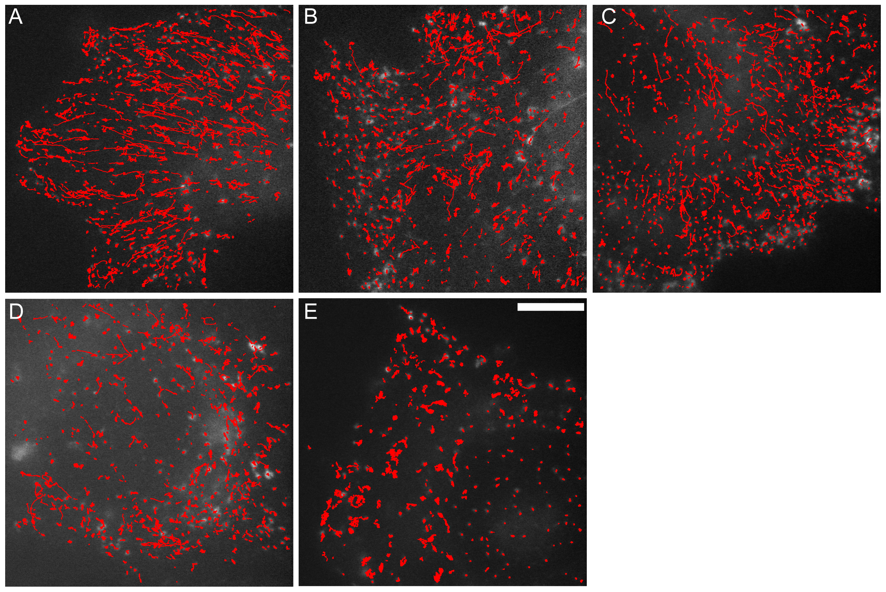

作者以 28 帧/秒记录 1000 帧，将自动追踪所得红色轨迹叠加在第一帧内体荧光图像上。A 为对照；B 为胞质动力蛋白重链 DHC1 耗竭；C 为过表达 dynactin 亚基 p50；D 为表达干扰 dynein–dynactin 相互作用的 CC1 片段；E 为 nocodazole 处理。比例尺 10 μm。红线是内体运动轨迹，绝不是微管染色。

**读图边界：** 各面板展示不同细胞的代表性轨迹，不能只比较单图中红线总量来计算抑制率；定量结论需结合原文 Figure 2–5 和统计。本图不直接显示 kinesin/actin，也不证明每个局部内吞位点形成都需要微管。

**许可：** [CC BY（原文未注明版本）](https://journals.plos.org/plosone/article?id=10.1371/journal.pone.0024479)。完整图版，未改绘。

营养状态与溶酶体位置、mTORC1 和降解过程之间存在反馈，相关研究也表明位置改变不能在缺乏营养输入时单独恢复全部信号。[N11](https://doi.org/10.1038/ncb2204) 因而“先饥饿以同步细胞”不是中性步骤：它可能改变表面受体、代谢、区室位置和后续响应。是否饥饿、多久、用何种培养条件，应由知识目标和预实验决定，而不是照抄习惯。

## 06 · 三类受体：先确定你在追踪谁

### 6.1 TfR1：受体、蛋白配体和铁是三个不同对象

TfR1 的经典功能是利用受体循环摄取转铁蛋白携带的铁。内体中的铁释放、还原与跨膜转运，并不意味着 apo-transferrin 必须立即离开受体；受体和配体还可共同回到表面，随后解离。这里最值得积累的不是单条箭头，而是**一个复合物在不同化学环境中的结合关系可以不同**。

**论文图 P15：TfR 回收可被细胞状态迅速调节：抗体预标记与流式定量**。BMC Biology (2022) · 原文 Figure 1 · [原始来源](https://doi.org/10.1186/s12915-022-01386-0)。

A：Jurkat T 细胞的 Alexa647-transferrin 摄取。B：先用生物素化抗 TfR 标记受体池，再封闭当时位于表面的标记；刺激后用荧光链霉亲和素检测重新到达细胞表面的受体。C：独立检测表面 TfR 水平及代表性流式分布；D、E 在扩增原代人 T 细胞中分别检测表面受体与回收。

**读图边界：** 数据来自 Jurkat 与扩增人 T 细胞及特定激活条件；回收受体的抗体标记信号不等同铁释放或铁输入量，本图也未直接测定内体 pH。不能将其时间与倍数作为所有细胞的 TfR 循环常数。

**许可：** [CC BY 4.0](https://creativecommons.org/licenses/by/4.0/)。完整图版，未改绘。

因此，荧光 Tf 摄取、表面 TfR1、预标记受体回收、细胞铁含量和铁依赖生理效应，不是可互换读出。上图直接提供的是特定 T 细胞条件下的受体回收证据，不测量绝对内体 pH 或铁输入量。研究营养摄取时，需要把运输与营养物释放的证据接起来；研究受体循环时，则应避免让铁代谢的下游变化替代回收测量。

为什么受体和配体回来了，铁却可以留在细胞内？

经典铁摄取链把不同物质分流：酸化改变 Tf 携铁的释放条件；Fe³⁺ 的还原与 Fe²⁺ 跨内体膜转运，将金属从腔内运输系统交给胞质侧代谢；apo-Tf 则可继续与 TfR1 共同循环，在表面环境中解离。铁跨膜不是 Tf 蛋白穿膜，也不是整个囊泡的内容物都进入胞质。

Ohgami 等以小鼠突变体的定位克隆、铁还原与摄取证据，识别出对红系细胞有效 Tf 铁摄取重要的 Steap3。[OH05](https://doi.org/10.1038/ng1658) STEAP3 的还原作用与 DMT1 等转运环节应分开理解；这项红系证据不能证明每一种细胞都只依赖 STEAP3。

**[研究建议]** 若问题是“铁获取为何不足”，可把配体摄取、受体回收与经验证的铁输入/利用读出连接起来。铁敏感染料反映的可交换铁池还受储存、利用和氧化还原影响，不等于单位时间跨膜输入。若运输读出正常而铁利用异常，下一步应转向释放、还原、转运或代谢，不能只继续拍更多 Tf 斑点。

### 6.2 LDLR：受体循环与脂蛋白加工为什么需要分开？

经典模型中，LDL 与 LDLR 内化后可在酸性运输环境中分开，受体被回收，LDL 进入后续加工；受体丰度与细胞胆固醇稳态还存在反馈。这意味着长时间的 LDL 摄取变化可能由入口速率、受体回收、受体表达或下游胆固醇处理共同产生。

**论文图 P16：LDLR 回收与 LDL 降解的分流**。Frontiers in Cell and Developmental Biology (2022) · 原文 Figure 1 · [原始来源](https://doi.org/10.3389/fcell.2022.826379)。

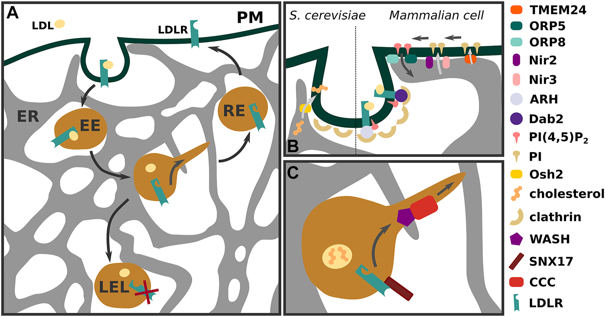

A：LDL 与 LDLR 内吞后分流；B：质膜–内质网接触位点，区分酵母与哺乳动物；C：SNX17、WASH 与 CCC 等参与受体回收。

**读图边界：** B 混合呈现不同物种机制，不能把酵母甾醇机制直接套用于哺乳动物；这也不是单一实验的直接观察。

**许可：** [CC BY 4.0](https://creativecommons.org/licenses/by/4.0/)。完整图版，未改绘。

**[研究建议]** 若处理降低荧光 LDL，应先检查表面 LDLR 与起始结合，再区分短时内化和较长时间的降解/脂质利用。检测胆固醇或转录响应能提供生理联系，却不能独立定位运输瓶颈。若比较回收接头，应直接观察受体命运，而不是只追踪配体颗粒。

酸性环境如何改变 LDLR 的结合？结构为什么还需要功能证据？

Rudenko 等的 Science 研究获得 pH 5.3、3.7 Å 的 LDLR 胞外区结构，显示配体结合模块向 β-propeller 回折，并提出有助于配体释放的分子内竞争模型。[RU02](https://doi.org/10.1126/science.1078124) 作者明确限定，该分辨率支持模块相对排布，不足以讨论精确侧链构象。晶体中的一种构象也不是完整细胞里释放、回收全过程的录像。

**[论证重建]** 选择内体相关 pH，使结构对应特定工作环境；研究用途是提出怎样释放配体的可检验解释，而非再确认一次受体能够结合 LDL。**[研究建议]** 比较候选突变时，需依次检查成熟/折叠与表面递送、中性条件结合、改变环境后的释放，以及受体回收。否则“回收减少”可能只是受体未到表面或没有正常起始结合。

释放后，LDL 颗粒的后续降解、胆固醇酯水解与游离胆固醇离开降解区室，仍是不同环节。因此，LDL 颗粒染料残留不必与可利用胆固醇同步，细胞胆固醇变化也不直接证明入口改变。研究目标若转为脂质利用，应增加对应的加工/运输证据，而不只追踪 LDLR。

### 6.3 EGFR：剂量和受体丰度会改变路线问题

EGF—EGFR 既是被运输的货物，也触发会影响运输的信号。配体剂量、受体数量、泛素化与细胞状态可能改变回收和降解的平衡；不能把某一细胞中的高/低刺激阈值作为所有体系的通用常数。[E13](https://doi.org/10.1038/emboj.2013.149)[E15](https://doi.org/10.1038/ncomms8999)

EGFR 的测量至少要分开：表面量、内化比例、总受体下降、受体磷酸化及下游信号。pERK 或 pAKT 是网络输出；其时间曲线还受反馈和磷酸酶影响。单靠它们，不能判断信号究竟来自质膜还是内体。需要位置相关的证据，或把运输改变与空间来源分开操控。

### 6.4 把同类案例迁移到新受体时，先检查四个条件

| 要迁移的认识 | 先检查什么 | 为什么会改变方法选择 |
|---|---|---|
| TfR 的循环逻辑 | 新受体是否持续循环？配体是否改变激活和结合？ | 配体追踪可能与受体追踪分离 |
| LDLR 的回收/配体分流 | 配体在哪个环境解离？受体尾部由谁识别？ | 需要测受体本身及其表面池 |
| EGFR 的刺激依赖性 | 受体丰度、剂量范围、细胞类型、是否过表达 | 需要二维剂量/表达设计或先限制表达范围 |
| 内体信号的概念 | 要测的是定位、活化构象还是下游效应？ | 相同共定位不能替代构象或局部活性读出 |

## 07 · 全环境地图：变量如何进入解释链？

“全环境”在这里意味着把膜两侧、相邻细胞器、细胞整体状态及观测环境纳入同一因果问题。**不是每个实验都要测完下面所有项目；应优先控制会使候选解释无法区分的变量。** 表中的“建议读出”是条件性选择，不是保证特异的标准答案。

| 环境层与变量 | 它怎样影响过程或读出？ | 常规起步可以做什么？ | 最容易发生的误判 |
|---|---|---|---|
| 胞外自由配体浓度、价态、聚集 | 改变占据、聚集、信号和货物负载 | 做剂量与起始结合比较；记录标记与聚集状态 | 用相同质量浓度假定相同有效受体占据 |
| 培养基 pH、温度、血清及游离配体 | 改变结合、酶动力学与生理状态 | 配对处理时间、培养条件及洗涤过程 | 把温度同步视为完全不扰动的瞬时开关 |
| 糖萼与胞外空间拥挤 | 改变膜形态的空间压力、表位可及性 | 比较表面检测与独立标记；必要时合作研究糖萼 | 从抗体染色变弱直接推出受体减少；从外向膜形态推断特定 CME 速率 [GL19](https://doi.org/10.1016/j.cell.2019.04.017) |
| ECM、黏附、极性、细胞密度 | 改变膜面、皮层与受体可及区域 | 固定基底、铺板密度和极化状态；区分顶端/底侧 | 用贴玻璃底面观测代表全细胞膜 [B11](https://doi.org/10.1038/ncb2307) |
| 内源受体量与外源表达 | 改变入口负载、阈值、接头竞争和信号 | 流式表面量、总蛋白和表达分层 | 把过表达导致的路线变化归因于待测蛋白 [E15](https://doi.org/10.1038/ncomms8999) |
| 质膜 PIP₂ 与负电表面 | 影响接头募集、构象与局部网络 | 低表达传感器、定位和功能的配套验证 | 把传感器亮度直接当绝对脂质浓度；忽略传感器缓冲 [K14](https://doi.org/10.1126/science.1254836) |
| 胆固醇、脂质不对称及弯曲刚度 | 改变膜材料性质与蛋白驻留 | 先检测细胞活性、表面池及多类货物响应 | 把去胆固醇处理等同某单一路线特异关闭 |
| 膜张力、面积储备、膜—皮层连接 | 改变形变负载；不同测量混合不同成分 | 形态、体积与阶段性内化；必要时独立力学测量 | 用低渗处理名称替代实际力学变量 [B11](https://doi.org/10.1038/ncb2307)[SH18](https://doi.org/10.1016/j.cell.2018.09.054) |
| 皮层 actin、Myo1E 与接头耦合 | 同时可能提供力、形成屏障或影响膜约束 | 急性/遗传干预对照、位点与货物功能双读出 | 看到 actin 增多就认定净内吞增强 [MY26](https://doi.org/10.1073/pnas.2532817123) |
| 胞质 ATP/GTP 与代谢状态 | 同时影响多种装配、泵和马达循环 | 先确认细胞状态、时程和多环节读出 | 从能量耗竭唯一定位某个 ATPase 或 GTPase |
| 胞质拥挤、可用接头及组分竞争 | 影响有效浓度、扩散与多价装配 | 表达范围控制、内源标记或接近内源的 rescue | 把蛋白总量当作某膜域的可用活性池 |
| 内体腔 pH、缓冲与反离子 | 影响配体解离、酶活性、体积与探针亮度 | 比率探针和原位校准；区分量与比率 | 酸性染料变亮就断言绝对 pH 下降 [I10](https://doi.org/10.1083/jcb.200911083) |
| 腔内 Ca²⁺、Cl⁻、Na⁺/K⁺ 等 | 改变电位、离子耦合及融合/裂分相关条件 | 只有机制问题需要时才选择对应探针和校准 | 由单一 pH 变化推出具体离子通道异常 |
| 限制膜胞质侧的 Rab/PI 身份 | 招募系留、融合和分选网络 | 多时间点、独立标记与功能干预 | 用 Rab 阳性就认定唯一成熟阶段或必然命运 |
| ER 接触、脂质交换和内体分裂 | 将分选域与邻近细胞器动态连接 | 多通道活细胞、时序与空间偶然率对照 | 高共定位率就是直接分子切割 [R14](https://doi.org/10.1016/j.cell.2014.10.023) |
| 微管、马达和区室分布 | 影响运动、接触概率和长距离组织 | 粒子追踪与货物命运；记录整体细胞形态 | 靠核积累就等于 dynein 活性增强 |
| 营养、细胞周期和应激 | 改变生物合成、代谢与内溶酶体网络 | 记录饥饿方案、细胞状态及恢复过程 | 将长时间终点当作单次内吞的直接结果 [N11](https://doi.org/10.1038/ncb2204) |
| 相邻胞质纳米环境 | 可能与体相测量不同；读出依探针位置 | 先问探针在哪一侧、离膜多远、怎样校准 | 把近期局部 pH 报告扩大为全部内体通则 [PH26](https://doi.org/10.1038/s41556-025-01855-y) |
| 观测光照、固定、去顶、标记和分析阈值 | 改变系统本身或被看到的样本集合 | 活性控制、曝光一致、盲法与阈值敏感性 | 把样品制备后可见状态当作完整活细胞过程 [D21](https://doi.org/10.1016/j.devcel.2021.03.017) |

### 7.1 怎样从环境清单里选择最重要的两项？

先写出当前结论依赖的假设。例如“处理使回收减慢”依赖起始内化池可比、表面剥离有效、追踪过程中再内化可控以及探针量不因 pH 改变而误读。优先验证这些，比不加选择地测十几个标记更能推进研究。

**[论证重建]** 研究的环境边界不是附在结尾的一句“细胞类型有差异”，而是模型的一部分：在什么条件下，哪些机制可以互相补偿，哪个步骤成为瓶颈？这才使跨细胞比较具有解释力。

## 08 · 动态尺度地图：你采样到的是哪个过程？

下表为选型的量级导航，不是跨体系统一常数。具体尺寸、寿命与分辨率，应回到所用细胞、标记及方法的校准；例如完整细胞、去顶膜片和体外膜管的几何与负载不同。

| 对象/过程 | 要保留的空间与时间关系 | 常规读出能做到什么？ | 需要升级时，升级解决什么？ |
|---|---|---|---|
| 受体/接头结合与构象 | 分子尺度状态、膜停留与交换 | IP/Western、突变和功能关系，通常不直接看构象 | 结构、体外结合或活性传感器区分“有蛋白”与“处于功能状态” |
| CME 位点起始和装配 | 约百纳米级结构中、秒到分钟的异质事件；短暂失败可能更快 | 总体摄取及较慢位点动力学 | TIRF/高帧率追踪可分开起始、增长、失败；单分子校准才支持计数 [C12](https://doi.org/10.1016/j.cell.2012.05.047) |
| 膜弯曲与颈部 | 亚衍射几何，不能仅靠强度曲线恢复 | 普通共聚焦通常不能确定颈部拓扑 | 相关电镜、偏振/轴向方法或超分辨，检验曲率与位置 [S18](https://doi.org/10.1038/s41467-018-02818-8) |
| 裂变事件 | 内陷与分离的先后，结构与可及性闭合 | 可先用表面不可及和内化功能确定事件 | 事件触发成像、快速冷冻等帮助定位短暂中间态 |
| 内体递送、成熟和回收 | 亚微米到微米区室，在分钟尺度及更长时段中融合/裂分 | 多时间点共聚焦、流式、受体池追踪 | 活细胞多通道与可靠轨迹分析，把分流、成熟与身份更替分开 |
| 受体降解与代谢反馈 | 运输终点与较长时间合成/转录变化叠加 | 总蛋白、表面池、功能输出及时间窗设计 | 需要时用脉冲标记或更直接的周转测量分开旧池和新生池 |
| 膜邻近离子与 pH | 纳米局部区域和体相测量的空间差别 | 体相或腔内探针只回答自身定位的环境 | 锚定式、距离可控探针及严格校准才能检验邻膜梯度 [PH26](https://doi.org/10.1038/s41556-025-01855-y) |

### 8.1 帧率、视野与光毒性是一组真实取舍

较快成像提高短事件可见性，但可能减少信噪比、视野或通道数；强光又可扰动细胞。预实验应先确定：目标事件在当前曝光下是否可检出，连续几帧才会被认定事件，移动到焦面外会不会被判为消失。不要只按仪器最高性能选择参数。

“定位精度很高”也不等于“能分辨两个邻近结构”。漂移、像差、通道配准、探针长度与标记密度会影响真实空间推断。尤其是跨通道的几到几十纳米先后位置关系，不能只看重建软件输出的小数位。

### 8.2 异步群体与单事件轨迹各自牺牲了什么？

流式或 Western 可覆盖较多细胞、较稳健地测群体水平，却常把处于不同阶段的细胞混合。单粒子或单内体追踪保留过程，但易产生检测选择与轨迹丢失。较强研究常让两类信息在同一目标上互补，而不是期望一种技术承担所有尺度。

## 09 · 实验决策：从常规设备开始，怎样知道下一步该做什么？

研究选择首先取决于要区分的解释，而不是哪个方法看起来更先进。下面的路线假定可用共聚焦、流式、Western 和遗传扰动；合作技术只在能解决明确未知时升级。

**交互实验决策练习见 HTML**：按胞内荧光、回收、降解、形态、互作或信号表型选择讨论入口。

### 9.1 第一轮先做对象与读出的闭合

**第一步，验证研究对象。** 细胞是否表达足够的内源受体？检测的是受体还是配体？标签位置是否影响尾部信号、糖基化、寡聚或胞外结合？比较不同条件前，确认细胞状态和表面起始池。

**第二步，确定观察边界。** 一个未透化染色报告可及表位，透化后总染色报告另一种池；荧光配体报告配体而不必是受体。若“内部”依靠图像分割定义，需要检查膜边缘、z 截面及离焦信号。

**第三步，做短时间系列。** 用预实验选择能观察早期变化和后续去向的时间点，而不是直接把文献中的一个终点当作唯一窗口。若不同条件的起始量差异很大，后续比较必须把分母带进去。

**第四步，才选择机制扰动。** 先问想排除哪种解释，再决定是改变货物尾部、接头、膜环境、骨架还是区室因子。每个扰动都要配合其实际影响范围，不能让一个实验同时承担路线鉴定、机制发现和全部生理功能。

### 9.2 表面结合与内化：为什么“洗过了”还不够？

常见思路是先建立可测的表面结合池，再开始内化，随后用酸洗、表面荧光淬灭、可切断标记或其他可及性操作区分内外。选择取决于配体结合性质、标签耐受性、细胞完整性及要追踪的是受体还是货物。

关键验证是：在以表面信号为主的条件下，外部标记能否被充分移除；已内化信号能否被保留；处理是否让细胞膜通透或改变抗原/探针。低温结合可提供有用对照，但也改变膜与反应动力学，因此不能把它当作完全生理的静态初态。

可报告的量至少包括：

- **起始表面池 B₀**：实际可结合/可标记的初始量。
- **处理后内部池 I(t)**：经已验证的外部信号排除后测得的量。
- **内化分数 I(t)/B₀**：在相同标记意义下比较；只有在模型和早期窗口允许时，其初期变化才近似入口速率。
- **细胞数、活性和表面积/大小信息**：用于解释表型与合理归一化，不能不加区分地把所有量都除以细胞面积。

如果回收已经显著发生，I(t) 是入口与出口的净结果；即使分母正确，也不能直接称为单向内化速率。

### 9.3 回收：先定义“曾经回来”还是“现在在表面”

抗体 feeding、可切断表面生物素和预标记受体再暴露，都可以把内化后的受体池与后续表面出现联系起来。它们的共同逻辑是：**先界定一个已经内化的标记群体，再追踪其中哪些分子重新变得表面可及。**

应分别检查初始内化池、第一次表面清除效率、追踪中的降解与再内化。一次末端第二次剥离的差异，主要报告该时点重新暴露在表面的标记；如果再内化显著，它并不自动等于整个时间段的累计回收量。若用“内部标记消失”推算回收，还必须排除降解、标签脱落和亮度变化。

**[研究建议]** 常规条件可先做表面受体量和预标记池的追踪，再以总标记保留的平行样品检查降解。若发现快速回收和再内化无法分开，升级的目标应是捕获再暴露事件或限制相应干扰，而不是增加几个固定共定位时间点。

### 9.4 降解：总蛋白下降不唯一指向溶酶体

总受体量取决于合成、降解、细胞数量、蛋白提取和抗体识别。追踪旧池、观察裂解片段或进行周转测量，与只测一个终点 Western 的信息不同。环己酰亚胺追踪能减少新生蛋白的贡献，却会改变细胞生理，不能被视作无副作用的数学扣除。

溶酶体抑制条件若恢复总量，可支持降解途径的联系，但其药物也可能改变 pH、运输和信号。更有辨识力的组合，是总量时间系列、货物/受体去向、内化与回收测量，以及独立的分选因子干预。**恢复蛋白量不等于恢复其正常表面功能。**

### 9.5 共定位：为什么要选择指标和零假设？

Pearson 系数主要描述两通道强度的协变，受背景、动态范围和空间分布影响；阈值型重叠或对象共定位回答的是另外的问题。一个大而拥挤的区室网络，本来就可能与另一标记频繁重叠。应事先定义对象、背景、通道配准、三维范围及何种空间随机化或覆盖率可作为偶然参照。

高共定位不能证明直接结合，也不能独立证明已经融合或完成货物递送。IP 反映共同富集，邻近标记反映时空范围内的接近，都不自动等于直接分子接触。不同技术的“相互作用”需要各自的操作定义。

### 9.6 标记与遗传扰动：先验证功能，再解释漂亮定位

内源标签能降低过表达风险，但仍可能改变功能；N 端、C 端和连接肽位置应结合结构与分选信号选择。对受体尾部尤其要警惕标签遮挡。SNX17 的 N/C 端 GFP 比较提供了实际案例：定位和货物结合都正常，仍可能缺少完整分选功能。[M17](https://doi.org/10.1038/ncb3610)

一个有解释力的 rescue 通常需要控制表达量、定位和功能，并区分野生型与分离功能突变体。若野生型同时恢复十种环境变量，仅凭表型恢复不能决定哪个变量是真正中介。急性干预更接近即时功能，长期敲除则可能出现适应和补偿；两者差异本身需要解释。

### 9.7 通路鉴定：一种药物为什么不能封口？

Pitstop 2 的原始研究显示，它还可影响非网格蛋白内吞，而且相关作用不能简单由 clathrin/AP2 解释。[P12](https://doi.org/10.1371/journal.pone.0045799) 因而“被某 CME 抑制剂抑制”通常只是线索。脂质干预、骨架药物和运输抑制剂也可能同时改变膜环境或多条路径。

**[研究建议]** 在条件允许时组合：一个经过功能验证的遗传扰动、一个可用的恢复/分离功能实验、受体自身的内化读出，以及适当的参照货物。即便如此，也要说明这些证据支持到“主要贡献”“依赖某因子”还是“某一路线特异”。不必在入口尚未确认前穷举所有替代通路。

### 9.8 什么时候升级技术？

| 未解决的知识问题 | 常规起步及其限度 | 值得合作升级的条件 |
|---|---|---|
| 真正内化还是表面残留？ | 流式/共聚焦加表面可及性验证 | 需要解析单事件或膜颈部闭合时，考虑 TIRF、事件报告或电镜 |
| 位点少了，还是失败多了？ | 总摄取不能区分二者 | 高时间分辨成像、功能标记与事件筛选，能改变机制判断时 |
| 是否改变膜曲率？ | 蛋白斑点形状通常不足 | 相关电镜、偏振/轴向读出或有适当校准的超分辨 |
| 是否直接提供机械力？ | actin 招募和药物依赖仅是部分证据 | 负载操控、力学读出或约束充分的重构能区分机械与调控解释时 |
| 是否进入 ILV？ | 普通共定位通常无法解剖同一内体内部膜层 | 这一拓扑决定信号或降解结论时，免疫电镜/断层成像具有明确价值 |
| 新接头通过谁发挥作用？ | IP/定位提示候选关联 | 蛋白组学或结构合作能与功能 rescue、特异扰动闭合时 |
| 信号究竟从哪里产生？ | 总 pERK/pAKT/cAMP 缺乏充分空间来源信息 | 局部活性/构象传感器及分区操控能区分候选来源时 |

**论文图 P17：先校准弯曲读出，再解释动态曲线**。Nature Communications (2018) · 原文 Figure 2 · [原始来源](https://doi.org/10.1038/s41467-018-02818-8)。

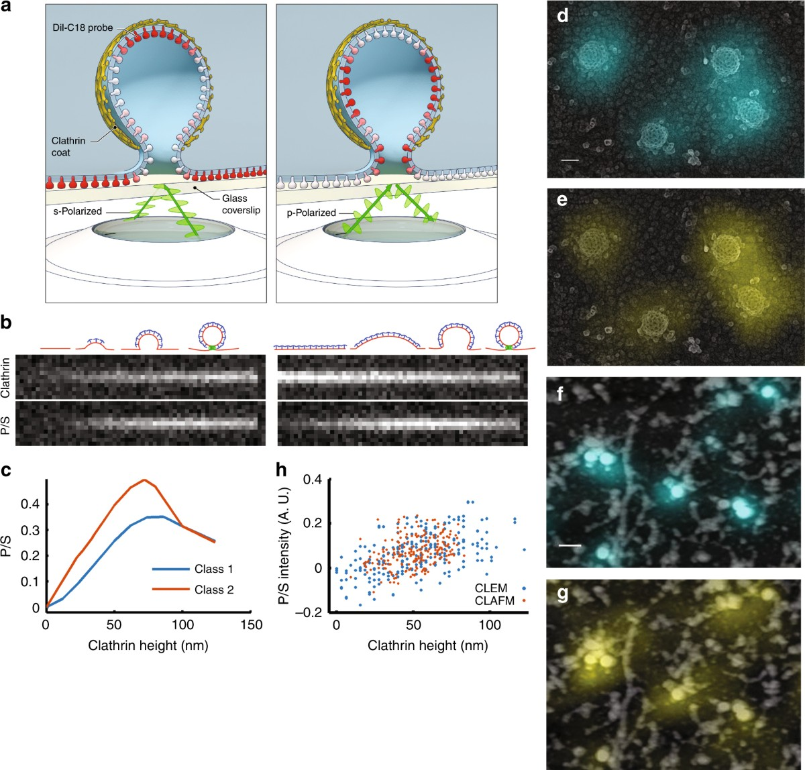

a–c：偏振原理与模拟；d–h：相关电镜、AFM 与 P/S 信号的校准。

**读图边界：** 本图主要验证方法；装配时序的直接证据见同文 Fig. 3。

**许可：** [CC BY 4.0](https://creativecommons.org/licenses/by/4.0/)。完整图版，未改绘。

上图说明“先校准曲率代理读出”的必要性。它本身并不是一项张力—actin 干预实验。把方法验证图与对应动态或因果实验分开，正是科研阅读中需要养成的习惯。

## 10 · 从终点量到通量：一个可以动手改变的模型

### 10.1 为什么看相同终点，仍可能发生不同的事？

设 S 是预标记且位于表面的受体池，E 是可回收的内部池，L 是已进入后续降解路线的池，D 是已从可检测完整受体池中移除的量。一个教学模型为：

dS/dt = −kinS + krecE dE/dt = kinS − (krec+ksort)E dL/dt = ksortE − kdegL dD/dt = kdegL

在该模型内，S+E+L+D 保持初始总量；它忽略新生、脱落、不同内体群体和多次路径分支。真实荧光还可能是 qE(pH)E + qL(pH)L 加背景，q 不一定恒定。模型只用于检查解释是否可识别，不能直接替代真实动力学拟合。

**交互教学模型 M1 见 HTML**：可分别改变入口、回收、分流、移除速率和探针亮度，比较量、通量和信号。所有曲线为合成教学模型。

### 10.2 怎样用模型决定补哪种数据？

若只测一个终点 E+L，多组入口、回收与降解参数都可能给出相近结果。增加更多同一终点的技术重复会降低噪声，却不一定解决结构性的不可识别。表面池时间系列、对初始内化池的追踪，以及区分 E/L 或探针亮度的独立信息，才可能打破这种等价。

**[研究建议]** 真正拟合前先固定参数的物理含义、单位、测量模型与观测时间窗，再检查参数是否能被数据区分。若只能稳定估计一个有效组合，就诚实报告组合，而不是给每个速率一个貌似精确的值。任何拟合都应保留不支持模型的系统残差和替代模型。

## 11 · 统计与图像分析：哪些习惯会把现象变成假机制？

### 11.1 事件数多，不等于独立样本多

同一细胞的数百内吞位点共享表达、细胞周期、培养和成像环境。独立培养/实验批次、细胞和位点是不同层级。应保存这些标识，使用与问题匹配的层级分析或按独立实验汇总，不能把全部斑点当作完全独立的生物重复。

### 11.2 寿命分布需要考虑看不见的开头和结尾

在录像开始前已出现、结束后仍存在的位点存在截断或删失；只分析完整出现又消失的轨迹会系统漏掉长事件。还要记录最短检出帧数、跨帧连接距离、合并/分裂规则及失败事件定义。均值变化可能来自混合群体比例变化，而不一定是每个事件都变慢。

### 11.3 分割结果不能替代结构本身

内体变大时，多个相邻小结构可能被合并为一个；药物改变形态又会改变阈值下的面积。应检验不同合理分割参数、查看原始图并在条件允许时保持盲法。必要时报告对参数敏感的部分；不要只保留最符合机制图的一组参数。

### 11.4 效应量、分布和阴性结果怎样进入判断？

除显著性外，报告效应大小、可见异质性和不确定性。阴性结果可能意味着机制没有贡献，也可能是敲低不足、补偿、窗口不合适或测量不敏感。事先设置操控有效性与阳性读出，才使“没有变化”有信息量。相反，统计显著的轻微变化也未必足以解释主要生理表型。

## 12 · 融合与胞吐作为背景：怎样迁移证据，而不迁移过头？

在重构膜中，脂质染料交换可以区分停靠与脂质混合相关事件，但不是水溶性内容物释放的直接测量。在分泌细胞中，pH 敏感标记变亮可以报告腔环境暴露，却不自动给出初始纳米孔结构或证明完全塌陷。两类实验的共同经验是：**一个代理读出要通过额外验证，才能被赋予具体事件的名称。**

**论文图 P02：双通道单囊泡融合：把显微图像与脂质荧光轨迹对应起来**。Scientific Reports (2015) · 原文 Figure 3 · [原始来源](https://doi.org/10.1038/srep12006)。

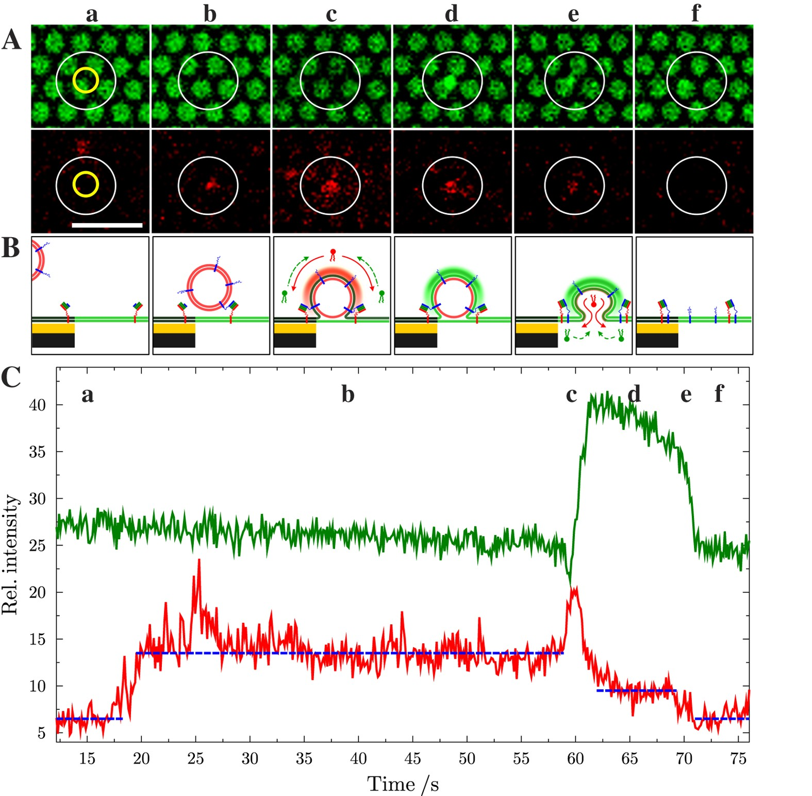

A：上排绿色为孔跨膜中的 Oregon Green DHPE，下排红色为含 synaptobrevin 2 囊泡中的 Texas Red DHPE；a–f 对应同一事件的不同时间点，比例尺 5 μm。B 是作者据荧光变化提出的状态模型，并非直接看到的纳米结构。C 将绿色/红色信号随时间变化与 A 的图像配对，区分停靠、脂质混合相关中间状态与最终信号消散。

**读图边界：** 这是 SNARE 蛋白重构的人工膜体系；脂质荧光、FRET 与扩散共同影响读出。本图不是水溶性内容物释放的直接测量，也不是纳米级半融合结构的直接成像。

**许可：** [CC BY 4.0](https://creativecommons.org/licenses/by/4.0/)。完整图版，未改绘。

**论文图 P03：活细胞胞吐：双标记荧光突增与超分辨融合孔环状结构**。Nature Communications (2021) · 原文 Figure 6 · [原始来源](https://doi.org/10.1038/s41467-021-21666-7)。

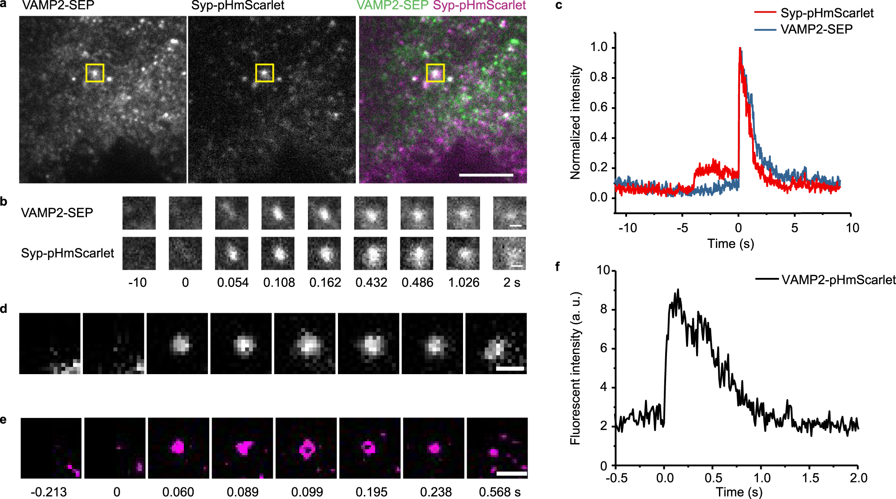

a–c：INS-1 细胞中 VAMP2-SEP（绿色）与 Syp-pHmScarlet（品红）双标记同一融合事件，显微时间序列与强度曲线显示同步突增；a 比例尺 5 μm，b 比例尺 0.5 μm。d–f：VAMP2-pHmScarlet 标记的另一事件，宽场 TIRF 与 Hessian-SIM 对照；e 的超分辨时间序列可分辨瞬时环状信号，f 为相应强度变化。

**读图边界：** 环状结构是经 SIM 重建后可分辨的较大孔形态，不能据此看见所有初始纳米孔。荧光随后衰减还会受膜蛋白扩散、重新酸化和成像条件影响，不能单独判定完全塌陷或 kiss-and-run；INS-1 的观察也不能无条件推广到所有分泌细胞。

**许可：** [CC BY 4.0](https://creativecommons.org/licenses/by/4.0/)。完整图版，未改绘。

胞吐增加的膜面积与胞吞回收并非每次原位、一对一、即时抵消。研究膜稳态时，需要根据时间和空间范围界定系统；研究单个受体时，也不应把整体膜面积平衡直接当作该受体循环的机制。

## 13 · 把论文读成可以迁移的研究经验

以下案例按公开论证组织。每例优先恢复作者真正建立的关系，然后讨论它为什么有辨识力，以及把它迁移到自己课题时还要补什么。完整图注与方法应从所列原文查阅；本轮定向核查范围列于文献表，未将摘要定位标成完整精读。

### 案例 A · AP2：怎样证明“到了膜上”还不够？

**研究问题。** 为什么 AP2 可以把胞质中的网格蛋白装配限制在适当膜上？如果只说 AP2 是接头，并未解释为什么它不在错误位置随意装配。

**[研究报告]** Kelly 等比较完整 AP2、可用结合区段及不同膜锚定条件，结合结构与解除抑制突变，连接了被遮蔽的网格蛋白结合区域和膜激活。脂质体实验还检验了含脂质/货物条件下的出芽能力。[K14](https://doi.org/10.1126/science.1254836)

**[论证重建：为什么这样选？]** 人工定位对照把“有没有接触膜”从“是否处于能有效招募的状态”中拆开；结构提出障碍在哪里，解除障碍的突变检验这个障碍是否与功能相关。它们比单独一张定位图更接近机制。重构减少未知组分，却也删去了真实皮层和膜约束。

迁移到自己的课题：结合/定位正常，但功能没有恢复

可以依次考虑活性状态、构象、膜驻留、下游结合和力学耦合，而不是立即断言该蛋白与功能无关。选择一个尽量保留整体折叠的分离功能突变体，并确认表达与定位；若突变体完全不稳定，就难以把效应归到某个界面。

若资源只有共聚焦、IP 和功能测量，先建立“定位/结合与输出分离”的现象即可；结构合作要解决的是具体界面或构象，而不是替代先行功能验证。能够在体外形成包被芽，也不能被称作已经证明完整活细胞裂变的充分条件。

### 案例 B · 起始的最初几秒：为什么校准能改变生物学问题？

**研究问题。** 一个稳定膜窝出现前，最初来了多少组分、如何到达，失败发生在哪里？普通亮点图很难回答，因为最早信号可能接近检测阈值。

**[研究报告]** Cocucci 等用高灵敏 TIRF、单分子 EGFP 强度及线性关系校准，分析初始组分；并用 FCHO 相关干预区分起始和持续增长。[C12](https://doi.org/10.1016/j.cell.2012.05.047)

**[论证重建：为什么这样选？]** 作者的关键能力是把“亮度”连接到可比较的分子量级，同时让短暂事件可见。若探针替代比例和单分子亮度未知，相似轨迹可能对应不同分子数。只用成熟结构作分母，还会把早期失败从问题中删除。

**[可迁移做法]** 如果课题是因子是否影响开始或完成，应保存失败事件及检出阈值；若只能测总摄取，就把结论限定为运输输出变化。不要从“有更多可见点”直接推出更高起始率。这里值得模仿的是测量校准服务具体问题，而不是每个课题都必须做单分子成像。

### 案例 C · actin：为什么看似相反的结果可以被条件连接？

**研究问题。** 为什么一些细胞或膜面在 actin 受扰后仍能完成 CME，另一些却停滞？把研究分成“actin 必需/不必需”两队，可能混合了不同负载条件。

**[研究报告]** Boulant 等比较极化细胞膜面，再使用低渗与机械拉伸改变约束，结合成像、形态与 actin 干预检验这种依赖性。[B11](https://doi.org/10.1038/ncb2307) Scott、Bucher 与后续结构工作则从不同几何和样品条件补充包被变形信息。[S18](https://doi.org/10.1038/s41467-018-02818-8)[BU18](https://doi.org/10.1038/s41467-018-03533-0)[D21](https://doi.org/10.1016/j.devcel.2021.03.017)

**[论证重建：为什么不只加一张药物图？]** 第二种机械扰动使“低渗特有的化学效应”不再是唯一解释；膜面比较又提供原有差异。但这些操作仍不等价于只改变一个纯张力参数，actin 干预也反过来改变约束。支持的是有条件的机械贡献，不是任意 actin 变化都能用张力解释。

**[可迁移做法]** 在自己的细胞中，先确认基线内化、细胞形态和阶段表型；再选择能产生独立信息的负载或耦合干预。若始终只测总受体量，新增昂贵的 actin 超分辨图也未必能决定瓶颈在哪一步。

### 案例 D · EGFR：怎样从剂量曲线走向机制？

**研究问题。** 为什么受体磷酸化和泛素化随配体变化的方式不同，这种差异如何与内化命运相连？一个相关的剂量阈值，还不能说明是谁产生了阈值。

**[研究报告]** Sigismund 等比较磷酸化、泛素化及 Cbl/Grb2 相关关系，并在缺少相关位点的受体背景中逐步补回候选位点，同时控制表达和激酶相关功能，检验泛素化与非网格蛋白摄取的联系。[E13](https://doi.org/10.1038/emboj.2013.149) 后续定量工作把受体丰度纳入阈值分析。[E15](https://doi.org/10.1038/ncomms8999)

**[论证重建：为什么用 add-back？]** 单独删除一个位点后，其他相互作用仍可能代偿；从较少功能的背景补回，有助于检验特定组合在该背景下是否足够。代价是构建体更远离天然网络，因此表达、整体功能和其他异常必须检查。数据支持的充分性总是带背景的充分性。

在自己的 RTK 课题中，应该怎样选择，而不是照抄刺激剂量？

先测可比较的表面受体范围和剂量响应，确认占据/激活窗口，再选择能区分解释的点。若受体丰度差异很大，比较相同外加剂量可能正在比较不同工作区。常规 Western/IP 与摄取测量可以先确定曲线是否不同；只有现象可靠后，才投入复杂位点组合或定量模型。

若突变使受体不能正常折叠、到达表面或被激活，它不能作为单纯的“泛素化专一缺陷”。即使一类细胞中 CME 偏向回收、NCE 偏向降解，也不能将路线与命运写成跨细胞无例外的标签。

### 案例 E · Retriever：为什么一个标签问题能成为发现入口？

**研究问题。** 已知货物需要 SNX17，但不能由既有 retromer 逻辑解释的回收，怎样找到下游机器？

**[研究报告]** McNally 等发现 N/C 端 GFP 构建体均可定位及结合货物，却有不同 rescue 能力，于是比较相互作用蛋白；随后以组分关联、干预及命运读出检验候选，并比较共享 VPS29 与 retromer 相关 VPS35 的作用。[M17](https://doi.org/10.1038/ncb3610)

**[论证重建：为什么这比普通 IP 列表更有价值？]** 功能有差异而部分性质保留的两个构建体，提供了较有目的的比较：哪类联系与丢失功能共同变化？但差异蛋白组仍只是候选，不能证明直接结合或运输因果；下游遗传、恢复及回收/降解读出才逐步闭合论证。

**[可迁移做法]** 遇到“定位正确但 rescue 失败”，先检查表达、构建体完整性和货物结合，再判断是否得到可用的分离功能扰动。若定位、稳定性和表达都不同，差异蛋白组会很难解释。若没有蛋白组设备，可先选有根据的候选做 IP 与功能验证；合作升级要解决候选空间问题。

从 2017 走到后续结构：不要让基因名和结构图替代功能判断

旧文的 C16orf62、DSCR3，在后续工作中常分别记作 VPS35L、VPS26C。Commander 的研究把 Retriever 与 CCC 等组分进一步放进更大的装配框架。Cell 2023 和后续结构工作使用不同程度的实验结构、计算预测及细胞验证；阅读时需要区分直接分辨的部分和模型构建的部分。[CM23](https://doi.org/10.1016/j.cell.2023.04.003)[CO24](https://doi.org/10.1038/s41594-024-01246-1)

VPS29 为相关复合物共享，并不意味着 VPS29 缺失的全部表型都属于一条路线；亚基缺失还可能影响整个复合物的稳定和定位。选择“界面突变”前，先问它是否选择性破坏所声称的联系，还是让整个复合物解体。

**论文图 N01：Commander 研究方法组合**。原文 Figure 1，[原文](https://doi.org/10.1038/s41594-024-01246-1)。

a 为不同实验操作的工作流示意；b 为组分与标签信息；c 为 AP–MS 得到的稳定互作网络；d 比较不同 bait 与标签配置的相对丰度；e 比较交联前后纯化样品的 SEC 行为。a 中仪器/分子图标是作者示意，c–e 才包含相应分析结果。

CC BY 4.0，完整原图。

**为什么联合 AP–MS、BioID–MS、XL–MS 与结构？** 它们分别偏向保留可共纯化组分、记录一定时空范围的邻近、提供可交联距离限制，以及解析可重建的结构。不同方法的交集和分歧有助于区分稳定组分、邻近环境和装配模型；每条网络边仍不能直接被读作单一、直接、永久的结合。该比较是本版的论证重建。

### 案例 F · ER 接触：怎样从“经常在旁边”走到功能贡献？

**研究问题。** 分选域怎样保持并最终裂分，邻近 ER 是否参与界定这个事件？

**[研究报告]** Rowland 等用多标记时间序列把 ER、内体域和货物分开追踪；比较接触相对裂分的时空关系及偶然覆盖，并改变 ER 形态/动态，配合内体和芽形态控制分析裂分效率。[R14](https://doi.org/10.1016/j.cell.2014.10.023)

**[论证重建：为什么要有时间顺序和空间零假设？]** 密集 ER 本来就容易与内体重叠，因此需要比较接触是否特异指向事件边界、是否在事件前到位。扰动把关联推进到功能联系；控制结构尺寸和芽长度，可排除某些“根本没有形成可裂芽”的解释。但广泛改变 ER 仍不等于找到了直接切割膜颈的分子。

**[可迁移做法]** 若课题是两个细胞器共同工作，先定义共同事件及随机接近的预期，再考虑选择性解除接触或功能界面的干预。普通共聚焦已可能提供高价值的时空线索；何时需要电镜，取决于你要证明接触距离、膜融合，还是货物分流。

### 案例 G · 内体信号：看到受体在那里，为什么还不够？

**研究问题。** 内体上的受体或 G 蛋白，是活跃地产生信号，还是只是被运输过去？

**[研究报告]** Irannejad 等以构象相关传感器追踪受体与 G 蛋白活化，并用可逆响应、延迟募集等验证限制替代解释。[G13](https://doi.org/10.1038/nature12000) 2026 年后续工作进一步区分 Gα 转位、活化状态和受体—G 蛋白耦联，并明确原生 G 蛋白与受体过表达的表达层级差别。[GP26](https://doi.org/10.1038/s41467-026-69329-9)

**[论证重建：为什么更换读出对象？]** 定位回答“在哪里”，构象探针试图回答“处于什么状态”；延迟募集帮助检验传感器是否只是从质膜一路被携带。但探针本身会结合并可能影响状态，必须验证选择性、表达和可逆性。一个总信号曲线不能独立定位起源。

**[可迁移做法]** 若常规实验显示受体内化改变了 pERK 或其他输出，先保留反馈、表面池变化和全局状态等解释。只有当空间来源决定结论时，再合作使用局部传感器或分区操控。不要把“某个蛋白为内源水平”简写成整个系统全部保持生理表达。

## 14 · 把“胞内荧光减少”变成一个可推进的课题

这是教学情景，**没有对应一组本资料产生的实验结果**。设某基因扰动后，EGF 处理时胞内荧光变少。第一轮不把题目定成“该基因促进内吞”，而是问：哪个对象、哪个池、哪个时间窗改变？

### 14.1 先比较候选解释

| 候选解释 | 第一轮需要什么区别信息？ | 哪种结果仍不足？ |
|---|---|---|
| 起始表面受体/结合减少 | 表面池与起始配体结合；短时间内化分数 | 胞内总量下降但没有表面分母 |
| 内化本身减少 | 表面信号排除得到验证后的早期内化时间系列 | 单张“膜边亮、胞内暗”的图片 |
| 回收更快 | 对已内化群体的追踪及再暴露读出 | 只见内部池快速消失 |
| 降解或标签丢失更快 | 标记和完整受体保留、后续去向及亮度控制 | 一种抑制剂恢复了荧光 |
| 探针受到 pH/环境影响 | 合适的参考通道、pH 敏感性与校准 | 酸性染料和受体探针同时变化 |
| 细胞状态或成像偏差 | 活性、体积、焦面、背景与配准 | 大量事件合并后一个显著性值 |

### 14.2 根据知识收益安排第一轮

如果表面池已经显著改变，先判断其对内化量的贡献；若归一化后早期内化仍不同，再进入入口机制。若早期相近、后期分离，优先研究回收、分选、降解或探针环境，避免过早把全部工作集中到膜窝形成。

选择两种具有不同偏差的读出，例如经表面排除验证的流式与分区共聚焦；它们的一致性提高稳健性，分歧则提示需要检查哪个操作定义不同。普通全细胞 Western 可测总量与磷酸化；表面池需要非透化流式，或经表面标记/分离后再做 Western 等操作，不能从普通裂解液条带直接读出。它们都不能单独替代单向通量。

### 14.3 怎样判断要不要做 rescue、组学或高级成像？

先确定扰动可靠、效应可重现、测量没有混淆，再用接近内源的野生型恢复与合适突变体区分功能。若问题转为“通过哪个伙伴连接分选”，组学可能有价值；若转为“是否进入 ILV”，结构成像有价值；若仍未确认入口还是出口，先升级仪器通常不会自动解决。

### 14.4 不支持预想时，怎样更新问题？

如果独立读出不支持内化改变，就撤回“入口因子”的表述，保留真实观察并研究其他池。若只有过表达时有表型，区分增强能力与生理必要性；若不同细胞给出不同结果，检查受体丰度、环境、补偿和实际检测窗口，而不是只保留最漂亮的细胞。

首轮成功可以是排除一条解释、确定测量边界或保留原有模型；并不要求一定发现新的分子机制。

## 15 · 发展研究思路：怎样从关系缺口提出好问题？

### 15.1 先问成功后改变什么，再问还能测多少东西

“这个蛋白还没研究过”“这种细胞还没拍过”并不自动形成重要问题。更有信息量的表达是：现有结果兼容 A 与 B，而它们对同一条件有不同预测；如果区分二者，就会改变对受体分选的解释或实验选择。

围绕本资料的核心主张，可以选择三类关系深入。下面都是**阅读者提出的研究用途**，不宣称领域中无人研究，也不是批准执行的实验计划。

| 工作问题 | 现有最强简单解释 | 真正需要区分的关系 | 第一项有信息量的动作 |
|---|---|---|---|
| 货物更多时，为什么有的位点更难成熟？ | 受体/接头占据变化，或入口负载变化 | 生化募集与机械约束是否可分离？ | 同时建立表面负载与成功内化，先确定瓶颈是否在入口；只有必要时增加局部力学读出 |
| 内体 pH 变化为何伴随受体回收变化？ | 配体解离、探针亮度、降解或位置变化都可产生表型 | pH 是运输中介，还是伴随读出？ | 用不依赖同一 pH 响应的受体池测量，并确认化学环境；再考虑更选择性的分离操作 |
| ER 接触更多，为什么裂分未增加？ | 接触可能是结果、补偿，或不属于同一功能类型 | 接触形成、分选域与实际裂分之间哪步受限？ | 以单个芽为单位比较接触前后及成功/失败，而不是只比较全细胞接触总量 |

### 15.2 三种“新认识”都值得保留

**解释成功。** 一个已有方法为什么能把以前混在一起的状态分开？例如从定位探针换成活化相关传感器，研究问题从“在哪里”变为“在那里做什么”。

**修正对象。** 早期内体不是同质的共同终点，受体数量也不是运输速率。这样的修正若改变了采样、分母或后续选择，就有实际研究后果。

**发现使能条件。** 某个机器在体外足以产生形态，但完整细胞只有特定负载下才依赖另一组因子。应寻找条件关系，而不是把两个体系强行合并成“谁才是真正驱动者”的单一竞赛。

### 15.3 怎样选择下一步，避免无边界加实验？

在新增测量前，用一段话写清：当前哪项结论仍不能成立；新结果的几种可能会怎样改变解释；无变化或技术失败如何识别；如果所有结果都不会改变行动，为什么还要做它。必要的技术校准可以非常重要，但它的目的应连接到这个上层问题。

选择时同时考虑科学重要性、已有证据、资源和信息收益。便宜但无法判别的实验不一定是好的首检；复杂但只增加同类图片的技术，也不自动更深入。允许保留原有模型、决定复现、改变问题表示，或暂时停止一条不能带来认识的路线。

## 16 · 自检与讨论：能否把认识带出这份资料？

表面受体减少，而总蛋白不变，能否直接说内化加快？

不能。回收、表面递送、表位可及性及内部分布都可能改变。需要界定起始表面池、短时内化及回收等信息。总量不变也可能只是多个通量变化后的平衡。

内体里的荧光变少，但降解 Western 没有变化，下一步优先是什么？

先看探针和受体是否是同一对象、标记是否受 pH 影响，以及表面再暴露和分割/焦面等操作差异。Western 的时间窗和灵敏度也可能不同。不要仅因总蛋白阴性就排除所有降解相关过程。

两个构建体定位和 IP 都相同，为什么还需要 rescue？

定位与共同富集只验证部分性质；尾部可用性、下游机器连接、状态循环和输出仍可能不同。SNX17 标签案例表明，这种差异有时可以进一步转成研究工具，但必须先排除表达、稳定性等更简单解释。

去顶膜片自发弯曲，是否证明 actin 只是多余的？

不证明。去顶改变了负载、边界和胞质条件；蛋白网络也可能在此前装配中储能。需要将结构固有能力与完整细胞在具体环境中的必要性区分。

晚期内体与 ER 高度共定位，是否应该立即做更多电镜？

先确定要证明什么。如果问题是接触是否先于某个裂分事件，可靠的活细胞时间序列及空间零假设可能更有价值；如果需要确证膜接触距离或是否融合，电镜可能正好解决关键未知。

药物阻断、敲低和 rescue 都支持一个因子，是否已证明直接机械作用？

它们可强化功能联系与特异性，但因子仍可能通过调控、运输其他组分或改变环境发挥作用。直接机械主张需要把力/几何与相应分离操作接起来，而不是只增加同类功能实验。

新论文比旧论文更新、期刊更高，是否就应该替换旧结论？

先比较对象、方法、条件、真正支持的命题与是否有更正。新工作可能测量了不同量，或者只扩展了适用条件。期刊和年代帮助定位阅读，不替代科学判断。

## 17 · 文献作为研究素材：核查到哪里，下一步怎样回源？

本轮以现版图源为起点，按 AP2 激活、包被力学、EGFR 剂量、回收机器、细胞器接触、局部环境与空间信号进行定向检索，并纳入截至 2026-11-20 的部分近期研究。**这不是系统综述，不宣称检索穷尽；“取得全文”也不等于本文复核了全部结果和所有补充数据。**

下面将来源与实际核查范围放在一起。核心案例优先使用可追溯的公开正文及明确图注；摘要定位的经典或近期工作只承担相应有限作用。原论文中的数值和条件，不因进入知识框架就升级成通用常数。

### [K14] AP2 controls clathrin polymerization with a membrane-activated switch

Science (2014) · [DOI](https://doi.org/10.1126/science.1254836)

核查范围：公开全文网页，正文及Fig1–4图注定向核查；本地XML获取失败

用途：膜定位不等于构象激活；结构、解除抑制突变和脂质体重构形成不同层级证据。出芽充分性不等于完整裂变充分性。

### [C12] The first five seconds in the life of a clathrin-coated pit

Cell (2012) · [DOI](https://doi.org/10.1016/j.cell.2012.05.047)

核查范围：作者实验室公开PDF，主要结果与单分子校准、FCHO缺失段落定向核查

用途：起始少量分子需要校准与时间分辨；初始到达、持续增长和成功成熟必须分开。

### [B11] Actin dynamics counteract membrane tension during clathrin-mediated endocytosis

Nature Cell Biology (2011) · [DOI](https://doi.org/10.1038/ncb2307)

核查范围：公开全文XML，主要结果、Fig1/3/4及讨论定向核查

用途：同种细胞不同膜面及不同机械挑战改变actin依赖性；独立扰动共同支持机械解释。

### [A15] Endocytic sites mature by continuous bending and remodeling of the clathrin coat

Science (2015) · [DOI](https://doi.org/10.1126/science.aaa9555)

核查范围：PubMed索引摘要核查；本轮未获取全文

用途：作为模型历史定位；不把摘要定位当逐图复核。

### [S18] Membrane bending occurs at all stages of clathrin-coat assembly and defines endocytic dynamics

Nature Communications (2018) · [DOI](https://doi.org/10.1038/s41467-018-02818-8)

核查范围：公开全文、方法校准与Fig2/3；V1已查看相应原图

用途：曲率代理读出与实际形态需校准；混合动力学不能被静态单一路径覆盖。

### [BU18] Clathrin-adaptor ratio and membrane tension regulate the flat-to-curved transition of the clathrin coat during endocytosis

Nature Communications (2018) · [DOI](https://doi.org/10.1038/s41467-018-03533-0)

核查范围：公开全文、摘要、结果与几何模型定向核查

用途：不要把强度、包被面积和膜曲率当同一量；结论带细胞与模型条件。

### [D21] The structure and spontaneous curvature of clathrin lattices at the plasma membrane

Developmental Cell (2021) · [DOI](https://doi.org/10.1016/j.devcel.2021.03.017)

核查范围：公开PMC正文的Introduction、主要结果与去顶弯曲实验定向核查；本地XML不可用

用途：去顶后无需新增能量/蛋白即可弯曲，限定于去顶体系；不等于活细胞不消耗能量。

### [SH18] Cell membranes resist flow

Cell (2018) · [DOI](https://doi.org/10.1016/j.cell.2018.09.054)

核查范围：公开PMC摘要及两膜管/bleb比较的网页内容定位；本地全文下载未成功

用途：局部张力与全细胞均一张力需要区分；不把特定细胞中的传播性质普遍化。

### [E13] Threshold-controlled ubiquitination of the EGFR directs receptor fate

The EMBO Journal (2013) · [DOI](https://doi.org/10.1038/emboj.2013.149)

核查范围：公开全文XML，Fig1–3及Fig6–9/相关结果定向核查

用途：剂量相关被位点重建、受体丰度与激酶活性控制推进到机制论证；原文为CC BY-NC-ND，本版仅链接不新增复刻图。

### [E15] Quantitative analysis reveals how EGFR activation and downregulation are coupled in normal but not in cancer cells

Nature Communications (2015) · [DOI](https://doi.org/10.1038/ncomms8999)

核查范围：公开全文，受体表达量和定量模型主要结果定向核查

用途：刺激剂量不能脱离受体丰度比较；不是所有细胞共用固定阈值。

### [R14] ER contact sites define the position and timing of endosome fission

Cell (2014) · [DOI](https://doi.org/10.1016/j.cell.2014.10.023)

核查范围：公开网页中Introduction、Fig1/4/6/7及Discussion定向核查；本地XML不可用

用途：时空定位、偶然覆盖对照及扰动共同支持ER参与；尚不单独确立分子切割机器。

### [R05] Rab conversion as a mechanism of progression from early to late endosomes

Cell (2005) · [DOI](https://doi.org/10.1016/j.cell.2005.06.043)

核查范围：PubMed摘要与书目信息；本轮未获全文

用途：历史定位；不重复把2005文中HOPS/GEF表述当作当代普遍分子模型。

### [L06] Ligands for clathrin-mediated endocytosis are differentially sorted into distinct populations of early endosomes

Cell (2006) · [DOI](https://doi.org/10.1016/j.cell.2005.12.038)

核查范围：作者实验室PDF，主要结果和货物/微管动力学比较定向核查

用途：早期内体异质性及递送选择不能简化为单一共同终点；具体分群依体系与测量。

### [M17] Retriever is a multiprotein complex for retromer-independent endosomal cargo recycling

Nature Cell Biology (2017) · [DOI](https://doi.org/10.1038/ncb3610)

核查范围：公开PMC全文，Fig1–3结果/图注、rescue及recycling实验定向核查；期刊页面仅摘要

用途：定位和结合正常不保证功能；标签差异提供分离功能扰动，比较蛋白组学需功能证据闭合。

### [G13] Conformational biosensors reveal GPCR signalling from endosomes

Nature (2013) · [DOI](https://doi.org/10.1038/nature12000)

核查范围：公开全文网页/PDF索引中Nb80、Nb37及Fig1/2验证段落定向核查；期刊页面为摘要

用途：位置与活化构象分开；排除从质膜一路携带传感器的替代解释。

### [ES18] ATP-dependent force generation and membrane scission by ESCRT-III and Vps4

Science (2018) · [DOI](https://doi.org/10.1126/science.aat1839)

核查范围：作者机构公开摘要与方法说明；本地PDF下载为空，不声称全文精读

用途：逆向拓扑、定时能量输入和催化控制展示机制设计；仅用于有限机制说明。

### [GL19] Physical Principles of Membrane Shape Regulation by the Glycocalyx

Cell (2019) · [DOI](https://doi.org/10.1016/j.cell.2019.04.017)

核查范围：公开摘要与PMC中聚合物刷模型/逆转实验段落定位；非逐图全文复核

用途：糖萼的空间压力可影响膜形态；不能由外向膜形态直接推定具体受体CME速率。

### [N11] Lysosomal positioning coordinates cellular nutrient responses

Nature Cell Biology (2011) · [DOI](https://doi.org/10.1038/ncb2204)

核查范围：公开全文XML，营养/位置/胞质pH及Fig3/4定向核查

用途：饥饿不是中性同步；位置与营养输入的必要性/充分性分开。

### [I10] A cation counterflux supports lysosomal acidification

Journal of Cell Biology (2010) · [DOI](https://doi.org/10.1083/jcb.200911083)

核查范围：公开全文XML，电荷补偿、离子替换、比率pH测量相关结果/方法

用途：酸化涉及电位、离子、缓冲和体积，不是V-ATPase蛋白量的单变量函数。

### [P12] Pitstop 2 Is a Potent Inhibitor of Clathrin-Independent Endocytosis

PLOS ONE (2012) · [DOI](https://doi.org/10.1371/journal.pone.0045799)

核查范围：公开全文XML，pitstop2在clathrin/AP2缺失条件下的实验

用途：药物能抑制标称靶通路之外的摄取；不能以一种抑制剂独立鉴定通路。

### [PH26] DNA nanodevices detect an acidic nanolayer on the lysosomal surface

Nature Cell Biology (2026) · [DOI](https://doi.org/10.1038/s41556-025-01855-y)

核查范围：期刊公开摘要、图题和两份更正；未取得订阅全文与完整方法，不作完整精读案例

用途：作为局部胞质环境的重要近期报告和待深入材料；不外推所有内体、不宣称已全面核验纳米尺度校准或独立复现。

### [ME26] In situ mapping of late-stage biomechanical coordination during clathrin-mediated endocytosis

Nature Communications (2026) · [DOI](https://doi.org/10.1038/s41467-026-75876-y)

核查范围：公开全文，纳米棒SPT、Fig1–7及方法/讨论定向核查

用途：新增可观测量仍带探针—目标耦合假设；载荷尺寸和药理特异性需要保留。

### [GP26] Conformational biosensors delineate endosomal G protein regulation by GPCRs

Nature Communications (2026) · [DOI](https://doi.org/10.1038/s41467-026-69329-9)

核查范围：公开全文，Fig2–6、endogenous/overexpression及Discussion定向核查

用途：G蛋白到达内体不等于在那里由受体激活；生理表达层级和传感器状态特异性要分开。

### [MY26] Class-I myosin responds to changes in membrane tension during clathrin-mediated endocytosis in human induced pluripotent stem cells

PNAS (2026) · [DOI](https://doi.org/10.1073/pnas.2532817123)

核查范围：公开全文XML，hiPSC标签、Myo1E缺失、微吸引与低渗主要结果/图注

用途：应区分位点、单细胞和细胞群环境；Myo1E缺失表型不等于所有细胞都必须依赖该蛋白。

### [CM23] Structure of the endosomal Commander complex linked to Ritscher-Schinzel syndrome

Cell (2023) · [DOI](https://doi.org/10.1016/j.cell.2023.04.003)

核查范围：公开摘要、主要结果及Fig1结构说明网页定位；本地XML未获取，不作全篇逐图复核

用途：使用当前亚基名称，并区分实验结构与计算建模。

### [CO24] Structure and interactions of the endogenous human Commander complex

Nature Structural & Molecular Biology (2024) · [DOI](https://doi.org/10.1038/s41594-024-01246-1)

核查范围：公开全文，Fig1和方法组合、Fig5结构比较定向核查；完整Fig1已目视检查并核对CC BY4许可

用途：不同互作技术施加不同观测约束，结合结构仍需区分直接分辨与装配模型。

### [MU16] An endosomal tether undergoes an entropic collapse to bring vesicles together

Nature (2016) · [DOI](https://doi.org/10.1038/nature19326)

核查范围：PMC公开作者稿的摘要、引言、Fig1/2说明及光镊方法和讨论定向核查；本轮XML下载未成功，不标为逐图视觉复核

用途：系留、几何靠近与融合不是同一事件；Rab5调节EEA1柔顺性的机制不能扩成EEA1单独完成全部融合。

### [PO10] Identification of the Switch in Early-to-Late Endosome Transition

Cell (2010) · [DOI](https://doi.org/10.1016/j.cell.2010.03.011)

核查范围：研究机构公开PDF，Introduction、线虫体系选择理由、Rab转换及RABX-5驻留和酵母实验相关正文/图注定向核查；未重做全部图像分析

用途：保留作者明确说明的体系选择理由；区分定位与活性，并以后续GEF研究限定历史HOPS解释。

### [CA14] The Mon1-Ccz1 GEF activates the Rab7 GTPase Ypt7 via a longin-fold-Rab interface and association with PI3P-positive membranes

Journal of Cell Science (2014) · [DOI](https://doi.org/10.1242/jcs.140921)

核查范围：PubMed原始研究索引摘要核查；本轮未获取全文，限用于摘要明确说明的酵母Ypt7交换活性及分离功能突变

用途：Mon1-Ccz1的GEF活性与定位可分离；不把酵母复合物组成和实验条件无条件套到所有物种。

### [OH05] Identification of a ferrireductase required for efficient transferrin-dependent iron uptake in erythroid cells

Nature Genetics (2005) · [DOI](https://doi.org/10.1038/ng1658)

核查范围：PubMed原始研究索引摘要核查；本轮未获取可核读的完整正文和全部功能图，限于红系Steap3识别与功能定位

用途：受体/配体运输与金属还原、铁获取分开；不将红系STEAP3依赖性扩展为所有细胞唯一机制。

### [RU02] Structure of the LDL receptor extracellular domain at endosomal pH

Science (2002) · [DOI](https://doi.org/10.1126/science.1078124)

核查范围：作者机构仓储公开PDF的在线文本：摘要、结构测定段及分辨率限制定向核查；本地下载空响应，未做全篇逐图检查

用途：低pH结构支持模块排布与释放模型，不能独立证明完整细胞释放/回收动力学或精确侧链接触。

### [WE18] Concerted ESCRT and clathrin recruitment waves define the timing and morphology of intraluminal vesicle formation

Nature Communications (2018) · [DOI](https://doi.org/10.1038/s41467-018-05345-8)

核查范围：V1已核P13原图；本轮另从已保存的原文XML定向核查Introduction、ESCRT募集摘要及HRS770替换实验正文/方法；未新增Fig5视觉检查

用途：内体HRS-clathrin与质膜AP2-clathrin作用分开；选择性接口扰动减少多位点干预混淆，仍需表达和功能验证。

### 当你准备把本资料用于真实课题

先选一个具体受体、一种细胞状态和一个可操作的问题；回到对应原文的构建体、表达水平、处理时间、数据定义及统计单位，再决定能否迁移。若要引用某幅论文图，沿图源及许可回到原文；本资料中的中文读法不能替代完整图注。

若需要形成开题材料，优先带走四样东西：**可检查的问题定义、最强已有解释、能改变判断的下一项证据，以及明确未解决的条件**。它们比一串尚未组织关系的蛋白和技术名称，更接近可继续合作的科研基座。
