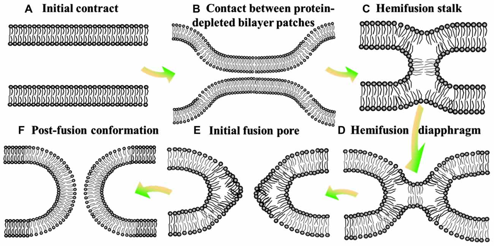
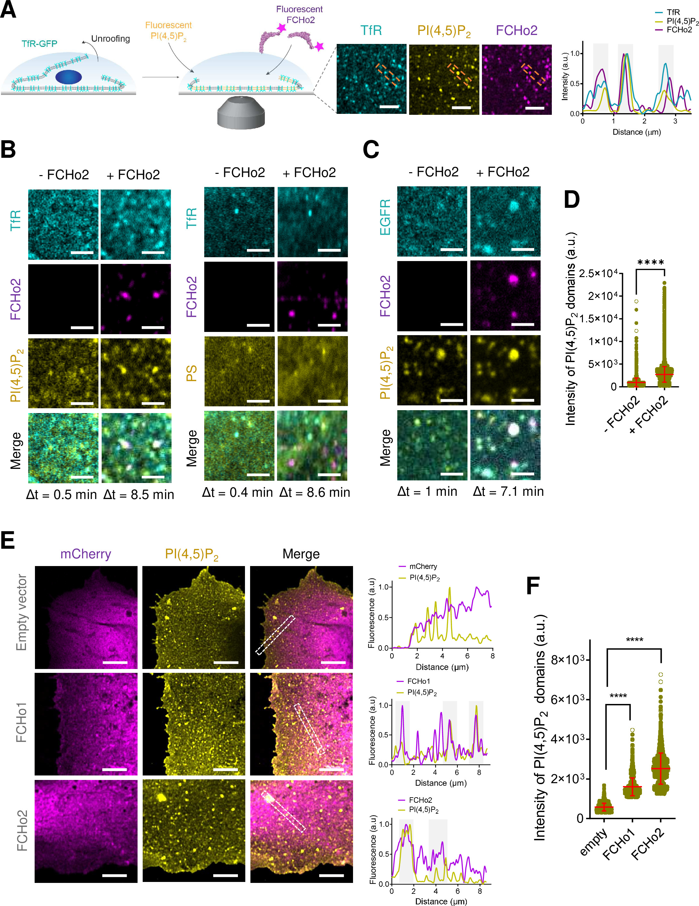
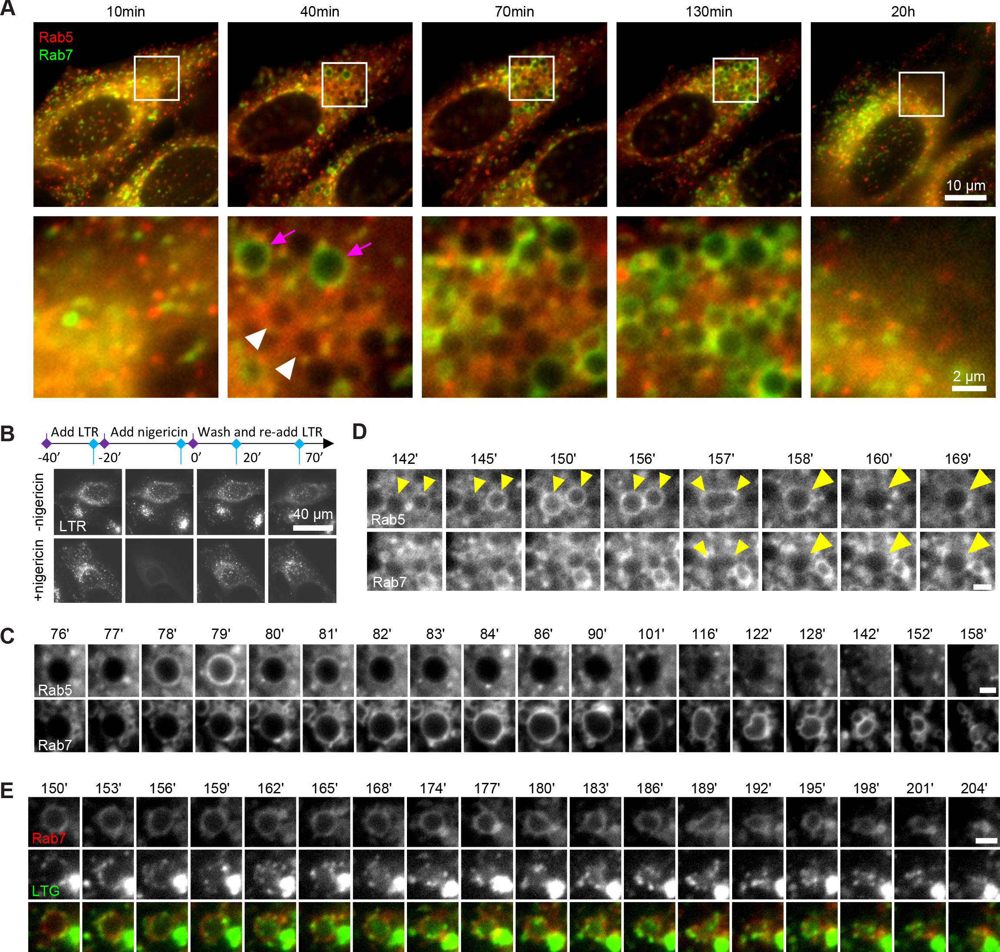
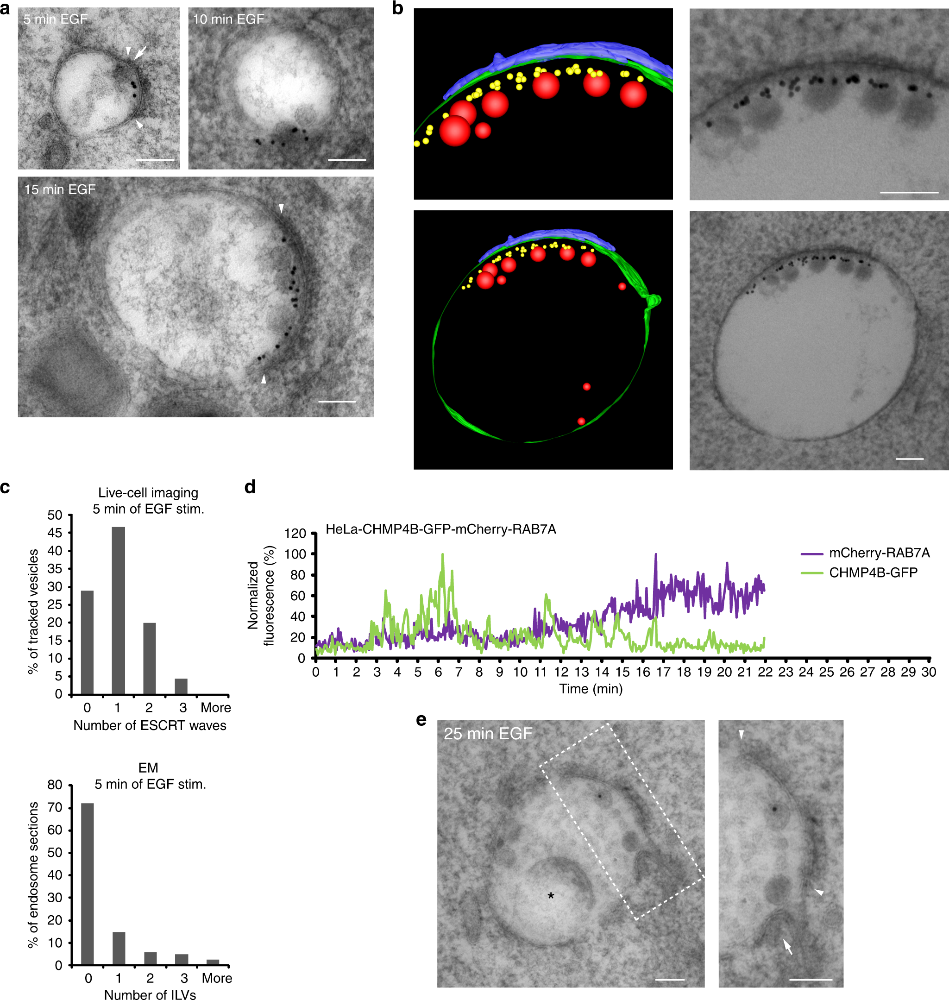
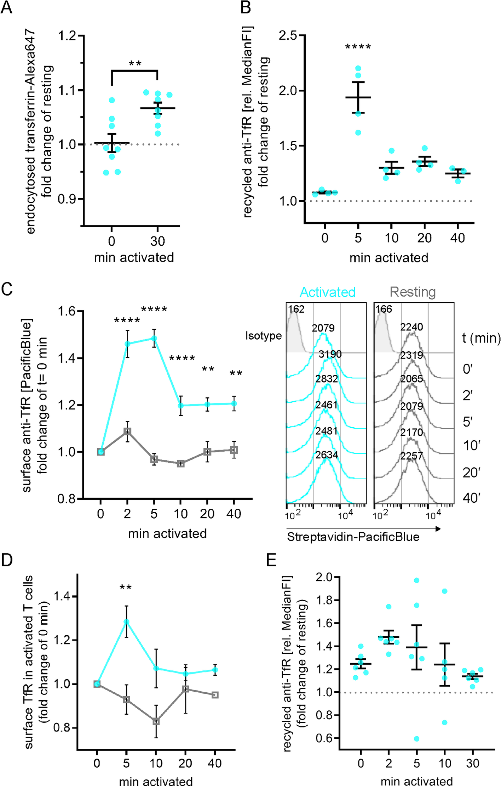
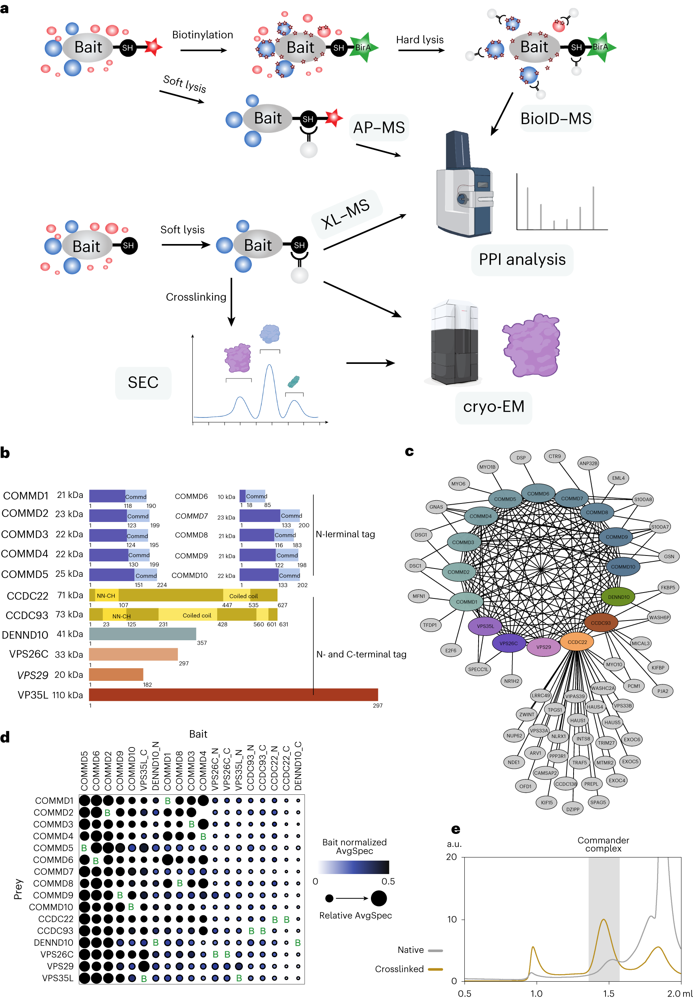

# 受体介导胞吞与内体分选：科研知识框架与研究基座 V2

## 00 · 怎样把这份资料用到自己的研究里

敲低一个基因后，细胞里的 EGF 荧光少了，下一步做什么？很容易想到拍 clathrin、测 actin，或者补一组降解实验。不过在选择之前，先看表面还有多少受体、荧光在什么时候开始下降，往往能省下不少弯路。入口变慢、回收加快和探针变暗，都可能给出相似的图像。

这份资料沿着受体介导胞吞、内体分选这条路线，讨论这些现象怎样发生，以及实验怎样把它们分开。膜融合与胞吐作为背景，帮助理解膜的朝向、区室连通和膜面积的收支。贯穿各章的出发点是：把受体运输看成几条相互牵连的状态转移，连同它们所处的环境一起研究。这样，一个亮点、一条条带或一个定位变化，就有了可以解释的位置。

### 按问题选择阅读入口

| 现在想弄清什么 | 可以从哪里读起 | 阅读时留意什么 |
|---|---|---|
| 分子机器怎样完成运输 | 01 至 06 章机制正文 | 分子在膜哪一侧，改变的是哪一步 |
| 换了细胞或培养条件，结果为何变了 | 07 至 08 章环境与尺度 | 哪个条件改变负载、反应或观测结果 |
| 手边设备能先做什么 | 09 至 11 章实验与分析 | 起始受体池、采样时间和测量分母 |
| 一篇好论文为什么这样安排实验 | 13 至 14 章案例与推演 | 对照拆开了什么解释，下一步因此怎样改变 |

文中用“某某等观察到”介绍论文结果；讨论实验为何有用时，依据的是公开论文的论证。换到自己的课题后可以怎样做，则以条件性的建议展开。作者明确写出的选择理由会单独指出，其余分析按方法和证据之间的关系理解；图的排列顺序未必就是实际发现顺序。

读到一个细节时，可以问它会不会改变自己的实验选择。例如标签挡住了受体尾部，就可能需要换构建体；探针受酸化影响，就需要参考通道。能把细节接到这些选择上，才算把知识带进了研究。上一版的内容审计保存在随附文件中，适合需要比较版本时查阅。

## 01 · 一次内吞包括哪些可以分别测量的事件？

### 1.1 从结合到分选

1. 结合：配体接触并占据受体，可以完全发生在细胞表面。
2. 募集与聚集：受体、接头或包被蛋白在局部积累。有些结构短暂出现后解体，有些继续成熟，也有些长期驻留。
3. 内陷：膜形成窝和颈部，此时腔内仍可能与胞外相通。
4. 裂变与内化：膜的连通关系改变，形成与质膜分离的载体。
5. 递送与分选：载体融合后，货物进入后续区室，随后回收、进入腔内囊泡（ILV），或走向降解。

荧光斑点增加可以出现在这条链的不同位置。光学截面、细胞形状和探针性质又会影响它的可见程度。因此，设计实验时要把“内吞改变了”写得更具体：是初始结合少了，膜窝成熟变慢了，还是已经内化的货物停在某个区室？对应的测量随之确定。

### 1.2 路线、货物与区室各自回答什么

RME 按选择货物的方式命名，CME 按包被机器命名，“早期内体”则描述区室的身份和功能。观察到受体进入 EEA1 阳性结构，说明它到达了一个相应的区室；要追溯入口路线或判断后续命运，还需要前后的运输信息。EGFR 对剂量和表达量的依赖，提供了一个具体例子。[E13](https://doi.org/10.1038/emboj.2013.149)[E15](https://doi.org/10.1038/ncomms8999)

非网格蛋白摄取包括 caveolae、CLIC/GEEC、快速 endophilin 介导内吞和巨胞饮等过程。它们的细胞条件、触发方式、形态及分子依赖各不相同。遇到 CME 难以解释的摄取时，可以据此选择候选路线，再用货物读出和相应干预检验。单一标记或药物适合提供线索，路线判断还要结合它们在该体系中的作用。

### 1.3 用起始池和流向理解流程图

表面结合与装配 → 内陷/裂变/递送 → 分选与回收 ↺ 或 ILV/降解/反馈。

**论文图 P05：CME 的分子机器与阶段全景**。Frontiers in Aging Neuroscience (2024) · 原文 Figure 1 · [原始来源](https://doi.org/10.3389/fnagi.2024.1378576)。

沿编号 1 至 5 定位启动、货物选择、包被装配、裂变和脱包被，再对照下方图例辨认 AP2、网格蛋白与 Dynamin。

分选、弯曲和裂变由胞质侧多蛋白网络协作完成。可沿着货物与膜两条线，分别追踪每一步发生的变化。

编号便于阅读，实际位点中的过程会相互重叠。脱包被以后，载体还要经历递送与融合，才能与后续内体衔接。

许可：[CC BY 4.0](https://creativecommons.org/licenses/by/4.0/)。完整图版，未改绘。

看流程图时，值得在每条箭头旁补上几个问题：从哪个池出发？能否返回？有没有分支？手里的数据测的是某一时点的分子量，还是一段时间内通过这里的通量？例如，表面受体减少，可以来自内化加快、回收变慢、合成或表面递送减少，也可能只是表位变得难以接近。内体里受体积累，则既可能是入口增加，也可能是出口或降解受阻。

这也是时间系列有用的原因。它把一个终点重新放回过程，帮助判断变化最早出现在哪里。

## 02 · 膜怎样弯曲，细胞环境又怎样改变它？

### 2.1 先画清膜的朝向

质膜的胞质侧面对胞质，非胞质侧在内化后面对囊泡腔。通常囊泡运输保持这种朝向。融合让原先分隔的非胞质水相连通，裂变则把连续膜分开；货物随区室运输，可溶性分子无需穿过脂质的疏水核心。

**辅助图 T1**：膜的胞质侧与非胞质侧。见 HTML 中的完整示意。

内体限制膜向腔内出芽形成 ILV 时，受体的胞质尾部最终封在 ILV 内侧，胞质信号因子因而难以继续接近它。受体还存在于膜上，但可接触的伙伴已经变了。理解这一点，才能把 ESCRT 分选、信号终止和最终水解接起来。

融合与裂变：拓扑关系相反，实际路径怎样选择？

膜最终连通关系的变化，与达到它的分子路径需要分别考虑。蛋白怎样装配、能量从哪里输入、膜颈是什么几何形状，以及脂质和张力条件，都会影响可达的中间态。融合中可以先出现脂质混合，随后才形成内容物通道；内吞中也可以先形成深窝，膜颈仍然连通。下面的模型有助于辨认这些状态。将其中某一步用于解释细胞实验时，还要找到对应的观测证据。

**论文图 P01：膜融合的近端单层、半融合与融合孔**。Frontiers in Molecular Neuroscience (2017) · 原文 Figure 1 · [原始来源](https://doi.org/10.3389/fnmol.2017.00168)。

沿 A 至 F 看接触、去蛋白脂质区、融合茎、半融合盘、初始融合孔及融合后形态。C、D 适合用来辨认近端与远端单层。

脂质混合以后，腔内容物仍可能尚未连通。看清每个状态的膜朝向，有助于选择对应的融合读出。

这是一幅经典路径的机制模型。具体细胞中是否出现可检测的半融合盘，需要相应的结构或动态证据。

许可：[CC BY 4.0](https://creativecommons.org/licenses/by/4.0/)。完整图版，未改绘。

### 2.2 用能量项理解实验变量

一个便于讨论的膜自由能表达式是：

F = ∫ [κ/2 · (2H − C₀)² + κ̄K] dA + σΔA + F黏附/骨架/蛋白

κ 表示弯曲刚度，H/K 描述曲率，C₀ 是有效自发曲率，σ 对应增加膜面积的张力代价。最后一项把皮层附着、蛋白装配、拥挤和胞外环境也纳入讨论。活细胞的面积储备、边界和骨架连接会随时间改变，所以这个表达式主要帮助我们辨认变量；计算具体内吞率还需要相应的动力学和参数。

由此再看 actin 增多，就会想到另一种解释：细胞可能正承受更高负载，需要更多力才能维持原来的通量。同样，包被结构变多也可能是某一步停滞后的积累。要区分这些情形，需要同时知道结构的形成、驻留和成功内化情况。

### 2.3 一项“张力测量”到底测到了什么

拉膜管常给出表观膜张力，其中混合了双层自身张力与膜和皮层连接的贡献。整体拉伸、渗透膨胀、局部膜管和荧光力学探针，受这些因素影响的方式各有不同；膜脂变化还可能改变弯曲刚度或探针响应。读数相似，背后的材料变化仍可能不同。

Shi 等比较完整细胞与 bleb，报告了不同的张力传播性质。这个结果使局部测量与远处膜区域的关系成为需要检验的问题。[SH18](https://doi.org/10.1016/j.cell.2018.09.054) 2026 年的 hiPSC 研究把微吸引、细胞群边界和局部内吞位点放在同一实验中，进一步讨论特定细胞环境中的机械耦合。[MY26](https://doi.org/10.1073/pnas.2532817123) 比较这些研究时，应保留各自的细胞和测量条件，也给其他体系中的远程响应留出解释空间。

如果课题目前只问摄取是否改变，可靠的内化测量就能先推进工作。等到问题明确为“这一变化由张力介导”，再加入独立力学测量，并检查体积、皮层和接头分布等可能的中介。设备选择跟着问题走，会更容易解释最终结果。

## 03 · 受体选择怎样接到包被装配上？

### 3.1 胞外占据与胞质尾部识别

配体浓度、亲和力、价态和受体表面密度共同影响占据与聚集。胞质侧的分选信号随后由接头识别：AP2 可读取特定 YxxΦ 和酸性双亮氨酸等信号，ARH/Dab2 等可以连接带 NPXY 信号的货物。泛素参与部分货物的内化或后续分选，其作用依货物和条件而定。

**论文图 P06：跨膜货物如何与胞质侧接头连接**。Frontiers in Molecular Biosciences (2017) · 原文 Figure 1 · [原始来源](https://doi.org/10.3389/fmolb.2017.00072)。

A 概览装配过程；B 将膜外货物、跨膜受体、AP2/CLASP、PIP₂ 和网格蛋白放在同一幅图中。可以先辨认膜的两侧，再沿连接关系阅读。

胞质尾部信号由接头读取，膜脂与接头之间的多价连接共同组织内吞机器。

图中呈现功能关系，具体货物由哪些接头连接、结合多强以及结构如何，需要分别查相应实验。部分货物通过其他接头连接 AP2 网络。

许可：[CC BY 4.0](https://creativecommons.org/licenses/by/4.0/)。完整图版，未改绘。

比较两种配体或抗体时，起始结合量相同只是一个起点，还要考虑受体的空间分布、聚集和停留时间。标记位置、标记比例、二价交联及游离染料都可能改变这些性质。抗体 feeding 便于追踪受体池；选择它时，也要确认抗体带来的聚集或激活是否影响了要测的回收过程。

### 3.2 AP2 到膜上以后，还要怎样被激活

Kelly 等在 Science 的工作，把 AP2 的自抑制结构、解除抑制突变和膜上重构接在了一起。生理膜配体及货物有助于形成可招募网格蛋白的状态；人工把 AP2 拴在膜上，则把“膜定位”单独拿出来检验。[K14](https://doi.org/10.1126/science.1254836) 这一设计让人看到，位置正确以后，构象和结合位点的可用性仍决定后续装配。

FCHO、Eps15、AP2 与 PIP₂ 组成的局部网络，还涉及分子接触、膜驻留和装配稳定性。下面的 FCHo2/PIP₂ 重构图显示局部环境怎样重新组织，AP2 构象则由另一类实验来检验。把证据按各自测量的对象接起来，就能逐渐解释整个启动过程。

**论文图 P07：内吞位点的脂质与货物环境：FCHo2 使受体附近的 PIP₂ 信号重新聚集**。eLife (2022) · 原文 Figure 1 · [原始来源](https://doi.org/10.7554/eLife.73156)。

A：去顶膜片中的三通道图像，TfR 为青色、PI(4,5)P₂ 为黄色、FCHo2 为品红。B 至 D 比较加入 FCHo2 前后受体附近 PIP₂ 信号及分布，PS 为脂质对照，A 至 C 标尺 2 μm。E、F 比较 HT1080 细胞表达 mCherry、mCherry-FCHo1 或 mCherry-FCHo2 后的内源 PIP₂ 染色和统计，E 标尺 4 μm。

FCHo2 招募伴随货物受体附近的 PIP₂ 重分布，说明启动位点的膜脂与蛋白会共同组织局部环境。

膜片实验经过细胞去顶，E、F 使用过表达。这里测的是局部信号分布；AP2 构象、膜裂变及内化通量，还需要各自的状态或功能读出。

许可：[CC BY 4.0](https://creativecommons.org/licenses/by/4.0/)。完整图版，未改绘。

### 3.3 起始、稳定与成熟的统计

Cocucci 等为观察最初少量分子，使用高灵敏时间序列，并用单 EGFP 强度把亮度校准到分子数量。他们将初始到达与后续失败分别分析，使 FCHO 的影响可以落实到具体阶段。[C12](https://doi.org/10.1016/j.cell.2012.05.047)

研究一个候选启动因子时，可以同时保留单位膜面积、单位时间的新事件数，事件持续时间分布，以及成功成熟比例。假如某蛋白稳定早期结构，又延迟其离开，位点就可能更多、更长，净内化却没有增加。低帧率或过高阈值还会漏掉短暂失败，造成成熟率偏高。这些统计定义最好在拍摄前就想清楚。

### 3.4 多价相互作用与凝聚机制

多位点、低亲和力及协同募集可以帮助解释局部装配。若进一步提出液态凝聚机制，就需要研究相行为、浓度依赖和材料性质怎样影响摄取。亮点、融合或 FRAP 恢复提供了可用观察，判定机制还要结合这些观察在其他装配模型下是否同样会出现。

## 04 · 包被弯曲、actin 与裂变的不同证据

### 4.1 比较弯曲模型时，先看几何定义

“边长边弯”和“先较平再弯”的讨论，可能分别指膜轮廓、包被表面或蛋白荧光之间的关系。Avinoam 等用相关成像与电子断层研究包被重塑，这里以其摘要作历史定位。[A15](https://doi.org/10.1126/science.aaa9555) Scott 等从活细胞追踪中辨认不同时间关系，Bucher 等进一步讨论几何模型、接头比例和张力条件。[S18](https://doi.org/10.1038/s41467-018-02818-8)[BU18](https://doi.org/10.1038/s41467-018-03533-0)

**论文图 P04：电镜中的平坦、穹顶与圆形包被**。Nature Communications (2018) · 原文 Figure 1 · [原始来源](https://doi.org/10.1038/s41467-018-02818-8)。

c 将去顶 SK-MEL-2 细胞的 dSTORM 与铂复型 TEM 对应起来，比例尺 200 nm；a、b 画出两种弯曲模型。

同一类样品中可见平坦、穹顶及圆形包被，提供了几何模型要解释的形态范围。

各结构来自不同位点。确定它们之间的时间关系，还要结合动态追踪。

许可：[CC BY 4.0](https://creativecommons.org/licenses/by/4.0/)。完整图版，未改绘。

**论文图 P08：装配与弯曲存在不同的时间关系**。Nature Communications (2018) · 原文 Figure 3 · [原始来源](https://doi.org/10.1038/s41467-018-02818-8)。

a 至 c 比较网格蛋白信号和弯曲读出 P/S 的起点、平台及重叠，d 给出寿命分布。

装配与弯曲既可同步，也可先后发生。比较两条曲线，比只看其中一条更容易辨认它们的时间关系。

分类与比例来自研究所用细胞和读出。换细胞、标记或筛选规则时，应重新确定这些分布。

许可：[CC BY 4.0](https://creativecommons.org/licenses/by/4.0/)。完整图版，未改绘。

平坦包被的电镜图能显示一种真实形态；要知道它后来怎样弯曲，需要时间信息。蛋白荧光增长还受到标记比例、照明、轴向位置和交换影响，将其换算为面积前需要校准。不同论文的模型比较，因而要从同一几何定义、同类细胞和相近筛选条件开始。

Sochacki 等在多细胞比较及去顶体系中观察包被自发弯曲。去顶后，即使没有新增能量源或胞质因子，体系仍保有促弯能力；其中也可能保留了此前装配储存的能量。[D21](https://doi.org/10.1016/j.devcel.2021.03.017) 这个实验隔离了结构自身的能力，完整细胞从装配到裂变的能量需求则仍需放回其负载和边界条件中研究。

### 4.2 actin 的作用为何随条件改变

Boulant 等比较极化细胞的不同膜面，又用低渗和机械拉伸改变约束，使原有的膜面差异能够接受力学解释的检验。[B11](https://doi.org/10.1038/ncb2307) 下面的 STORM 图补充了另一层信息：actin 在包被周围怎样排列。固定图像给出空间组织，实际力值还需要对应的测量或干预。

**论文图 P09：内吞位点的网格蛋白与 actin 三维组织**。Molecular Biology of the Cell (2022) · 原文 Figure 1 · [原始来源](https://doi.org/10.1091/mbc.E21-11-0589)。

A 至 C 显示网格蛋白（红）与 actin（青）的空间分布；E 为浅窝、U 形和 Ω 形包被的 x-z 投影；F、H 将包被几何与 actin 覆盖程度或高度对应。

相近包被形态周围可有不同程度的 actin 包裹，几何与骨架组织需要分别观察。

固定细胞图提供空间排列，时间次序、力值和每个窝的张力需另行测量。讨论张力适应时，还要结合该文后续的干预实验。

许可：[CC BY-NC-SA 4.0](https://creativecommons.org/licenses/by-nc-sa/4.0/)。完整图版，未改绘。

从负载补偿的解释出发，可以预期较易变形时 actin 干预影响较小，负载较高时影响更明显。检验这个预测时，低渗带来的体积、离子和骨架变化也要一起考虑；actin 干预本身还会改变皮层。研究难点在这组双向作用中：怎样让不同操作提供独立信息，并确定各自实际改变了什么。

### 4.3 用运动读出观察晚期 CME

2026 年一项 Nature Communications 研究用转铁蛋白修饰的金纳米棒追踪旋转行为，将晚期 CME 的机械运动与 actin 招募联系起来。[ME26](https://doi.org/10.1038/s41467-026-75876-y) 它提供了蛋白亮度以外的运动信息。解释时要沿着纳米棒、受体和膜窝之间的耦合往回看：尺寸、负载、连接稳定性和通路归属，都影响运动怎样对应膜形变。

如果争议已经集中在晚期运动方式，这类单粒子或力学合作就很有针对性。若目前还在区分结构形成与货物真正内化，常规成像和内化测量通常更适合先解决问题。

### 4.4 从 Dynamin 装配到膜真正分离

Dynamin 装配、GTP 循环、膜管收缩和膜分离可以分别观察。重构体系便于控制组分与几何，活细胞保留了皮层和运输网络。下面的高速 AFM 序列展示重构膜管怎样变化，受体内化效率则需要细胞中的功能测量。

**论文图 P10：Dynamin-amphiphysin 膜裂变的高速 AFM 序列**。eLife (2018) · 原文 Figure 4 · [原始来源](https://doi.org/10.7554/eLife.30246)。

A：同一膜管的高速 AFM 序列及沿红线的高度剖面，FP.1/FP.2 标出蛋白簇两侧的裂变位置，红箭头指向蛋白簇。B 比较相应位置收缩前后的高度。C 的另一序列显示蛋白簇侧方收缩，标尺 40 nm。暖色表示 AFM 伪彩高度。

这个重构体系中，裂变发生在 dynamin-amphiphysin 簇边缘的裸露膜区域。蛋白簇的位置与最终断开的位置由此可以分别考察。

样品是固体支持上的体外膜管。高度轮廓尚不能分辨脂质单层拓扑，GTP 水解与各步裂变的精确耦联也需其他证据。原图 B 横轴标为 ms，对应序列和图注则用 s；这个单位不一致使该轴不适合直接计算速率。

许可：[CC BY 4.0](https://creativecommons.org/licenses/by/4.0/)。完整图版，未改绘。

ESCRT-III/Vps4 的研究提供了另一种裂变几何。研究者通过定向膜管、可定时释放的 ATP 与催化条件，检验逆向拓扑切割。[ES18](https://doi.org/10.1126/science.aat1839) 它与质膜 CME 所处的膜方向和执行机器不同；对照两类实验时，先画清机器能接触膜的哪一侧，会比只比较“都能切膜”更有帮助。

### 4.5 脱包被以后，载体继续运输

Auxilin 类 J-domain 蛋白、Hsc70 循环和磷脂酰肌醇去磷酸化，共同改变外层包被与接头的驻留。胞质侧蛋白壳释放后，膜载体及腔内货物仍可保留。因此，包被囊泡积累时，要在形成增加、脱包被减慢和后续融合受阻之间寻找原因。

**论文图 P11：壳消失、膜囊泡保留：酶促脱包被的负染电镜证据**。eLife (2018) · 原文 Figure 4—figure supplement 1 · [原始来源](https://doi.org/10.7554/eLife.32569)。

A、B 比较小鼠脑来源包被囊泡经中性 500 mM Tris 处理前后；C、D 比较 auxilin、Hsc70 与 Hsp110 酶促处理前后，处理后可见失去外层笼状包被的膜囊泡。标尺 100 nm。两组都是群体样品的前后比较。

蛋白壳释放以后，膜囊泡仍可保留。酶促和缓冲液条件各自引起形态变化，适合结合操作来理解脱包被。

酶促条件同时包含三个组分，单个组分的贡献需要拆分检验。静态负染图提供形态；ATP 动力学、接头释放顺序和细胞内时程，需要相应动态测量。

许可：[CC BY 4.0](https://creativecommons.org/licenses/by/4.0/)。完整图版，未改绘。

ATP/GTP 在这些过程里分别参与状态循环、装配重排或复位。整细胞能量下降会同时触及多个环节，适合提示能量依赖；要定位某个节点，还需要更选择性的操作。

## 05 · 内体的身份、环境与货物命运

### 5.1 怎样追踪一个不断融合和裂分的区室

Rab5、PI3P 和 EEA1 参与组织早期内体的系留、融合与分选，Rab7 参与较晚阶段的功能网络。区室在此期间还会融合、裂分，交换膜和蛋白。追踪时所谓“同一个内体”，可能是一段连续膜轮廓、一团货物或某个膜域；一次融合后，这些对象的身份就可能分开。

Rink 等提出 Rab 转换作为成熟机制，这里用其摘要介绍这一历史概念。[R05](https://doi.org/10.1016/j.cell.2005.06.043) 下面的活细胞图则展示单内体上的标记更替。该实验用 nigericin 扩大内体，便于观测，时间应结合处理与洗脱条件理解。

**论文图 P12：Rab5→Rab7 转换：在同一个扩大内体上追踪膜身份变化**。eLife (2021) · 原文 Figure 1 · [原始来源](https://doi.org/10.7554/eLife.70982)。

A 以 mApple-Rab5（红）和 GFP-Rab7（绿）观察处理后扩大内体的形态恢复。C 逐帧追踪一个内体上 Rab5 募集、消失及 Rab7 出现；D 看两个 Rab5 阳性内体融合后的变化；E 同时记录 Rab7 和 LysoTracker。C 至 E 标尺 2 μm，时间相对 nigericin 洗脱计算。

Rab 转换涉及膜上蛋白身份的更替，Rab5 与 Rab7 分别募集和离开。连续追踪使这一过程比静态共定位更容易辨认。

细胞经 10 μM nigericin 处理 20 min 后洗脱，内体人为扩大，图中时程应连同此条件使用。LysoTracker 报告酸性区室富集，绝对 pH 需要校准；Rab 转换的因果机制还需结合干预分析。

许可：[CC BY 4.0](https://creativecommons.org/licenses/by/4.0/)。完整图版，未改绘。

分析 Rab5→Rab7 轨迹时，可以先标出融合、裂分和轨迹断裂，再检查 z 位移、曝光和分割阈值。这样比较容易判断，一段信号变化究竟来自膜身份更替，还是追踪对象已经改变。处理后扩大内体的时程也应与未处理细胞分别记录。

分子接口：Rab、PI3P、EEA1 与 SNARE 分别解决什么问题？

Rab 是受核苷酸状态调控的小 GTP 酶。GEF 促进 GDP 释放和核苷酸交换，GAP 促进 GTP 水解。Rab 的活性状态、总量和膜定位各有各的测量。PI3P 提供膜脂身份，EEA1 读取膜脂与 Rab 条件并参与系留，SNARE 参与后续膜融合。把这些角色分开，就能沿着货物递送逐步提出问题。

| 操作层 | 要实现的关系 | 读出怎样解释 |
|---|---|---|
| 膜身份与募集 | 合适膜脂和活化 Rab 招募效应因子 | EEA1 信号变化需结合 PI3P、Rab 状态及蛋白量判断 |
| 远距离捕获 | 系留增加合适载体相遇并保持接触的机会 | 接近或共同移动说明接触，腔内容物连通需另测 |
| 拉近与对接 | 从捕获距离进入更接近的几何状态 | 载体团聚既可能是捕获增加，也可能是后续步骤受阻 |
| 融合与递送 | 膜连通和内容物交换 | 脂质混合、染料转移和水相内容物混合各自对应不同事件 |

Murray 等在 Nature 的研究重构 EEA1、PI3P 与 Rab5 系留体系，结合结构观察、光镊和构建体分析，报告 Rab5:GTP 使 EEA1 从伸展变得柔顺，并提出熵塌缩将捕获载体拉近的机制。[MU16](https://doi.org/10.1038/nature19326) 这一步解释了远距离捕获怎样衔接到后续对接，完整融合还涉及其他机器。

在常规实验中，可以先看内化货物能否到达相应区室，同时记录 EEA1 总量、定位和货物去向。若问题进一步变为“捕获正常，融合受阻”，就需要能够报告内容物交换的测量，或考虑重构合作。固定共定位图在这里主要提供位置参照。

Rab 身份怎样切换，当年为什么选择线虫体腔细胞？

早期身份若能通过正反馈维持，成熟就需要解除旧网络并建立后续网络。Poteryaev 等研究 SAND-1/Mon1 与 RABX-5/Rabex5 的联系及膜驻留，支持它打断 Rab5 正反馈的作用。[PO10](https://doi.org/10.1016/j.cell.2010.03.011) 这里需要同时理解两种变化：膜上蛋白的驻留改变，以及 Rab 的核苷酸状态转换。荧光定位直接观察前一种，后一种要靠活性相关证据。

论文明确写出了选择线虫体腔细胞的理由：内体较大、摄取活跃，普通光学成像容易辨认限制膜与腔，已有标记和 BSA-Texas Red 又便于活体示踪。随后使用酵母研究过表达，也是利用其表达量较易控制的优势。每换一个体系，研究者都在换取某种观察或操控能力；迁移到哺乳动物时，就要重新确认尺寸、表达和动态范围。

读历史论文还要留意模型的后续发展。早期关于 HOPS 的交换因子推测，后来由直接生化研究进一步澄清：Mon1-Ccz1 对酵母 Rab7 同源物 Ypt7 具有 GEF 活性。相关突变可以保留复合物形成和定位，却损失交换活性。[CA14](https://doi.org/10.1242/jcs.140921) 因而定位与催化功能在实验上可以分开，具体物种的复合物组成也要一并核对。

### 5.2 内体 pH 是怎样建立的

质子泵入腔内，同时建立化学梯度和膜电位。反离子通量、质子泄漏、缓冲容量、腔体积及膜运输，都会影响最终 pH。对一个 H⁺ 的电化学代价可以写作：

ΔμH⁺ = RT ln([H⁺]腔/[H⁺]胞质) + F(ψ腔−ψ胞质)

所以，增加泵的数量以后，还要看电荷怎样补偿、质子怎样泄漏。Steinberg 等通过离子替换、区室通透控制和比率 pH 读出，讨论反离子对酸化的贡献，将阴离子内流以外的补偿方式也纳入解释。[I10](https://doi.org/10.1083/jcb.200911083)

选择探针取决于要回答什么。判断货物是否到达酸性区室，可以使用相应染料；测绝对 pH，则需要合适动态范围、参考通道和原位校准。亮度还受装载、体积、区室数量与保留影响，这些因素决定怎样从信号换算到环境。

### 5.3 膜附近的化学环境

腔内 pH、胞质平均 pH 和膜邻近环境，对应不同的空间。2026 年 Nature Cell Biology 报告了溶酶体外表面的酸性纳米层及其与运输调控的联系。[PH26](https://doi.org/10.1038/s41556-025-01855-y) 这项近期报告目前在此仅作问题线索：可核读材料为公开摘要、图题和两份更正，订阅全文及完整校准方法尚未取得，适用对象也应保留在溶酶体表面。

出版更正涉及审稿信息，作者更正补充了讨论及参考文献。进一步阅读时，值得追问膜锚定探针与可溶探针为何不同：空间梯度、探针化学、定位纯度和校准，都可能参与。这个问题会直接影响下一种探针怎样设计、放在什么位置。

### 5.4 货物在早期内体就开始分流

Lakadamyali 等用活细胞货物与内体运动追踪，研究不同货物进入不同早期内体群体的偏好。[L06](https://doi.org/10.1016/j.cell.2005.12.038) 早期内体由此呈现出与货物和动态相关的异质性；具体群体划分也依赖该研究的细胞和读出。

货物尾部、泛素修饰、膜域、分选因子和管状载体共同参与出口选择，actin 与微管运动也影响其组织。回收本身需要识别和装配：例如 SNX27/retromer 与 SNX17/retriever 各有相应的货物及复合物关系。学习时应沿货物和亚基逐一对应，VPS 或 SNX 这样的共有命名容易掩盖它们的差别。[M17](https://doi.org/10.1038/ncb3610)

### 5.5 ILV 形成怎样改变信号可及性

ESCRT 网络可将泛素化货物分选入 ILV，使受体胞质尾部与胞质效应因子隔离。随后水解还依赖降解环境。获得 Rab7、进入 ILV 和蛋白消失，可以在不同时间发生。

经典分工中，ESCRT-0 的 HRS/STAM 等帮助识别、集中泛素化货物；ESCRT-I/II 衔接货物分选、膜形变及下游装配；ESCRT-III 和 VPS4 参与重排与切割。各场景对这些组分的依赖和时序需要具体分析。Wenzel 等在 HeLa 中观察到不同组分反复募集，而且动力学各异，为静态顺序图补上了时间维度。[WE18](https://doi.org/10.1038/s41467-018-05345-8)

**论文图 P13：EGFR 进入腔内囊泡：电镜、三维断层与 ESCRT 招募动力学**。Nature Communications (2018) · 原文 Figure 3 · [原始来源](https://doi.org/10.1038/s41467-018-05345-8)。

a：EGF 刺激 5、10、15 min 后的电镜，以 10 nm 金颗粒标记内化 EGFR，可见出芽和逐渐增加的 ILV。b 为 250 nm 厚切片的断层重建，红色标出已脱离限制膜的 ILV，蓝色为邻近包被区。c 比较 ESCRT 招募波与 ILV 数目分布；d 追踪单内体 CHMP4B-GFP 和 mCherry-RAB7；e 显示 25 min 时的出芽、降解相关结构。电镜标尺均为 100 nm。

EGFR 进入 ILV 后，胞质侧结构域被隔离。d 中获得 RAB7 后仍可继续招募 CHMP4B，说明 Rab 转换与 ILV 形成可以在时间上重叠。

电镜时间点取自不同样本。募集波与 ILV 数目的关系由两类实验的统计对应支持，单波与单 ILV 尚未同时直接配对；动力学也需保留该体系的条件。

许可：[CC BY 4.0](https://creativecommons.org/licenses/by/4.0/)。完整图版，未改绘。

同样是 clathrin，怎样区分质膜入口与内体分选？

内体上由 HRS 关联的 clathrin，与质膜 AP2-clathrin 处在不同几何和运输步骤中。整细胞敲低 clathrin 会同时影响多处运输，EGFR 降解异常也就可能从不同环节产生。

Wenzel 等明确针对这一混淆设计了替换实验：先敲低内源 HRS，再用接近内源水平的抗 siRNA 野生型或缺少 clathrin-binding 区的 HRS770 恢复，核查 clathrin 关联与募集。[WE18](https://doi.org/10.1038/s41467-018-05345-8) 这样把干预集中到目标接口，更容易讨论内体上的贡献。删除区域也可能影响构建体其他性质，因此表达、定位和关联验证与功能读出同样需要保留。

自己的课题若也遇到入口与后续分选相互牵连，可以考虑功能分离构建体，或从已经内化的同一货物池开始追踪。晚期加药也是一种选择，但作用速度和其他靶点仍决定它实际隔离了哪一步。

普通共聚焦往往把亚分辨内体中的限制膜和 ILV 合在一起。可先用运输、降解和遗传证据缩小问题；当两种膜位置直接决定信号或降解解释时，免疫电镜或断层成像就能解决明确的拓扑问题。

### 5.6 ER、骨架与营养状态怎样参与运输

ER 接触可以连接分选域、脂质交换和裂分位置，不同接触也可能承担不同功能。[R14](https://doi.org/10.1016/j.cell.2014.10.023) 微管运输改变区室位置和接触概率；解聚微管则同时重组整个细胞。解释靠核积累时，因此要把轨迹和货物命运放在一起看，才能进一步讨论特定马达。

**论文图 P14：微管与动力蛋白扰动后的内体轨迹**。PLOS ONE (2011) · 原文 Figure 1 · [原始来源](https://doi.org/10.1371/journal.pone.0024479)。

作者以 28 帧/秒记录 1000 帧，将自动追踪所得红色轨迹叠在第一帧内体荧光图上。A 为对照，B 耗竭胞质动力蛋白重链 DHC1，C 过表达 dynactin 亚基 p50，D 表达干扰 dynein-dynactin 互作的 CC1，E 用 nocodazole 处理。标尺 10 μm；红线表示内体轨迹。

对照有较长、近直线的运动；动力蛋白、dynactin 或微管受扰以后，轨迹改变。几种干预让运动过程与运输机器建立了功能联系。

各面板为不同细胞的代表性轨迹，抑制程度要结合原文 Figure 2 至 5 的定量和统计。图中直接观察的是 Rab5 内体运动，kinesin、actin 及局部内吞位点形成需要另行研究。

许可：[CC BY（原文未注明版本）](https://journals.plos.org/plosone/article?id=10.1371/journal.pone.0024479)。完整图版，未改绘。

营养状态、溶酶体位置、mTORC1 与降解之间存在反馈。相关研究中，单独改变位置也无法在缺乏营养输入时恢复全部信号。[N11](https://doi.org/10.1038/ncb2204) 这使常见的饥饿步骤成为实验的一部分：它会改变表面受体、代谢和区室组织。决定是否饥饿、持续多久以及怎样恢复时，应先看这些变化会怎样影响自己要研究的响应。

## 06 · TfR1、LDLR 与 EGFR：货物不同，实验也要跟着换

### 6.1 TfR1：分别追踪受体、转铁蛋白和铁

TfR1 通过受体循环摄取转铁蛋白携带的铁。进入内体后，铁经历释放、还原和跨膜转运；apo-transferrin 仍可与受体一起回到表面，随后解离。同一对受体与配体，在不同化学环境中的结合关系因此可以改变。

**论文图 P15：TfR 回收可被细胞状态迅速调节：抗体预标记与流式定量**。BMC Biology (2022) · 原文 Figure 1 · [原始来源](https://doi.org/10.1186/s12915-022-01386-0)。

A 测 Jurkat T 细胞的 Alexa647-transferrin 摄取。B 先用生物素化抗 TfR 标记受体池，封闭当时的表面标记；刺激后用荧光链霉亲和素检测重新到达表面的受体。C 独立测表面 TfR，并展示流式分布；D、E 在扩增原代人 T 细胞中测表面量及回收。

预标记受体重新暴露到表面，提供了回收的直接读出。激活后的短暂增加，也使细胞状态成为解释回收时必须考虑的条件。

数据来自 Jurkat 和扩增人 T 细胞的特定激活条件，时间与倍数应在其他细胞里重新测定。抗体再暴露测受体循环，铁释放、铁输入和内体绝对 pH 各需相应读出。

许可：[CC BY 4.0](https://creativecommons.org/licenses/by/4.0/)。完整图版，未改绘。

研究 TfR1 时，最好先确定自己关心链条的哪一段。荧光 Tf 摄取追踪蛋白配体，预标记受体的再暴露追踪回收，铁含量和铁依赖效应则描述营养获取及利用。上图以特定激活条件下的 T 细胞为对象，直接测受体回收；要讨论绝对内体 pH 或铁输入，还要加入相应测量。把这些结果接起来，才能解释运输怎样产生营养功能。

受体和配体回来以后，铁怎样留在细胞内？

经典摄取链在这里分流。酸化改变 Tf 释放铁的条件，Fe³⁺ 经还原后，Fe²⁺ 通过内体膜进入胞质侧代谢；apo-Tf 则随 TfR1 循环，并在细胞表面环境中解离。金属跨过内体膜，蛋白仍留在腔内运输系统，两种物质走上了不同路线。

Ohgami 等从小鼠突变体的定位克隆入手，结合铁还原与摄取证据，识别了对红系细胞有效摄取 Tf 铁重要的 Steap3。[OH05](https://doi.org/10.1038/ng1658) STEAP3 完成还原，DMT1 等参与转运，各环节需要分别考虑。其他细胞采用哪些还原组分，也应在自己的体系里确认。

如果配体摄取和受体回收正常，铁利用却下降，研究重心就可以转向释放、还原、转运或后续代谢。选择铁敏感染料时，还要知道它报告的可交换铁池同时受储存、利用和氧化还原影响；估计单位时间的铁输入，需要与输入过程更直接对应的测量。

### 6.2 LDLR：受体回收，脂蛋白继续加工

LDL 与 LDLR 内化后，可在酸性运输环境中解离，受体返回表面，LDL 进入后续加工。与此同时，受体丰度又受到胆固醇稳态的反馈。因此，长时间 LDL 摄取的变化，可能同时包含入口、回收、表达和胆固醇处理的贡献。

**论文图 P16：LDLR 回收与 LDL 降解的分流**。Frontiers in Cell and Developmental Biology (2022) · 原文 Figure 1 · [原始来源](https://doi.org/10.3389/fcell.2022.826379)。

A 画出 LDL 与 LDLR 内化后的分流；B 区分酵母和哺乳动物的质膜与 ER 接触机制；C 将 SNX17、WASH 和 CCC 等接到受体回收上。

受体回收与配体降解可以并行，膜接触又把运输和脂质稳态联系起来。

这是综述机制图，整合了不同实验与物种。阅读 B 时应保留酵母和哺乳动物的区分，具体甾醇机制还要回到对应体系。

许可：[CC BY 4.0](https://creativecommons.org/licenses/by/4.0/)。完整图版，未改绘。

遇到荧光 LDL 降低，可以从表面 LDLR 和起始结合查起，再比较短时内化与较长时间的降解、脂质利用。若重点研究回收接头，就直接追踪受体；若重点研究营养功能，就补充胆固醇或转录响应。这些读出分别帮助定位运输瓶颈和建立生理联系。

低 pH 结构怎样帮助解释 LDL 释放？

Rudenko 等在 Science 报道 pH 5.3、3.7 Å 的 LDLR 胞外区结构，观察到配体结合模块向 β-propeller 回折，并提出有助于配体释放的分子内竞争模型。[RU02](https://doi.org/10.1126/science.1078124) 这一分辨率能够支持模块间相对排布，精确侧链构象则超出了作者所述的解析能力。结构提出了释放机制，完整细胞里的释放和回收动力学仍需要功能实验衔接。

将蛋白放在内体相关 pH 下，是为了观察它在释放环境中可能采用的构象。借鉴到突变研究时，可以沿过程逐步检查：蛋白能否成熟并到达表面，中性条件下能否结合 LDL，改变环境后能否释放，最后能否回收。前一步出了问题，后面的回收表型也会随之出现。

LDL 释放以后，颗粒降解、胆固醇酯水解和游离胆固醇离开降解区室又是几个环节。颗粒染料残留与可利用胆固醇因而未必同步。若目标已经转向脂质利用，就需要对应的加工和运输证据，才能说明细胞得到的胆固醇发生了什么。

### 6.3 EGFR：剂量、表达与信号共同参与分选

EGF-EGFR 一方面是运输货物，另一方面触发影响运输的信号。配体剂量、受体数量、泛素化和细胞状态共同改变回收与降解的平衡。使用文献中的高低剂量前，先在自己的表达范围里确认响应窗口。[E13](https://doi.org/10.1038/emboj.2013.149)[E15](https://doi.org/10.1038/ncomms8999)

可以把表面量、内化比例、总受体下降、受体磷酸化和下游信号分别记录。pERK、pAKT 描述网络输出，曲线受到反馈与磷酸酶影响；要确定信号来自质膜还是内体，还要加入位置相关证据，或分别操控运输和空间来源。这样，信号变化才能与受体命运建立具体关系。

### 6.4 将这些经验用到新受体

| 借鉴的认识 | 在新对象上先查什么 | 对实验选择的影响 |
|---|---|---|
| TfR 的循环 | 是否持续循环，配体是否改变激活或结合 | 决定配体追踪能否代表受体追踪 |
| LDLR 的受体与配体分流 | 在哪种环境解离，胞质尾部由谁识别 | 需要分别测受体命运和表面池 |
| EGFR 的刺激依赖性 | 受体丰度、剂量、细胞类型和过表达情况 | 可先限制表达范围，或结合剂量与表达设计比较 |
| 内体信号 | 要研究定位、活化构象，还是下游输出 | 决定是否需要局部活性或构象读出 |

## 07 · 从膜两侧到细胞状态：环境怎样进入实验

运输发生在有负载、有化学梯度、也不断变化的细胞里。培养基、黏附、皮层和相邻细胞器，都可能改变反应或读出。选实验条件时，可以从自己的几个候选解释往回找：哪些变量如果不同，就会让比较失去意义？优先处理这些，其他项目留到问题需要时再测。

| 变量 | 对过程或读出的影响 | 常规条件下怎样了解它 | 解释时还要看什么 |
|---|---|---|---|
| 胞外自由配体浓度、价态和聚集 | 改变占据、聚集、信号与货物负载 | 剂量与起始结合比较，记录标记和聚集状态 | 相同质量浓度对应的有效占据可能不同 |
| 培养基 pH、温度、血清和游离配体 | 改变结合、酶动力学及生理状态 | 配对处理时程、培养和洗涤条件 | 低温同步本身会改变膜与反应动力学 |
| 糖萼和胞外拥挤 | 改变膜形态的空间压力及表位可及性 | 表面检测配合独立标记，按需合作研究糖萼 | 抗体变暗可能来自可及性；外向膜形态与特定 CME 速率还需分别测量 [GL19](https://doi.org/10.1016/j.cell.2019.04.017) |
| ECM、黏附、极性与密度 | 改变膜面、皮层和受体可及区域 | 固定基底、铺板密度及极化条件，区分顶端和底侧 | 贴玻璃底面只代表其中一部分膜 [B11](https://doi.org/10.1038/ncb2307) |
| 内源受体量与外源表达 | 改变负载、阈值、接头竞争及信号 | 流式测表面量，配合总蛋白和表达分层 | 表达差异本身也会改变路线 [E15](https://doi.org/10.1038/ncomms8999) |
| 质膜 PIP₂ 和表面负电性 | 影响接头募集、构象与局部装配 | 低表达传感器配合定位和功能验证 | 传感器的响应、缓冲作用与绝对脂质浓度之间的关系 [K14](https://doi.org/10.1126/science.1254836) |
| 胆固醇、脂质不对称和弯曲刚度 | 改变膜材料性质和蛋白驻留 | 检查细胞活性、表面池与多类货物 | 去胆固醇会同时影响多种膜过程 |
| 膜张力、面积储备及膜与皮层连接 | 改变膜形变的负载 | 先看形态、体积和内化阶段，按需独立测力学 | 低渗带来的离子和体积变化，以及不同张力读出的组成 [B11](https://doi.org/10.1038/ncb2307)[SH18](https://doi.org/10.1016/j.cell.2018.09.054) |
| 皮层 actin、Myo1E 与接头耦合 | 可提供力、形成屏障或改变约束 | 比较急性和遗传干预，同时看位点及货物 | actin 增多可能在补偿负载，净内化需另测 [MY26](https://doi.org/10.1073/pnas.2532817123) |
| 胞质 ATP/GTP 和代谢状态 | 同时影响装配、泵和马达循环 | 记录细胞状态、时程和多个环节的响应 | 能量耗竭影响的节点范围较广 |
| 胞质拥挤、可用接头和组分竞争 | 改变有效浓度、扩散及多价装配 | 控制表达范围，使用内源标记或接近内源的 rescue | 蛋白总量与局部可用活性池的差别 |
| 内体腔 pH、缓冲与反离子 | 改变配体解离、酶活、体积和探针亮度 | 比率探针、参考通道及原位校准 | 装载与体积也会改变酸性染料亮度 [I10](https://doi.org/10.1083/jcb.200911083) |
| 腔内 Ca²⁺、Cl⁻、Na⁺/K⁺ 等 | 改变电位、离子耦合及融合或裂分条件 | 根据机制选择相应探针和校准 | 定位具体离子通道还需其功能证据 |
| 限制膜胞质侧的 Rab/PI 身份 | 招募系留、融合和分选网络 | 多时间点、独立标记与功能干预 | 标记、阶段和最终命运之间的对应关系 |
| ER 接触、脂质交换与内体裂分 | 将分选域接到相邻细胞器的动态上 | 多通道活细胞成像，比较时序与偶然接近 | 接触位置与实际切割作用分别由哪些证据支持 [R14](https://doi.org/10.1016/j.cell.2014.10.023) |
| 微管、马达与区室分布 | 改变运动、接触概率及长距离组织 | 货物追踪结合整体形态 | 靠核积累可由多种运输变化产生 |
| 营养、细胞周期与应激 | 改变合成、代谢和内溶酶体网络 | 记录饥饿、细胞状态和恢复过程 | 长时间终点叠加了运输及后续反馈 [N11](https://doi.org/10.1038/ncb2204) |
| 膜邻近的胞质环境 | 可能与体相不同，读出取决于探针位置 | 确定探针所在膜侧、距离和校准方式 | 近期局部 pH 报告的适用对象与材料范围 [PH26](https://doi.org/10.1038/s41556-025-01855-y) |
| 光照、固定、去顶、标记及分析阈值 | 改变系统或可见样本集合 | 活性控制、曝光配对、盲法和阈值敏感性检查 | 制备条件保留或移除了哪些环境因素 [D21](https://doi.org/10.1016/j.devcel.2021.03.017) |

### 7.1 怎样选出当前最值得控制的变量

例如，要比较回收是否减慢，就先确认起始内化池可比、表面剥离有效，并了解追踪中的再内化和探针亮度。它们直接影响这次比较，优先级通常高于再增加几个区室标记。

跨细胞比较时也可以这样处理差异。具体指出哪种环境让某个机制能够补偿、哪一步开始成为瓶颈，比结尾笼统写一句“细胞类型不同”更容易指导下一轮实验。

## 08 · 空间与时间：怎样选采样尺度

选择分辨率和时间窗，要从目标事件的量级出发，再回到所用细胞、标记与仪器做校准。完整细胞、去顶膜片和体外膜管的几何、负载不同；下面的量级适合导航，具体数值仍随体系变化。

| 对象或过程 | 需要保留的信息 | 常规读出提供什么 | 进一步测量怎样帮助判断 |
|---|---|---|---|
| 受体和接头结合、构象 | 分子状态、膜驻留和交换 | IP/Western、突变与功能关系 | 结构、体外结合或活性传感器进一步测状态 |
| CME 起始与装配 | 百纳米量级结构中，秒到分钟的异质事件，短暂失败可能更快 | 总摄取及较慢位点动态 | TIRF/高帧率分开起始、增长和失败；分子计数还要单分子校准 [C12](https://doi.org/10.1016/j.cell.2012.05.047) |
| 膜弯曲与颈部 | 亚衍射几何及其随时间的变化 | 普通共聚焦提供位置和蛋白信号 | 相关电镜、偏振、轴向方法或超分辨检验曲率和位置 [S18](https://doi.org/10.1038/s41467-018-02818-8) |
| 裂变 | 内陷到分离的过程，膜的可及性变化 | 表面不可及和内化功能作为起点 | 事件触发成像、快速冷冻等定位短暂中间态 |
| 内体递送、成熟与回收 | 亚微米至微米区室，在分钟及更长时段的融合和裂分 | 多时间点共聚焦、流式及受体池追踪 | 多通道活细胞与轨迹分析分开货物流向和标记更替 |
| 降解与代谢反馈 | 运输与较长时间合成、转录的叠加 | 总蛋白、表面池和功能输出 | 脉冲标记或周转测量区分旧池与新生池 |
| 邻膜离子与 pH | 纳米局部空间相对体相的差异 | 探针报告其所在位置的环境 | 锚定、距离可控的探针及校准检验邻膜梯度 [PH26](https://doi.org/10.1038/s41556-025-01855-y) |

### 8.1 帧率、视野与光毒性怎样取舍

更快成像能捕捉短事件，但可能牺牲信噪比、视野或通道数，强光又会扰动细胞。预实验可以先确认目标在当前曝光下能否检出、连续几帧才认定事件，以及离开焦面时轨迹怎样处理。随后再选择足够的帧率，通常比直接用仪器最高设置更合适。

空间判断也需要区分定位精度与分辨两个结构的能力。漂移、像差、通道配准、探针长度和标记密度，都影响实际距离。尤其在比较跨通道几到几十纳米的关系时，应把这些误差与重建位置一起考虑。

### 8.2 群体测量与单事件追踪怎样配合

流式和 Western 覆盖较多细胞，适合估计群体响应，但其中混合着不同阶段。单粒子或单内体追踪保留过程，又会受到检出选择与轨迹丢失影响。让两种测量围绕同一个问题互补，可以同时保留总体效应和事件过程：群体里是否改变，改变又发生在哪一步。

## 09 · 从现有条件出发选择实验

共聚焦、流式、Western 和遗传扰动，已经能够回答不少运输问题。安排实验前，先把现象写成几个可比较的解释，再看哪种测量能把它们分开。等问题落到膜颈几何、局部力或分子构象时，再寻求相应合作，会更容易知道升级带来了什么。

**交互实验决策练习见 HTML**：按胞内荧光、回收、降解、形态、互作或信号表型选择讨论入口。

### 9.1 第一轮先确认什么

先看细胞表达多少内源受体，检测对象是受体还是配体。标签放在哪里，有没有影响尾部信号、糖基化、寡聚或胞外结合？这些决定了起始表面池是否可比。

接着明确“表面”和“内部”在实验里怎样区分。未透化染色测可及表位，透化后测到的池不同；荧光配体直接追踪的是配体。若通过图像分割划出内部，还要查看膜边缘、z 截面和离焦信号怎样处理。

然后做一个短时间系列，用预实验找到早期变化和后续分离的时间。起始量差异较大时，同时报告起始池及归一化后的结果。到这一步，往往已经能判断问题更靠近入口，还是后续运输，再决定干预货物尾部、接头、骨架或区室因子。

### 9.2 怎样从表面结合量中分出内化

常见做法是先建立可测的表面结合池，允许内化后，用酸洗、表面荧光淬灭、可切断标记或其他可及性操作排除外部信号。具体选哪一种，取决于配体结合、标签耐受性、细胞完整性，以及要追踪的对象。

这一步值得单独验证：以表面信号为主时能移除多少，已内化信号保留多少，处理是否改变膜通透性或抗原、探针。低温结合常用于建立对照，但它也改变膜和反应动力学，因此恢复温度后的起始过程需要在自己的条件中确认。

记录数据时，可以把几个量放在一起：

- B₀：起始可结合或可标记的表面池。
- I(t)：经过外部信号排除后测得的内部池。
- I(t)/B₀：在标记含义一致时比较内化分数；模型与早期时间窗合适时，初期变化可近似入口速率。
- 细胞数、活性和大小或表面积：帮助选择与对象相符的归一化方式。

回收一旦显著，I(t) 就同时包含进入与离开的结果。这时仍可比较内部积累，但估计单向内化速率还需要约束出口。

### 9.3 回收：现在在表面，还是曾经到过表面

抗体 feeding、可切断表面生物素和受体再暴露测量，都从一群已经内化的标记受体开始，观察其中多少重新变得表面可及。这个起点很重要：它让后续变化能够对应同一群体。

实验中要确认初始内化池和第一次表面清除效率，并追踪标记的总保留。末端第二次剥离主要测该时点位于表面的标记；已经回到表面又再次内化的部分，可能被漏掉。因此，“当前表面量”和“累计回收量”需要不同的捕获或分析设计。由内部标记消失估计回收时，还要了解降解、标签脱落及亮度的贡献。

常规条件下，可以先做表面受体量与预标记池追踪，并设置平行样品检查总标记保留。若快回收与再内化已经限制解释，再考虑捕获再暴露事件或约束再内化的方法。此时增加固定共定位时间点，主要补充的是位置。

### 9.4 总蛋白、旧池周转与降解

总受体量由合成和降解共同决定，还受细胞数、提取及抗体识别影响。追踪旧池、查看裂解片段或测周转，可以更直接研究消失的过程。环己酰亚胺减少新生蛋白贡献的同时，也会改变细胞生理，需要把处理时长和细胞状态一起记录。

溶酶体抑制条件恢复总量，有助于建立与该途径的联系。不过药物同时可能改变 pH、运输及信号。总量时间系列、货物去向、内化与回收，以及独立的分选因子干预，可以从不同位置约束解释。若关心功能恢复，还要看被保留下来的受体能否回到表面并正常工作。

### 9.5 怎样解释共定位与互作

Pearson 系数描述两通道强度怎样协变，背景、动态范围和空间分布都会影响它。阈值重叠和对象共定位回答的问题又不同。密集而较大的区室网络，本来就更容易与另一通道重叠，所以分析前应选好对象、背景、配准和三维范围，并考虑用空间随机化或覆盖率估计偶然接近。

不同方法里的“互作”也有不同含义：共定位提供位置，IP 提供共同富集，邻近标记记录一定时空范围内的接近。要进一步讨论直接结合、融合或货物递送，就选择与该事件对应的证据。理解每种读出实际保留的关系，比简单累计方法种类更有用。

### 9.6 标签、扰动与恢复实验

内源标签能减少过表达的影响，功能验证仍有必要。N 端、C 端及连接肽的选择，应结合结构与分选信号，尤其要查看受体尾部是否仍可接近。SNX17 的 N/C 端 GFP 案例说明，即使定位和货物结合正常，完整回收功能仍可能不同。[M17](https://doi.org/10.1038/ncb3610)

做 rescue 时，表达、定位及功能要一起比较；分离功能突变体则帮助进一步定位作用。野生型恢复了整体表型以后，若还想解释具体中介，需要继续拆开同时恢复的变量。急性干预偏向即时作用，长期敲除可能加入适应与补偿，两者的差异也可以成为研究线索。

### 9.7 通路归属怎样逐步建立

Pitstop 2 的原始研究发现，它还影响非网格蛋白内吞，相关作用也难以简单归因于 clathrin/AP2。[P12](https://doi.org/10.1371/journal.pone.0045799) 因此，药物响应适合帮助选择候选机制。脂质、骨架和其他运输药物同样可能影响多处过程，解释时要结合它们在所用细胞中的实际作用。

可以从经过功能验证的遗传扰动、恢复或分离功能实验、受体自身内化及参照货物之间寻找一致关系。这些证据有时支持某因子参与，有时支持主要贡献，达到路线特异性还需要更强的选择性。研究顺序可从已经确认的入口问题向外推进，逐步缩小候选。

### 9.8 什么时候值得合作升级

| 还想知道什么 | 常规测量的起点 | 合作方法补充什么 |
|---|---|---|
| 货物真实内化，还是表面残留 | 流式或共聚焦加表面可及性验证 | TIRF、事件报告或电镜进一步解析单事件和颈部闭合 |
| 位点起始减少，还是失败增加 | 总摄取建立整体效应 | 高时间分辨率追踪保留增长、失败和成熟过程 |
| 膜曲率怎样变化 | 蛋白信号及位置 | 相关电镜、偏振、轴向或经校准的超分辨测量几何 |
| 某因子是否直接提供力 | actin 招募和功能依赖 | 负载操控、力学读出或重构区分机械与调控作用 |
| 受体是否进入 ILV | 共定位、命运及遗传证据 | 免疫电镜或断层成像区分内体内部膜层 |
| 新接头通过哪个伙伴工作 | IP、定位及候选运输表型 | 蛋白组或结构缩小候选与界面，再接回功能验证 |
| 信号从哪个位置产生 | 受体池与信号时间系列 | 局部活性或构象传感器、分区操控提供来源信息 |

**论文图 P17：先校准弯曲读出，再解释动态曲线**。Nature Communications (2018) · 原文 Figure 2 · [原始来源](https://doi.org/10.1038/s41467-018-02818-8)。

a 至 c 介绍偏振原理和模拟，d 至 h 将相关电镜、AFM 形态与 P/S 信号对应起来。

P/S 作为曲率代理量，先经过独立形态测量的校准，后续动态曲线才有了可解释的几何含义。

这里主要检验测量方法，装配与弯曲时序的直接数据在同文 Figure 3。

许可：[CC BY 4.0](https://creativecommons.org/licenses/by/4.0/)。完整图版，未改绘。

这幅方法图把曲率代理读出与独立形态测量相比较。先建立这种对应，后续动态曲线才容易解释；张力和 actin 的因果关系则要回到相应干预实验。

## 10 · 用一个模型比较量、通量和荧光

### 10.1 相同终点可以怎样产生

设 S 是预标记的表面受体池，E 是可回收内部池，L 是进入后续降解路线的池，D 是从可检测完整受体池中移除的量。一个教学模型为：

dS/dt = −kinS + krecE dE/dt = kinS − (krec+ksort)E dL/dt = ksortE − kdegL dD/dt = kdegL

模型中 S+E+L+D 保持初始总量，暂时省略新生、脱落、不同内体群体和更多分支。实际荧光还受到测量响应影响，可以写成 qE(pH)E + qL(pH)L 加背景，q 也可能随条件变化。

试着分别改变入口、回收和亮度，会看到相近终点怎样对应不同过程。这里的曲线是按假设生成的教学数据，用来了解解释的可识别性；真实动力学拟合需要另行建立与实验相符的模型。

**交互教学模型 M1 见 HTML**：可分别改变入口、回收、分流、移除速率和探针亮度，比较量、通量和信号。所有曲线为合成教学模型。

### 10.2 模型怎样帮助选择下一种数据

只测一个 E+L 终点，多组速率都可能给出相近值，这就是参数不可识别的一种情形。更多同一终点的技术重复可以降低噪声，分开这些速率则需要不同信息，例如表面池时间系列、同一内化群体的追踪，或区分 E/L 与探针亮度的测量。

拟合前，先确定速率的物理含义、单位、测量模型和时间窗，再检查数据实际能约束哪些参数。有时能够稳定估计的是一个速率组合，报告这个组合会比强行拆成多个值更清楚。系统残差和替代模型也应保留，它们可能提示遗漏了一个运输状态。

## 11 · 统计与图像分析中的几个实际选择

### 11.1 实验、细胞与事件三个层级

同一细胞的数百个位点共享表达、周期、培养和成像环境。保存独立实验批次、细胞及位点的标识，后续才能按独立实验汇总，或进行与问题相符的层级分析。位点数增加提高了对该细胞内事件的了解，生物重复仍要看独立实验层。

### 11.2 怎样处理录像边界

录像开始前已经存在、结束后仍未离开的位点，带有截断或删失信息。只选完整出现又消失的轨迹，会系统漏掉长事件。分析规则还应写明最短检出帧数、连接距离、合并与裂分处理，以及失败事件定义。寿命均值改变时，可以进一步查看分布：是各类事件都变慢，还是混合群体的比例变了？

### 11.3 分割参数怎样影响形态结论

相邻小内体可能被分成一个大结构，处理造成的形态和亮度变化又会改变阈值下的面积。比较几组合理参数，回看原始图像并尽量保持盲法，有助于了解哪些结果稳定、哪些依赖分析选择。参数敏感的部分也应随结论记录，方便后续判断。

### 11.4 效应大小与阴性结果

显著性之外，还要看效应大小、异质性和不确定性。没有变化时，操控是否充分、是否存在补偿、窗口和灵敏度是否合适，都影响结论。提前设置操控有效性与阳性读出，会让这类结果更容易解释。同样，一个统计显著的微小变化，也要与它试图解释的生理效应比较量级。

## 12 · 从融合与胞吐研究借鉴读出设计

在重构膜中，双通道脂质荧光可帮助区分停靠和脂质混合，水相内容物释放需要相应读出。在分泌细胞中，pH 敏感标记变亮报告腔环境暴露，孔的几何和后续命运则依靠结构与动态信息。两类实验都在处理同一个问题：怎样把探针变化对应到具体膜事件。

**论文图 P02：双通道单囊泡融合：把显微图像与脂质荧光轨迹对应起来**。Scientific Reports (2015) · 原文 Figure 3 · [原始来源](https://doi.org/10.1038/srep12006)。

A：上排绿色来自孔跨膜中的 Oregon Green DHPE，下排红色来自含 synaptobrevin 2 囊泡的 Texas Red DHPE；a 至 f 为同一事件的时间点，比例尺 5 μm。B 是作者按荧光变化提出的状态模型。C 将两通道强度与 A 配对，用于区分停靠、脂质混合相关中间态和最终信号消散。B 中的纳米结构是解释模型。

囊泡靠近膜与发生脂质交换，在两通道中的表现不同。将图像和轨迹配对，就能逐步给这些变化赋予事件含义。

实验采用 SNARE 重构的人工膜，读出受脂质荧光、FRET 和扩散共同影响。水相内容物释放、纳米级半融合结构，需要另外的测量来确认。

许可：[CC BY 4.0](https://creativecommons.org/licenses/by/4.0/)。完整图版，未改绘。

**论文图 P03：活细胞胞吐：双标记荧光突增与超分辨融合孔环状结构**。Nature Communications (2021) · 原文 Figure 6 · [原始来源](https://doi.org/10.1038/s41467-021-21666-7)。

a 至 c：INS-1 细胞用 VAMP2-SEP（绿色）与 Syp-pHmScarlet（品红）标记同一融合事件，两通道图像和曲线同步突增；a 比例尺 5 μm，b 为 0.5 μm。d 至 f：另一事件以 VAMP2-pHmScarlet 标记，比较宽场 TIRF 和 Hessian-SIM；e 可辨认瞬时环状信号，f 给出对应强度。

融合孔开放以后，酸性囊泡腔接触胞外环境，pH 敏感标记去淬灭而变亮。SIM 进一步显示了亮点内部可分辨的环状结构。

这里解析到的是较大孔形态，初始纳米孔仍可能低于分辨能力。后续衰减同时涉及膜蛋白扩散、重新酸化与成像条件，判断完全塌陷或 kiss-and-run 还要结合其他证据。迁移到其他分泌细胞时，也需确认相应条件。

许可：[CC BY 4.0](https://creativecommons.org/licenses/by/4.0/)。完整图版，未改绘。

讨论膜稳态时，还要选定系统的时间与空间范围。一次胞吐增加的面积，可以在其他位置或稍后通过胞吞补回；单个受体又有自己的识别和分选规则。整体膜面积收支与特定受体循环因而需要各自的测量，再讨论它们怎样耦合。

## 13 · 从七个案例学习怎样推进研究

读论文时，可以先停在研究者当时面对的问题上：已经看到了什么，还有哪几种解释，下一项操作为什么有用。这里沿公开论文的结果和方法重建这些关系，再讨论怎样借鉴到自己的课题。具体图注、构建体和处理条件可以从文献入口继续查阅，核读范围列在文献记录中。

### 案例 A · AP2：膜定位以后，功能怎样开启

AP2 把胞质中的网格蛋白装配限制在适当膜上，这件事需要某种控制。仅知道两者能够结合，还解释不了装配为什么在这里开始。

Kelly 等比较完整 AP2、可用结合区段和不同膜锚定条件，再结合结构及解除抑制突变，研究被遮蔽的网格蛋白结合区域怎样开放。含相应脂质和货物的脂质体，还让他们检验了膜上出芽能力。[K14](https://doi.org/10.1126/science.1254836)

人工定位对照在这里很有用：先让 AP2 接触膜，再看它是否有效招募网格蛋白，就能把位置和状态分开。结构给出可能的抑制位置，突变则进一步检验解除这个限制会发生什么。两种证据相互衔接，使构象解释能够接到功能上。重构中减少了未知组分，也移除了完整皮层与膜负载；细胞里哪种条件主导，仍要带回相应环境研究。

自己的蛋白定位正常，功能却没有恢复，可以怎样查？

可以沿着定位之后的步骤继续看：活性状态、构象、膜驻留、下游结合或力学耦合。选择分离功能突变体时，尽量保留整体折叠，并确认表达与定位。一个已经不稳定的突变体，很难用来单独解释某个界面的作用。

只有共聚焦、IP 和功能测量，也能先建立“部分性质保留，输出却丢失”的现象。若后续问题落到具体界面或构象，再引入结构合作。体外包被芽提供的是出芽能力，完整细胞裂变还需要沿后续步骤检验。

### 案例 B · 最初几秒：怎样看见少量分子和失败事件

稳定膜窝出现以前，最初来了多少组分，怎样到达，又在哪里失败？这段过程信号接近检测阈值，普通亮点图很容易只留下后来长大的结构。

Cocucci 等用高灵敏 TIRF 追踪最初的装配，采用单分子 EGFP 强度与线性关系校准，并通过 FCHO 相关干预区分起始和持续增长。[C12](https://doi.org/10.1016/j.cell.2012.05.047) 校准使亮度可以对应到可比较的分子量级；较好的时间采样，则让短暂事件进入了统计。

这两步改变了能问的问题。如果探针替代比例和单分子亮度未知，相似轨迹可以对应不同数量；如果分母只包含成熟结构，失败事件就一开始被排除了。研究启动因子时，检出阈值、短暂轨迹和成功率因而都属于结果的一部分。

借鉴这个案例，未必要立刻做单分子成像。先问自己的读出能否分开开始与完成：总摄取可以建立运输输出，事件追踪才进一步定位阶段。更多可见位点也可能来自驻留延长，起始率需要按面积和时间统计。校准应服务于这项区别。

### 案例 C · actin：把细胞条件放进“必需性”的解释

为什么一些细胞或膜面在 actin 受扰后仍能完成 CME，另一些却停滞？如果它在某些条件下主要补偿负载，这些结果就可能来自不同工作环境。

Boulant 等先比较极化细胞膜面，再使用低渗和机械拉伸改变约束，结合成像、形态及 actin 干预研究依赖性。[B11](https://doi.org/10.1038/ncb2307) Scott、Bucher 和后续结构工作则从几何与样品条件补充包被变形信息。[S18](https://doi.org/10.1038/s41467-018-02818-8)[BU18](https://doi.org/10.1038/s41467-018-03533-0)[D21](https://doi.org/10.1016/j.devcel.2021.03.017)

第二种机械扰动有助于检验低渗本身的化学效应，膜面比较又保留了细胞原有的差异。几种操作从不同方向支持条件性的机械贡献。解释时还要考虑低渗对体积和离子的影响，以及 actin 干预对皮层约束的反作用；这些变量说明“负载”在完整细胞里需要怎样被测量和约束。

自己的细胞可以先从基线内化、形态和阶段表型查起，再选择提供独立信息的负载或耦合干预。若目前只知道总受体量改变，优先把运输阶段分清，随后拍 actin 超分辨图才容易回答具体问题。

### 案例 D · EGFR：从剂量关系追到位点组合

受体磷酸化和泛素化随配体变化的方式不同，这一差异怎样产生，又怎样影响内化？剂量曲线提供了现象，机制研究还要找到产生曲线的相互作用。

Sigismund 等比较磷酸化、泛素化及 Cbl/Grb2 相关关系，并在缺少相关位点的受体背景中逐步补回候选位点，配合表达和激酶相关功能控制，研究泛素化与非网格蛋白摄取的联系。[E13](https://doi.org/10.1038/emboj.2013.149) 后续定量工作又将受体丰度纳入阈值分析。[E15](https://doi.org/10.1038/ncomms8999)

为什么采用 add-back？删去一个位点后，其他联系可能仍能代偿；从功能较少的背景逐步补回，可以观察特定组合能恢复什么。代价是这个背景与天然网络相距更远，表达和整体受体功能就格外重要。由此建立的充分性，也应理解为该构建体背景下的充分性。

在自己的 RTK 研究里怎样选剂量和突变体

先了解表面受体的表达范围和剂量响应，确认占据、激活窗口，再选择用于判别的刺激点。受体量差异较大时，相同外加剂量可能落在不同工作区。Western/IP 与摄取测量可以先建立这些曲线，之后再投入复杂的位点组合和模型。

解释突变体时，需要确认它能折叠、到达表面并被激活，随后才适合讨论泛素化相关的功能分离。在某类细胞中观察到 CME 偏向回收、NCE 偏向降解，也应连同表达、剂量和细胞条件一起借鉴，换体系后重新核对路线与命运的关系。

### 案例 E · Retriever：怎样利用标签造成的功能差异

已知一些货物依赖 SNX17 回收，但既有 retromer 关系无法充分解释，怎样找出下游机器？McNally 等遇到了一个可用的差异：N/C 端 GFP 构建体都能定位并结合货物，rescue 能力却不同。他们据此比较相互作用蛋白，再用组分关联、干预及货物命运逐步检验候选，也比较了共享 VPS29 与 retromer 相关 VPS35 的作用。[M17](https://doi.org/10.1038/ncb3610)

这个比较有价值，是因为功能丢失时，一部分已知性质仍被保留。“丢掉了哪种功能联系”由此为差异蛋白组筛选提供了明确方向。候选怎样结合、是否影响运输，则继续由下游遗传、恢复和回收或降解读出来建立。

遇到定位正常却 rescue 失败的构建体，可以先查表达、完整性和货物结合。若这些也差很多，差异蛋白组将混入多种原因；若它们保留得较好，就可能得到功能分离工具。没有蛋白组条件时，也可以从有依据的候选做 IP 和运输验证。是否寻求组学合作，取决于候选范围是不是当前瓶颈。

从 Retriever 走向 Commander：结构增加了哪些信息

旧文中的 C16orf62、DSCR3，后续常分别记作 VPS35L、VPS26C。Commander 研究将 Retriever、CCC 等放进更大的装配关系。Cell 2023 和后续工作结合了不同程度的实验结构、计算预测与细胞验证；回看结构时，可以逐一确认哪些部分直接分辨，哪些由模型建立。[CM23](https://doi.org/10.1016/j.cell.2023.04.003)[CO24](https://doi.org/10.1038/s41594-024-01246-1)

VPS29 由相关复合物共享，因此其缺失可能同时影响多条联系；亚基缺失还可能改变整个复合物的稳定与定位。设计界面突变时，要检验丢失的是目标联系，还是整体装配。

**论文图 N01：Commander 研究方法组合**。原文 Figure 1，[原文](https://doi.org/10.1038/s41594-024-01246-1)。

a 画出实验工作流，b 列出组分与标签，c 给出 AP-MS 稳定互作网络，d 比较不同 bait 和标签配置的相对丰度，e 比较交联前后的 SEC 行为。a 中的图标用于说明方法，c 至 e 含对应分析结果。

CC BY 4.0，完整原图。

AP-MS 保留可共纯化的组分，BioID-MS 记录一定时空范围内的邻近，XL-MS 提供交联距离限制，结构研究则分析可重建的装配。按这些测量性质来理解，方法间的交集和分歧就有了意义：哪些联系稳定，哪些更像邻近环境，哪些支持同一个装配模型。网络边的“直接性”和“持续性”，仍需由相应证据确定。

### 案例 F · ER 接触：从相邻位置追踪到裂分事件

一个分选域怎样保持并最终裂分？附近的 ER 是否参与了这件事？Rowland 等用多标记时间序列分别追踪 ER、内体域和货物，比较接触相对裂分的时空关系与偶然覆盖，再改变 ER 形态和动态，并用内体、芽形态控制分析裂分效率。[R14](https://doi.org/10.1016/j.cell.2014.10.023)

密集 ER 本来就容易与内体重叠，因而“在旁边”需要一个偶然接近的参照。看接触是否在事件前出现、是否集中于边界，能够把空间关系具体到一个过程。干预进一步检验功能贡献，控制结构尺寸和芽长则帮助判断是否已形成可裂分的芽。至于直接切割膜颈的分子，仍是另一个层次的问题。

如果自己也研究细胞器协作，可以先定义共同事件和随机接近的预期，再选择解除接触或改变功能界面的操作。普通共聚焦已能提供时序线索；需要确证接触距离或膜融合时，电镜才补上相应结构信息。货物分流则仍要追踪货物。

### 案例 G · 内体信号：怎样从位置测到活化状态

受体和 G 蛋白到达内体以后，是否仍在产生信号？Irannejad 等采用构象相关传感器，追踪受体及 G 蛋白活化，并结合可逆响应、延迟募集等操作检验解释。[G13](https://doi.org/10.1038/nature12000) 2026 年后续工作进一步分别研究 Gα 转位、活化状态和受体与 G 蛋白耦联，也保留了原生 G 蛋白与过表达受体之间的表达层级差别。[GP26](https://doi.org/10.1038/s41467-026-69329-9)

换成构象读出，问题就从分子在哪里推进到它在那里处于什么状态。延迟募集则帮助检查传感器是否只是随受体从质膜带入。传感器自身会结合目标，也可能影响状态，所以选择性、表达和可逆性验证与定位图同样重要。

在常规实验中，若内化改变伴随 pERK 等输出变化，可以先把反馈、表面池和全局细胞状态纳入解释。等研究确实需要定位信号来源，再合作使用局部传感器或分区操控，并分别记录受体和信号组分的表达水平。某个蛋白保持内源表达，只说明该组分的条件。

## 14 · 围绕“胞内荧光减少”安排一轮研究

设某基因扰动后，EGF 处理时胞内荧光减少。下面是一个假设情景，用来练习实验选择。可以先问减少的是哪个标记、哪个受体池，以及差异最早出现在哪个时间点。

### 14.1 现有现象还兼容哪些解释

| 候选解释 | 第一轮需要的信息 | 现有结果还缺什么 |
|---|---|---|
| 起始表面受体或结合减少 | 表面池、起始结合和短时内化分数 | 胞内总量需要配上表面分母 |
| 入口减慢 | 验证表面信号排除后的早期时间系列 | 静态膜边与胞内图像还缺过程信息 |
| 回收加快 | 同一内化群体的追踪及再暴露测量 | 内部池消失还要查它去了哪里 |
| 降解、标签丢失加快 | 完整受体和标记保留、去向及亮度 | 抑制剂恢复荧光还需判断作用环节 |
| pH 或探针环境改变 | 参考通道、pH 响应及校准 | 两种探针同时变亮或变暗的共同影响 |
| 细胞状态或成像差异 | 活性、体积、焦面、背景与配准 | 汇总显著性之外的细胞和操作信息 |

### 14.2 第一轮怎样排序

若表面池已经明显改变，先估计它对内化量的贡献；归一化后早期内化仍有差异，再集中研究入口。若早期相近、后期分离，回收、分选、降解和探针环境就更值得优先检查。

选两种偏差不同的读出，例如经表面排除验证的流式与分区共聚焦，可以检查效应是否稳健。二者分歧时，回到各自的操作定义找原因。普通全细胞 Western 补充总量和磷酸化；表面池用非透化流式，或经表面标记、分离后再做 Western。根据这些数据的时间窗和池定义，再讨论单向通量。

### 14.3 怎样选择 rescue、组学与成像合作

先确认扰动有效、效应可重现及测量可靠，再用接近内源的野生型恢复和合适突变体研究功能。若下一步卡在“通过谁连接分选”，组学可以缩小候选；若关键在是否进入 ILV，结构成像能分辨膜位置。入口和出口尚未分清时，先补池与通量的信息通常更直接。

### 14.4 结果与预想不同时怎样继续

独立读出若不支持内化改变，就把研究对象转到实际变化的池，修改“入口因子”的表述。只有过表达时出现效应，可以研究增强能力及其剂量，同时继续确认生理必要性。不同细胞结果不同，则比较受体丰度、环境、补偿和检测窗口。

第一轮的收获也可以是排除一个解释、确定一个可靠读出，或判断现有模型仍够用。这些结果都能帮助决定下一步投入哪里。

## 15 · 怎样从现象提出值得继续的问题

### 15.1 想清楚结果将改变什么

发现一个尚少研究的蛋白或细胞类型后，还可以再往前问一步：弄清它以后，我们对运输的哪一段会理解得更好？例如现有结果同时符合两种解释，它们却对同一条件有不同预测，区分二者就会改变后续实验。这比单纯增加一个研究对象更容易说明课题的意义。

下面几个问题是沿前面案例延伸出的研究设想。它们适合练习怎样选下一项证据；用于真实课题前，还需要针对具体对象查阅已有工作。

| 工作问题 | 已有的简单解释 | 想进一步分清什么 | 可以先取得哪种信息 |
|---|---|---|---|
| 货物增多时，某些位点为何更难成熟 | 受体或接头占据变化，入口负载增加 | 生化募集与机械约束各贡献多少 | 同时看表面负载和成功内化，先定位入口瓶颈，再按需测局部力学 |
| pH 改变为何伴随回收改变 | 配体解离、探针响应、降解或位置变化 | pH 是否介导了运输变化 | 以不依赖同一 pH 响应的方式测受体池，确认环境后选择更具体的干预 |
| ER 接触增加，裂分为何没有增加 | 接触可能是补偿、结果，或属于不同类型 | 接触、分选域与裂分之间哪步受限 | 按单个芽比较接触时序和成功、失败，保留事件与总接触量的关系 |

### 15.2 从已有研究里继续获得认识

一种方法为什么成功，常常值得认真追问。构象传感器让定位与活化可以分别观察，测量能力的变化就打开了新的生物学问题。

研究对象的定义也会影响结论。早期内体有不同群体，受体数量又与运输速率不同；认识到这些差别后，采样、分母和下一项实验都可能改变。

还可以寻找机制工作的条件。体外机器已有产生形态的能力，完整细胞却只在某种负载下需要另一组因子，两者之间可能存在补偿关系。明确这种关系，可以进一步预测换条件后会出现什么。

### 15.3 怎样决定下一步投入哪里

新增测量前，可以简短写下自己最想确定的关系，以及结果不同会怎样更新解释。无变化时怎样确认操控和灵敏度，出现新现象时又怎样重新定义问题，也值得提前想一遍。技术校准同样可以成为必要的下一步，只要它确实解决了当前解释中的困难。

选择时，把科学意义、已有证据、资源和预期信息放在一起比较。便宜的方法如果能分开关键解释，就值得先做；复杂方法若能回答结构或状态问题，也可能非常合适。复现、沿用现有模型，或暂停一条信息收益较低的路线，都是可以据此作出的选择。

## 16 · 带着这些问题检查自己的理解

表面受体减少，总蛋白不变，怎样判断变化来自哪里？

先界定起始表面池，再比较短时内化与回收。表面递送、表位可及性和内部分布也会改变表面读数；总量保持不变，可能是几项通量重新平衡的结果。

内体荧光减少，Western 总量却相近，下一步优先看什么？

先确认探针与受体是否对应同一对象，再查 pH 响应、表面再暴露和分割、焦面。Western 的时间窗和灵敏度也影响它能检出的周转变化，可以据此决定是否进一步追踪旧池。

两个构建体定位和 IP 相近，rescue 还能告诉我们什么？

它直接检验输出是否保留。尾部可用性、下游连接及状态循环，可能在定位和共同富集相近时仍然不同。SNX17 的标签案例提供了一个例子；先确认表达和稳定性，才能将差异用作功能分离工具。

去顶膜片能自发弯曲，怎样理解完整细胞中 actin 的作用？

去顶改变了负载、边界和胞质环境，也可能保留此前装配储存的能量。它显示结构自身的促弯能力；完整细胞在特定负载下需要多少 actin，要回到相应条件和功能测量。

晚期内体与 ER 经常相邻，应该怎样选择下一种成像？

若想了解接触是否先于裂分，活细胞时间序列和偶然接近参照更直接。若关键在膜间距或是否融合，电镜可以补上结构信息。先明确缺的是时序还是几何，方法就容易选择。

药物、敲低与 rescue 一致支持某因子，怎样继续研究它的机械作用？

这些结果建立了功能联系和特异性。接下来要分开直接力学贡献、调控、其他组分运输和环境改变，可将负载、力或几何读出与功能分离操作连接起来。

新旧论文结论看起来不同，怎样比较？

先对齐对象、条件、方法和各自支持的命题，再检查后续更正。新工作有时测了另一种量，有时扩展了适用条件。期刊与年代帮助找到材料，具体判断仍从这些关系展开。

## 17 · 文献入口与进一步阅读

文献围绕 AP2 激活、包被力学、EGFR 剂量、回收机器、细胞器接触、局部环境和空间信号选取，纳入了截至 2026-11-20 的部分近期工作。每条记录列出实际核读范围和定位信息：有些用于摘要定位，有些进一步读到指定结果、图注或方法。本次采用定向检索，未进行领域文献的穷尽检索或原始数据重分析。

### [K14] AP2 controls clathrin polymerization with a membrane-activated switch

Science (2014) · [DOI](https://doi.org/10.1126/science.1254836)

核查范围：公开全文网页，正文及Fig1–4图注定向核查；本地XML获取失败

用途：膜定位不等于构象激活；结构、解除抑制突变和脂质体重构形成不同层级证据。出芽充分性不等于完整裂变充分性。

### [C12] The first five seconds in the life of a clathrin-coated pit

Cell (2012) · [DOI](https://doi.org/10.1016/j.cell.2012.05.047)

核查范围：作者实验室公开PDF，主要结果与单分子校准、FCHO缺失段落定向核查

用途：起始少量分子需要校准与时间分辨；初始到达、持续增长和成功成熟必须分开。

### [B11] Actin dynamics counteract membrane tension during clathrin-mediated endocytosis

Nature Cell Biology (2011) · [DOI](https://doi.org/10.1038/ncb2307)

核查范围：公开全文XML，主要结果、Fig1/3/4及讨论定向核查

用途：同种细胞不同膜面及不同机械挑战改变actin依赖性；独立扰动共同支持机械解释。

### [A15] Endocytic sites mature by continuous bending and remodeling of the clathrin coat

Science (2015) · [DOI](https://doi.org/10.1126/science.aaa9555)

核查范围：PubMed索引摘要核查；本轮未获取全文

用途：作为模型历史定位；不把摘要定位当逐图复核。

### [S18] Membrane bending occurs at all stages of clathrin-coat assembly and defines endocytic dynamics

Nature Communications (2018) · [DOI](https://doi.org/10.1038/s41467-018-02818-8)

核查范围：公开全文、方法校准与Fig2/3；V1已查看相应原图

用途：曲率代理读出与实际形态需校准；混合动力学不能被静态单一路径覆盖。

### [BU18] Clathrin-adaptor ratio and membrane tension regulate the flat-to-curved transition of the clathrin coat during endocytosis

Nature Communications (2018) · [DOI](https://doi.org/10.1038/s41467-018-03533-0)

核查范围：公开全文、摘要、结果与几何模型定向核查

用途：不要把强度、包被面积和膜曲率当同一量；结论带细胞与模型条件。

### [D21] The structure and spontaneous curvature of clathrin lattices at the plasma membrane

Developmental Cell (2021) · [DOI](https://doi.org/10.1016/j.devcel.2021.03.017)

核查范围：公开PMC正文的Introduction、主要结果与去顶弯曲实验定向核查；本地XML不可用

用途：去顶后无需新增能量/蛋白即可弯曲，限定于去顶体系；不等于活细胞不消耗能量。

### [SH18] Cell membranes resist flow

Cell (2018) · [DOI](https://doi.org/10.1016/j.cell.2018.09.054)

核查范围：公开PMC摘要及两膜管/bleb比较的网页内容定位；本地全文下载未成功

用途：局部张力与全细胞均一张力需要区分；不把特定细胞中的传播性质普遍化。

### [E13] Threshold-controlled ubiquitination of the EGFR directs receptor fate

The EMBO Journal (2013) · [DOI](https://doi.org/10.1038/emboj.2013.149)

核查范围：公开全文XML，Fig1–3及Fig6–9/相关结果定向核查

用途：剂量相关被位点重建、受体丰度与激酶活性控制推进到机制论证；原文为CC BY-NC-ND，本版仅链接不新增复刻图。

### [E15] Quantitative analysis reveals how EGFR activation and downregulation are coupled in normal but not in cancer cells

Nature Communications (2015) · [DOI](https://doi.org/10.1038/ncomms8999)

核查范围：公开全文，受体表达量和定量模型主要结果定向核查

用途：刺激剂量不能脱离受体丰度比较；不是所有细胞共用固定阈值。

### [R14] ER contact sites define the position and timing of endosome fission

Cell (2014) · [DOI](https://doi.org/10.1016/j.cell.2014.10.023)

核查范围：公开网页中Introduction、Fig1/4/6/7及Discussion定向核查；本地XML不可用

用途：时空定位、偶然覆盖对照及扰动共同支持ER参与；尚不单独确立分子切割机器。

### [R05] Rab conversion as a mechanism of progression from early to late endosomes

Cell (2005) · [DOI](https://doi.org/10.1016/j.cell.2005.06.043)

核查范围：PubMed摘要与书目信息；本轮未获全文

用途：历史定位；不重复把2005文中HOPS/GEF表述当作当代普遍分子模型。

### [L06] Ligands for clathrin-mediated endocytosis are differentially sorted into distinct populations of early endosomes

Cell (2006) · [DOI](https://doi.org/10.1016/j.cell.2005.12.038)

核查范围：作者实验室PDF，主要结果和货物/微管动力学比较定向核查

用途：早期内体异质性及递送选择不能简化为单一共同终点；具体分群依体系与测量。

### [M17] Retriever is a multiprotein complex for retromer-independent endosomal cargo recycling

Nature Cell Biology (2017) · [DOI](https://doi.org/10.1038/ncb3610)

核查范围：公开PMC全文，Fig1–3结果/图注、rescue及recycling实验定向核查；期刊页面仅摘要

用途：定位和结合正常不保证功能；标签差异提供分离功能扰动，比较蛋白组学需功能证据闭合。

### [G13] Conformational biosensors reveal GPCR signalling from endosomes

Nature (2013) · [DOI](https://doi.org/10.1038/nature12000)

核查范围：公开全文网页/PDF索引中Nb80、Nb37及Fig1/2验证段落定向核查；期刊页面为摘要

用途：位置与活化构象分开；排除从质膜一路携带传感器的替代解释。

### [ES18] ATP-dependent force generation and membrane scission by ESCRT-III and Vps4

Science (2018) · [DOI](https://doi.org/10.1126/science.aat1839)

核查范围：作者机构公开摘要与方法说明；本地PDF下载为空，不声称全文精读

用途：逆向拓扑、定时能量输入和催化控制展示机制设计；仅用于有限机制说明。

### [GL19] Physical Principles of Membrane Shape Regulation by the Glycocalyx

Cell (2019) · [DOI](https://doi.org/10.1016/j.cell.2019.04.017)

核查范围：公开摘要与PMC中聚合物刷模型/逆转实验段落定位；非逐图全文复核

用途：糖萼的空间压力可影响膜形态；不能由外向膜形态直接推定具体受体CME速率。

### [N11] Lysosomal positioning coordinates cellular nutrient responses

Nature Cell Biology (2011) · [DOI](https://doi.org/10.1038/ncb2204)

核查范围：公开全文XML，营养/位置/胞质pH及Fig3/4定向核查

用途：饥饿不是中性同步；位置与营养输入的必要性/充分性分开。

### [I10] A cation counterflux supports lysosomal acidification

Journal of Cell Biology (2010) · [DOI](https://doi.org/10.1083/jcb.200911083)

核查范围：公开全文XML，电荷补偿、离子替换、比率pH测量相关结果/方法

用途：酸化涉及电位、离子、缓冲和体积，不是V-ATPase蛋白量的单变量函数。

### [P12] Pitstop 2 Is a Potent Inhibitor of Clathrin-Independent Endocytosis

PLOS ONE (2012) · [DOI](https://doi.org/10.1371/journal.pone.0045799)

核查范围：公开全文XML，pitstop2在clathrin/AP2缺失条件下的实验

用途：药物能抑制标称靶通路之外的摄取；不能以一种抑制剂独立鉴定通路。

### [PH26] DNA nanodevices detect an acidic nanolayer on the lysosomal surface

Nature Cell Biology (2026) · [DOI](https://doi.org/10.1038/s41556-025-01855-y)

核查范围：期刊公开摘要、图题和两份更正；未取得订阅全文与完整方法，不作完整精读案例

用途：作为局部胞质环境的重要近期报告和待深入材料；不外推所有内体、不宣称已全面核验纳米尺度校准或独立复现。

### [ME26] In situ mapping of late-stage biomechanical coordination during clathrin-mediated endocytosis

Nature Communications (2026) · [DOI](https://doi.org/10.1038/s41467-026-75876-y)

核查范围：公开全文，纳米棒SPT、Fig1–7及方法/讨论定向核查

用途：新增可观测量仍带探针—目标耦合假设；载荷尺寸和药理特异性需要保留。

### [GP26] Conformational biosensors delineate endosomal G protein regulation by GPCRs

Nature Communications (2026) · [DOI](https://doi.org/10.1038/s41467-026-69329-9)

核查范围：公开全文，Fig2–6、endogenous/overexpression及Discussion定向核查

用途：G蛋白到达内体不等于在那里由受体激活；生理表达层级和传感器状态特异性要分开。

### [MY26] Class-I myosin responds to changes in membrane tension during clathrin-mediated endocytosis in human induced pluripotent stem cells

PNAS (2026) · [DOI](https://doi.org/10.1073/pnas.2532817123)

核查范围：公开全文XML，hiPSC标签、Myo1E缺失、微吸引与低渗主要结果/图注

用途：应区分位点、单细胞和细胞群环境；Myo1E缺失表型不等于所有细胞都必须依赖该蛋白。

### [CM23] Structure of the endosomal Commander complex linked to Ritscher-Schinzel syndrome

Cell (2023) · [DOI](https://doi.org/10.1016/j.cell.2023.04.003)

核查范围：公开摘要、主要结果及Fig1结构说明网页定位；本地XML未获取，不作全篇逐图复核

用途：使用当前亚基名称，并区分实验结构与计算建模。

### [CO24] Structure and interactions of the endogenous human Commander complex

Nature Structural & Molecular Biology (2024) · [DOI](https://doi.org/10.1038/s41594-024-01246-1)

核查范围：公开全文，Fig1和方法组合、Fig5结构比较定向核查；完整Fig1已目视检查并核对CC BY4许可

用途：不同互作技术施加不同观测约束，结合结构仍需区分直接分辨与装配模型。

### [MU16] An endosomal tether undergoes an entropic collapse to bring vesicles together

Nature (2016) · [DOI](https://doi.org/10.1038/nature19326)

核查范围：PMC公开作者稿的摘要、引言、Fig1/2说明及光镊方法和讨论定向核查；本轮XML下载未成功，不标为逐图视觉复核

用途：系留、几何靠近与融合不是同一事件；Rab5调节EEA1柔顺性的机制不能扩成EEA1单独完成全部融合。

### [PO10] Identification of the Switch in Early-to-Late Endosome Transition

Cell (2010) · [DOI](https://doi.org/10.1016/j.cell.2010.03.011)

核查范围：研究机构公开PDF，Introduction、线虫体系选择理由、Rab转换及RABX-5驻留和酵母实验相关正文/图注定向核查；未重做全部图像分析

用途：保留作者明确说明的体系选择理由；区分定位与活性，并以后续GEF研究限定历史HOPS解释。

### [CA14] The Mon1-Ccz1 GEF activates the Rab7 GTPase Ypt7 via a longin-fold-Rab interface and association with PI3P-positive membranes

Journal of Cell Science (2014) · [DOI](https://doi.org/10.1242/jcs.140921)

核查范围：PubMed原始研究索引摘要核查；本轮未获取全文，限用于摘要明确说明的酵母Ypt7交换活性及分离功能突变

用途：Mon1-Ccz1的GEF活性与定位可分离；不把酵母复合物组成和实验条件无条件套到所有物种。

### [OH05] Identification of a ferrireductase required for efficient transferrin-dependent iron uptake in erythroid cells

Nature Genetics (2005) · [DOI](https://doi.org/10.1038/ng1658)

核查范围：PubMed原始研究索引摘要核查；本轮未获取可核读的完整正文和全部功能图，限于红系Steap3识别与功能定位

用途：受体/配体运输与金属还原、铁获取分开；不将红系STEAP3依赖性扩展为所有细胞唯一机制。

### [RU02] Structure of the LDL receptor extracellular domain at endosomal pH

Science (2002) · [DOI](https://doi.org/10.1126/science.1078124)

核查范围：作者机构仓储公开PDF的在线文本：摘要、结构测定段及分辨率限制定向核查；本地下载空响应，未做全篇逐图检查

用途：低pH结构支持模块排布与释放模型，不能独立证明完整细胞释放/回收动力学或精确侧链接触。

### [WE18] Concerted ESCRT and clathrin recruitment waves define the timing and morphology of intraluminal vesicle formation

Nature Communications (2018) · [DOI](https://doi.org/10.1038/s41467-018-05345-8)

核查范围：V1已核P13原图；本轮另从已保存的原文XML定向核查Introduction、ESCRT募集摘要及HRS770替换实验正文/方法；未新增Fig5视觉检查

用途：内体HRS-clathrin与质膜AP2-clathrin作用分开；选择性接口扰动减少多位点干预混淆，仍需表达和功能验证。

### 准备用于自己的课题时

选定受体、细胞状态和工作问题后，回到相应原文，重点核对构建体、表达、处理时间、数据定义和统计单位。引用图像时，还要查看完整图注和原许可。

准备开题讨论，可以把材料压成一页：现在的问题是什么，已有解释是什么，下一项证据会怎样改变判断，以及哪些条件仍待确认。具体细节沿文献入口展开，讨论就能从共同的问题继续往前走。
